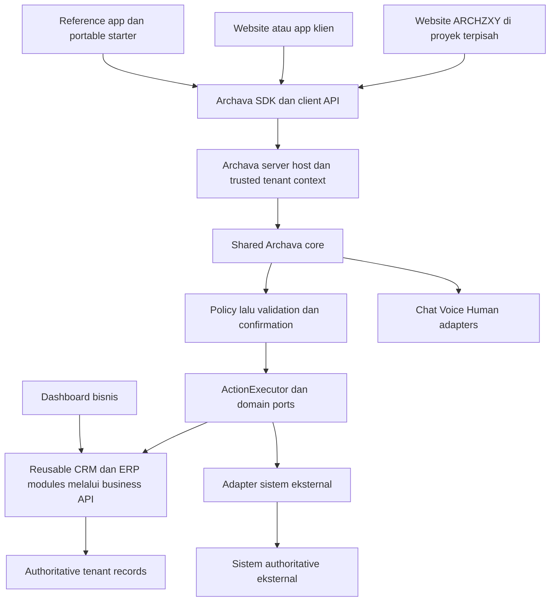

# Archava — audit dan usulan core/modul reusable

Tanggal: 7 Oktober 2026. Baseline source: `main`, commit `63b221b`.

Status: **supporting audit/proposal; product scope sekarang mengikuti [PRD v2](../PRD.md) dan [riset](REUSABLE_PLATFORM_RESEARCH.md). Dokumen ini bukan bukti implementasi.**

**ARCHZXY adalah company. Archava adalah produk unggulan ARCHZXY.** Fokus repository ini adalah core, SDK, adapter, action modules, configuration dan reference implementations yang dapat digunakan kembali di proyek berbeda. Website ARCHZXY akan dibangun di luar folder/repo Archava dan menjadi konsumen produk melalui SDK/API.

Klarifikasi scope dari owner menggantikan usulan sebelumnya yang menjadikan operasi internal ARCHZXY sebagai pilot utama. Milestone awal yang disarankan: satu core Archava berjalan pada dua host/configuration berbeda tanpa fork logic bisnis, dengan tenant isolation dan permission boundary yang sama.

Dokumen ini membaca source dan memakai bukti verifikasi konsolidasi yang sudah tersedia. Tidak ada penggantian stack, perubahan dependency, perubahan harga, implementasi website company atau aktivasi provider.

## A. Current state

Repo sudah memiliki 19 package platform, satu app web, dan dua workspace tool. Bersama root, pnpm mengenali 23 workspace project. `Archava Template` adalah proyek npm/Python tersendiri dalam repo yang sama.

| Area                    | Yang benar-benar ada                                                                | Batas saat ini                                                                             | Bukti                                                                                                                                              |
| ----------------------- | ----------------------------------------------------------------------------------- | ------------------------------------------------------------------------------------------ | -------------------------------------------------------------------------------------------------------------------------------------------------- |
| Fondasi dan kontrak     | Context Graph, event, tenant scope, Zod, currency contract                          | Belum ada tenant provisioning atau authenticated membership                                | [core](../packages/core/src/), [config](../packages/config/src/)                                                                                   |
| Izin tindakan           | Registry 24 action, L0–L5, capability, role, konfirmasi, deny reasons               | Role masih berasal dari trusted caller; belum terhubung identitas pengguna produksi        | [actions.ts](../packages/acl/src/actions.ts), [policy.ts](../packages/acl/src/policy.ts)                                                           |
| Turn pipeline           | Mask/project → plan/knowledge/truth → gate → validate → resolve → execute           | Brain percakapan reference deterministik; authoritative business systems masih fixture     | [turn.ts](../packages/assistant/src/turn.ts), [validation.ts](../packages/assistant/src/validation.ts)                                             |
| Decision Intelligence   | Rule provider, Jev adapter server, off/shadow/assist, fallback dan eval             | Jev belum live; advisory tidak memberi izin atau fakta                                     | [DECISION_INTELLIGENCE.md](DECISION_INTELLIGENCE.md)                                                                                               |
| Act                     | Booking/email ports, replay/outbox, tenant-bound composition, confirmation dan host | Belum ada HTTP host terautentikasi, PMS nyata, atau pengiriman Postmark live               | [ACT_PILOT.md](ACT_PILOT.md)                                                                                                                       |
| PostgreSQL              | Migration dan adapter untuk attempt dan confirmation                                | SQL client di-inject; belum ada database aplikasi bisnis yang dioperasikan                 | [act-storage](../packages/act-storage/), [act-confirmation-pg](../packages/act-confirmation-pg/)                                                   |
| Pricing dan konfigurasi | Pricebook, klasifikasi scope, tiga varian, quote dan `ClientConfig`                 | Stateless; belum ada persisted proposal/agreement atau dependency graph modul              | [pricing](../packages/pricing/src/engine.ts), [configurator](../tools/configurator/src/), [client schema](../packages/config/src/client/schema.ts) |
| Website/workspace       | `/archava`, `/workspace`, CRM/ERP UI, local edits dan approval demo                 | `localStorage`, data fiktif; belum Frappe/ERPNext atau admin multi-user                    | [FRONTEND.md](FRONTEND.md)                                                                                                                         |
| Voice/Human             | LiveKit/Gemini/avatar worker dan frontend portable                                  | Terpisah dari shared intelligence core; provider call dan fallback produksi belum terbukti | [template](<../Archava Template/README.md>)                                                                                                        |
| Observability           | Metadata event dan trace vocabulary                                                 | Belum ada persistent audit trail, telemetry sink, cost metering atau incident routing      | [analytics.ts](../packages/assistant/src/analytics.ts)                                                                                             |
| Sales/delivery bisnis   | Intake dan quote; visual demo leads/tasks/orders                                    | Lifecycle sales/delivery company berada di luar scope core reusable sekarang               | [server API](../apps/web/src/server/api.ts), [frontend data](../apps/web/src/frontend/data.ts)                                                     |

Verifikasi yang tersedia dari konsolidasi dalam sesi ini: enam gate `pnpm verify` lolos, 1.295 test di 80 file, format lolos, 31/31 browser reference dan 16/16 browser frontend. Template: install bersih, 55 test JavaScript, empat guardrail Python, dan build lolos. PostgreSQL disposable: 14 invariant attempt serta race claim/settlement antarproses; confirmation 27 pemeriksaan lolos. CI platform dan template pada PR konsolidasi juga lolos. Itu bukti offline/source dan database lokal, belum bukti deployment atau provider live. Tujuh test SDK Python belum diulang karena venv proyek tidak tersedia.

Audit ini tidak menjalankan ulang seluruh suite: baseline kode sudah diverifikasi dalam sesi yang sama dan perubahan setelahnya hanya dokumentasi. SAST/DAST, load test, restore produksi, dan pengujian model live belum termasuk bukti tersebut.

Batas penting: `apps/web` adalah app demo/reference produk. `Archava Template` adalah starter portable. Keduanya bukan proyek website ARCHZXY. Package yang sudah memakai port/workspace boundary merupakan fondasi reuse, tetapi belum membuktikan pemasangan independen ke semua host.

## B. Target state

Archava dibangun sebagai produk yang tersusun dari reusable code dan modul dengan kontrak yang jelas:

1. **Core:** turn pipeline, context, knowledge/truth ports, policy, validation, confirmation, execution dan event vocabulary.
2. **SDK dan presence:** host integration/page awareness, Chat, Voice dan Human melalui boundary core yang sama.
3. **Reusable business modules:** CRM dan kapabilitas ERP seperti inventory, orders, billing atau procurement sesuai kebutuhan. Reuse mencakup data model, aturan bisnis, API, dashboard components, events dan migrations, dengan extension untuk variasi domain.
4. **Adapter/action modules:** Archava memakai business module milik platform atau sistem eksternal melalui kontrak yang jelas, dengan server-side credentials serta authoritative outcomes.
5. **Configuration dan kits:** tenant config, optional module selection, validated dependencies dan vertical/reference starter kit yang mengomposisikan modul tersebut.

Core mengenali tenant, capability dan kontrak data; tidak berisi identitas, pipeline sales atau aturan operasional khusus ARCHZXY. Identitas/knowledge/workflow bisnis datang melalui configuration dan ports. Website company, situs klien, dashboard dan host lain mengonsumsi Archava tanpa menyalin seluruh implementasinya.

CRM/ERP lintas model bisnis berarti reuse kapabilitas bisnis itu sendiri, termasuk backend dan UI, bukan hanya konektor ke vendor. Business modules tetap deterministic dan dapat dipakai melalui dashboard/API tanpa percakapan AI; Archava merupakan interface tambahan. Variasi sederhana memakai configuration; perbedaan aturan/domain yang substantif memakai extension atau vertical module dengan kontrak yang eksplisit.

Acceptance reuse awal: dua host/configuration memakai artifact/package/core yang sama; branding, knowledge, entity source dan allowed actions berubah melalui data/adapter; business-specific logic tidak ditambahkan ke core; satu tenant tidak dapat membaca atau mengotorisasi aksi tenant lainnya.

Rasio reuse 80–90% tetap hipotesis yang diukur melalui kebutuhan fork, perubahan core per integration dan waktu pemasangan. PRD v2 menjadi product specification; Pricing v1 tetap baseline komersial yang tidak berubah oleh riset.

## C. Gap analysis, konflik dan technical debt

| Prioritas                | Temuan                                                                                            | Langkah yang diusulkan                                                                                                                                           |
| ------------------------ | ------------------------------------------------------------------------------------------------- | ---------------------------------------------------------------------------------------------------------------------------------------------------------------- |
| P0 sebelum live write    | Host attempt masih `find` lalu `save`, dan ledger yang tersedia in-memory                         | Atomic durable attempt identity/lifecycle, restart/race proof. [host](../packages/act-host/src/host.ts#L416), [ledger](../packages/act-host/src/attempts.ts#L60) |
| P0 sebelum live exposure | Trusted host masih library; auth/tenant/session binding belum tersambung route produksi           | Generic server composition dan principal contract; public visitor tidak wajib menjadi employee yang login.                                                       |
| P0 sebelum live email    | Status Postmark selalu unknown                                                                    | Positive authoritative recovery atau operator recovery yang eksplisit; tidak ada blind resend. [status](../packages/act-postmark/src/status.ts#L68)              |
| P0 sebelum deploy        | Template dependency audit memiliki dua high advisory                                              | Review upgrade dengan regression test provider/renderer sebelum deployment. [validation](<../Archava Template/docs/VALIDATION.md>)                               |
| P1 reuse                 | SDK/packages private dan umumnya mengekspor TypeScript source untuk workspace                     | Tentukan artifact/export browser-versus-server, build/install contract dan internal distribution; buktikan consumer di luar workspace tanpa alias test.          |
| P1 reuse                 | Reference brain/truth berasal dari hospitality fixture; template memiliki kontrak section sendiri | Pertahankan reference behavior, lalu inject business data/provider dan adapt host contract secara eksplisit; jangan memasukkan kebutuhan host ke core.           |
| P1 modularity            | Module config berupa nama/toggle tanpa dependency/version resolution                              | Registry tipis dan compatible release profile; module activation tidak memberi permission.                                                                       |
| P1 configuration         | Common integrations dari template ditandai enabled                                                | Bedakan suggested/configured/connected; connected memerlukan evidence. [resolver](../packages/config/src/client/resolver.ts#L61)                                 |
| P1 presence              | Voice/avatar standalone belum memakai shared intelligence/action boundary                         | Hubungkan melalui server adapter dan typed protocol; pertahankan worker Python sampai ada alasan memindahkannya.                                                 |
| P1 product operation     | Persistent audit, tenant-scoped knowledge runtime dan cost telemetry belum beroperasi             | Bangun hanya persistence/observability yang diperlukan untuk core dan integration lifecycle.                                                                     |
| P2 maintenance           | Contract/release/config versions belum memiliki supported matrix                                  | Exact artifacts, compatibility tests, migration/support window.                                                                                                  |
| Debt                     | Nx config ada tanpa Nx dependency/script; baseline stack dan usulan baru berbeda                  | Pertahankan pnpm/Node/esbuild/Zod saat ini. ADR sebelum Next/Payload/Nest/queue migration; tidak ada rewrite otomatis.                                           |
| Scope boundary           | Website, proposal/contract/deposit dan delivery capacity ARCHZXY                                  | Consumer/business workflow di proyek lain; tidak menjadi gap core yang harus ditutup pada fase reusable sekarang.                                                |

Registry saat ini belum mempunyai input contract/executor untuk semua action. Optional module belum dapat dijual sebagai connected capability hanya karena action ID atau UI-nya tersedia. Preserve working behavior dan test existing saat merapikan public contracts.

## D. Proposed architecture

Modular monolith untuk host/runtime bisnis Archava, dengan reusable packages dan adapter di tepi. Packaging kode dan deployment process adalah dua keputusan berbeda; core tidak berubah menjadi microservices hanya karena Voice membutuhkan worker Python.



Struktur existing menjadi titik awal: `packages/assistant`, `acl`, `core`, `knowledge`, `config`, `sdk`, `adapters`, `chat`, `decision` dan `act-*`. Tidak perlu mengganti nama/reorganisasi semua package hanya agar terlihat modular. Port/execution semantics dipertahankan.

`apps/web` tetap reference/demo harness. Company website berada di proyek lain. `Archava Template` tetap dapat dipasang independen, sementara intelligence/actions dipertemukan melalui boundary yang dirancang dan diuji. Reusable business modules disusun terpisah dari assistant core: pemasangan CRM/inventory tidak mewajibkan voice/avatar, dan penggunaan Archava tidak mewajibkan seluruh ERP. Business API menegakkan authorization serta aturan transaksi baik pemanggilnya dashboard maupun Archava. Existing client systems tetap dapat diintegrasikan lewat adapter tanpa menyalin authoritative records menjadi database tandingan.

Stack sekarang dipertahankan. PostgreSQL dipakai ketika durable tenancy/attempt/audit diperlukan. Next/Payload/Nest/Drizzle/Redis/BullMQ dipilih melalui ADR untuk kebutuhan konkret; tidak diinstal semuanya. Delivery/ticketing company bukan alasan menambah queue framework ke Archava.

## E. Module contract design

Pisahkan library package, Archava capability module, reusable business module, business adapter dan starter kit. Mulai dari metadata deklaratif milik build, bukan plugin engine yang menjalankan kode kiriman tenant.

Contoh konseptual, belum kontrak yang dijalankan repo:

```json
{
  "id": "archava.action.email",
  "version": "0.1.0",
  "requires": {
    "archava.core": ">=0.1.0 <0.2.0",
    "archava.confirmation": ">=0.1.0 <0.2.0"
  },
  "actions": ["email.send"],
  "capability": "act",
  "configSchema": "email.config.v1",
  "requiredPorts": ["templates", "gateway", "attemptStore", "status"],
  "credentialRefs": ["mailProvider"],
  "events": ["action_execution_succeeded", "action_execution_failed"],
  "healthChecks": ["email.integration"]
}
```

MVP metadata: ID/version, dependency/conflict constraints, config schema, required ports/actions dan readiness. API/event/UI/migration metadata tumbuh saat modulnya membutuhkan. References mengarah ke implementation allowlist, bukan raw secrets atau arbitrary SQL/component dari client config.

Business module yang menyimpan records harus mendeklarasikan schema/migrations, permissions, API/events dan extension points yang dimilikinya. Modul lain memakai kontrak publik; tidak mengubah tabel internal modul tersebut secara langsung. Setiap bisnis memakai code/version yang kompatibel, sementara tenant data dan configuration tetap terisolasi.

Resolve dependencies terhadap katalog terbatas dan release profile yang diuji. Tolak unknown ID, cycle, incompatible version atau disabled required dependency. Disabled module tidak boleh dieksekusi; disable tidak menghapus records atau membatalkan side effect yang sudah terjadi. Permission, validation dan confirmation tetap diperiksa pada execution.

## F. Tenancy strategy

Tenant adalah bisnis/deployment konsumen Archava. Company website ARCHZXY kelak dapat menjadi satu konsumen/tenant, tetapi tidak menjadi identitas default core atau syarat membangun library reusable.

Trusted host memetakan deployment/session/principal ke tenant. Tenant ID di SDK menunjukkan intended deployment, bukan bukti authorization. Browser/model tidak boleh memilih server credentials, role atau data tenant lain.

Public customer dapat memakai anonymous session yang dibatasi; owner/employee memerlukan identity/membership yang sesuai. Service actor Archava dan manusia yang menginisiasi action dibedakan. Customer data ownership harus diperiksa di dalam tenant, termasuk booking/order milik pelanggan tertentu.

Repository, jobs, retrieval, cache, files dan credential references mengikuti tenant scope. Shared PostgreSQL memerlukan tenant-aware relations, repository checks dan RLS yang diuji sebelum multi-tenant exposure. Runtime bukan superuser/owner/BYPASSRLS; context berlaku per transaksi untuk mencegah pooled connection membawa tenant sebelumnya. PostgreSQL mendokumentasikan default-deny serta role yang dapat melewati RLS. [Row security](https://www.postgresql.org/docs/current/ddl-rowsecurity.html).

Dedicated deployment tetap opsi untuk kebutuhan kontrak/isolation. Core tidak mengasumsikan semua consumer berada pada shared hosting atau semua deployment memakai database yang sama.

## G. Configuration strategy

Evolusikan `ClientConfig` dan template registry yang sudah ada: tenant identity, branding, locale, knowledge sources, entity/truth ports, presence, capability, enabled actions/modules dan server-side integration references.

Configuration menentukan komposisi; host menyediakan implementation yang diregistrasikan. Field configured/enabled tidak otomatis berarti module implemented, provider healthy atau permission granted. Pisahkan requested, supported, configured dan connected state.

Untuk CRM/ERP, configuration memilih module set, pipeline stages, field options, terminology dan workflow options yang memang didukung. Aturan stock, reservation, patient care atau pendidikan yang memiliki invariant berbeda tidak disamakan lewat label saja; gunakan domain extension/vertical module dan compatibility tests. Arbitrary tenant scripts bukan bagian configurator awal.

Compiler tipis menghasilkan resolved plan dengan config version, release profile, exact module versions, required ports dan validated options. Production runtime memakai validated plan tersebut. Secrets tinggal di host environment/secret store; browser memperoleh public projection.

`tools/configurator` dan pricing tetap dapat digunakan untuk merancang deployment produk Archava. Proposal/contract/project management website ARCHZXY nanti dapat memakai hasilnya dari proyek luar. Proses bisnis company itu tidak dimasukkan ke core agar configuration bekerja.

Pertahankan legacy config dan buat migrator eksplisit jika schema berkembang. Unknown toggles/dependencies ditolak atau diberi unsupported status yang jelas; jangan diam-diam mengaktifkan integration dari nama template.

## H. Versioning strategy

SemVer berlaku pada kontrak publik yang didefinisikan: API/service port, event schema, configuration schema dan behavior yang dijanjikan. Versi paket saja tidak cukup. SemVer membedakan perubahan kompatibel dan breaking, serta menyatakan versi 0.x belum stabil. [Spesifikasi SemVer](https://semver.org/).

Untuk standard hosted customers, gunakan **supported release profiles**, bukan semua kombinasi versi bebas. Code module pada satu proses Node berasal dari artifact build yang sama; tenant configuration tidak dapat memilih paket npm berbeda lalu memasangnya secara dinamis. Profiles menyimpan exact versions, migration set dan matrix fitur yang diuji. Deployment dedicated atau cohort lama memakai artifact tersendiri dengan support window yang terbatas.

Mulai dengan satu profile stabil, satu kandidat upgrade dan satu masa transisi bila diperlukan. Setiap upgrade mempunyai changelog, contract tests, config migrator, data migration dan rollback plan. Tidak perlu mengklaim dapat merawat ratusan kombinasi dengan dua manusia. Biaya mempertahankan profile lama masuk maintenance/support, dengan kebijakan yang disepakati.

Module, config, pricebook, event dan API version dikelola terpisah. Signed quote tetap mengacu pada pricebook snapshot saat diterbitkan; upgrade code tidak memperbarui harga atau scope kontrak lama secara otomatis.

## I. Migration strategy

1. Tetapkan existing package exports dan port ownership sebagai reuse contract awal; petakan pure/browser/server dependencies tanpa mengganti runtime behavior.
2. Buat distribution/install proof untuk consumer di luar pnpm workspace. Jangan mengandalkan alias Vitest atau relative import ke repository parent.
3. Tambahkan generic host composition dengan tenant/principal binding dan server-only provider wiring. Reference offline tetap tersedia.
4. Lengkapi durable attempt/confirmation/recovery sebelum exposing action module dengan real side effect.
5. Jalankan core yang sama pada dua host/configuration berbeda dengan injected knowledge, truth dan action ports. Reference fixtures boleh dipakai untuk proof reuse offline; live correctness diuji terpisah.
6. Pertemukan Voice/Human dengan shared contracts secara bertahap; pertahankan deadline, guest binding, page revision protocol dan explicit fallback.
7. Generalisasikan adapter/kit hanya ketika kebutuhan host berikutnya menunjukkan kontrak yang berulang.

Company website tidak dibuat atau dipindahkan ke repository ini. Runtime/database migration memakai compatibility window, expand/backfill/contract, rollback code yang aman dan recovery untuk external effects. Demo records tidak dipromosikan menjadi data klien.

## J. Security model

Model ancaman utamanya: pengunjung meminta internal tool, user lintas tenant menebak record ID, dokumen retrieval menyisipkan instruksi, browser memalsukan approval, webhook dipalsukan/diduplikasi, provider timeout setelah efek terjadi, serta dependency atau kredensial integrasi disalahgunakan.

| Boundary         | Aturan target                                                                                                                                                                                                        |
| ---------------- | -------------------------------------------------------------------------------------------------------------------------------------------------------------------------------------------------------------------- |
| Identity         | Verifikasi identitas/session di server, membership per tenant, session expiry/revocation; authenticator matang melalui adapter, tanpa engine password buatan sendiri.                                                |
| Public visitor   | Boleh mengakses katalog publik dan own session/records yang diverifikasi. Tidak memperoleh employee tools, internal prices/COGS atau daftar proyek klien lain.                                                       |
| Database         | Repository tenant-scoped, RLS yang diuji, role runtime terbatas, encrypted connections, backup dan restore proof.                                                                                                    |
| Inputs dan model | Input/output schema, bounded tool schemas, sanitasi render, parameterized SQL; tidak ada tool generic SQL/shell/HTTP untuk pengguna.                                                                                 |
| Approval         | Server-verified actor, canonical payload digest, revision dan expiry; ulangi authorization/precondition pada execution, karena hak dan data bisa berubah setelah review.                                             |
| External effect  | Durable attempt, opaque provider correlation, per-tenant credentials, verified outcome; unknown tetap unknown sampai reconciliation sah.                                                                             |
| Audit            | Catat permintaan, izin, approval, attempt dan outcome sebagai event durable. Append-only permission untuk runtime; perubahan privileged harus dapat ditelusuri. Ini bukan klaim immutable terhadap administrator DB. |
| Secrets          | Secret references dan secret store server, tidak ada key di prompt/browser/log. Rotasi HMAC mempertahankan key version lama selama replay lifetime.                                                                  |
| Supply chain     | Lockfile dan reviewed dependency set; review install scripts, advisory triage, license inventory dan artifact build. CI scan ditambahkan berdasarkan repo yang benar-benar dideploy.                                 |
| Costs dan abuse  | Rate limit, provider timeout, usage budget dan batas sesi per tenant/principal; batas biaya hanya menghentikan/mengurangi layanan sesuai kebijakan yang jelas.                                                       |

Retention dibedakan untuk conversation, financial records, audit, knowledge dan provider payload. Menyelesaikan ticket tidak membuat seluruh percakapan otomatis layak masuk knowledge base. Simpan root cause/affected version/fix/prevention yang direview, lalu publish ke retrieval scope yang tepat.

Kebijakan IP yang diusulkan berlaku untuk kode yang memang dibuat/dimiliki ARCHZXY. Data/brand/content klien dan licensed client application harus dijelaskan dalam agreement; browser bundle tetap dapat dilihat pengguna. Template `npm run export` saat ini memang menghasilkan source portable: pertahankan untuk reuse internal, lalu bedakan handoff data/deployment dengan licensed source delivery. Jangan otomatis mengirim seluruh platform private library melalui export komersial.

Third-party software tidak menjadi IP ARCHZXY karena dimasukkan ke library atau diakses melalui API. Frappe CRM memakai AGPLv3 dan ERPNext GPLv3 pada repository yang diperiksa; pilih release yang spesifik dan review license/kontrak sebelum redistribusi atau modifikasi untuk pelanggan. Boundary API adalah pilihan arsitektur, bukan kesimpulan hukum tentang kewajiban lisensi. [Lisensi Frappe CRM](https://github.com/frappe/crm/blob/develop/LICENSE), [lisensi ERPNext](https://github.com/frappe/erpnext/blob/develop/license.txt).

Ownership, signature validity, warranty, refund, SLA, liability dan data retention perlu dituangkan pada terms yang direview penasihat hukum sesuai konteks kontrak. Proposal arsitektur ini tidak menetapkan batas liability atau menjamin suatu klausul dapat diberlakukan.

## K. Tool/action permission model

Effective permission adalah irisan initiating principal/resource ownership, service allowlist, tenant capability/module policy, valid inputs, approval dan current business preconditions. Module installation tidak memberi owner authority dan model confidence tidak membuktikan success.

| Surface              | Akses yang dapat diberikan                                                            | Batas                                                                         |
| -------------------- | ------------------------------------------------------------------------------------- | ----------------------------------------------------------------------------- |
| Customer/public host | Published business knowledge, page assistance, own booking/order dan approved actions | Session/customer ownership diverifikasi; tidak ada internal employee tools.   |
| Owner/employee host  | Tenant-scoped operational reads dan allowed workflows sesuai role/assignment          | Identity/membership server; tidak mewarisi seluruh hak melalui machine actor. |
| Worker/integration   | Action terbatas untuk valid workflow/approval                                         | Service grant yang spesifik, tenant credentials dan audit.                    |

`runTurn`, ActionPolicy, input validation, entity resolution, confirmation service dan ActionExecutor tetap final boundaries. Host application melakukan authentication/resource authorization sebelum menyusun turn. Query/action module menggunakan closed schema, bounded filters dan authoritative IDs; bukan generic SQL/shell/HTTP tool.

Approval terikat canonical payload/revision/expiry dan menunjukkan target/efek yang relevan. Unknown effect memerlukan reconciliation; retry tidak boleh menjadi action baru secara diam-diam. Shared core memiliki aturan ini; aturan bisnis host di-inject melalui ports/policies yang eksplisit.

## L. Pricing engine architecture

`packages/pricing` dan `config/pricing.v1.json` tetap authority untuk konfigurasi/harga produk Archava. Preserve currency scale, region rule, automatic discount, included integrations, zero discretionary model discount dan custom/manual scoping.

Module metadata dan resolved deployment scope dapat menjadi input untuk configurator; metadata bukan izin mengubah harga atau menagih ulang fitur yang sudah bundled. Item planned/unsupported tidak dipromosikan sebagai integration siap deploy.

Kelak website ARCHZXY dapat memakai Quote API/configurator untuk konsultasi sales dari proyek terpisah. Rendering proposal, agreement, deposit jasa studio dan company CRM menjadi urusan consumer/business workflow tersebut. Jangan mencampur commercial workflow company dengan runtime intelligence/action core.

Usage/cost telemetry Archava berasal dari backend/provider evidence dan tetap tenant-scoped. Model tidak membuat angka invoice, mengubah pricebook atau menandai financial state successful.

## M. CRM / ERP lintas model bisnis dan project pipeline

Target library mencakup **reusable CRM/ERP business modules**, bukan hanya Archava connector. Tiap modul memiliki deterministic records, validation, permission, API, reusable dashboard components dan event/action contracts. Archava membaca atau meminta action melalui kontrak tersebut; business module mempertahankan authority atas data dan state transitions.

| Lapisan                         | Contoh                                                                                              | Batas reuse                                                                                                                                       |
| ------------------------------- | --------------------------------------------------------------------------------------------------- | ------------------------------------------------------------------------------------------------------------------------------------------------- |
| Shared primitives               | Tenant identity, roles, contacts/organizations, audit, notification contracts                       | Identitas dan tenant scope konsisten; data dan akses tiap bisnis terpisah.                                                                        |
| CRM modules                     | Leads, contacts, opportunities, activities, follow-up                                               | Pipeline/terminology yang didukung dikonfigurasi; aturan domain khusus berada pada extension.                                                     |
| ERP capability modules          | Inventory, orders, billing, suppliers, procurement                                                  | Pilih kebutuhan aktual; invariant dan transaksi tetap dimiliki masing-masing modul. Tidak semua bisnis memakai semua kapabilitas.                 |
| Vertical extensions/kits        | Hotel rooms/reservations/housekeeping; retail products/stock/sales; school students/attendance/fees | Compose shared modules dan tambahkan domain-specific records/workflows. Student, guest atau patient tidak otomatis dipaksakan menjadi sales lead. |
| Client configuration/extensions | Brand, module selection, supported stages/fields dan kebutuhan khusus                               | Konfigurasi untuk variasi yang tersedia; extension untuk kebutuhan baru tanpa fork shared core.                                                   |

Milestone business-module reuse: satu slice CRM yang kecil, misalnya contacts dan follow-up, berjalan di dua model bisnis dengan configuration berbeda dan code yang sama. Pilih slice dari kebutuhan nyata sebelum membangun ERP luas. Project pipeline menjadi optional project module; workflow internal ARCHZXY bukan default semua klien.

External CRM/ERP tetap didukung lewat adapter ketika klien sudah memiliki sistemnya. Tentukan satu source of truth per resource; jangan membuat dual ownership records. Business modules dapat berjalan tanpa LLM runtime, dan authorization tetap berlaku pada API/dashboard.

Workspace CRM/ERP saat ini masih prototype/reference UI dengan data browser-local; reusable backend/domain module lintas bisnis belum terbukti. Klarifikasi target ini memperluas proposal, bukan klaim fitur tersebut sudah production-ready atau instruksi langsung mengimplementasikan semuanya.

## N. Delivery queue model

Capacity planning, project delivery queue dan ticketing jasa ARCHZXY berada di luar scope reusable Archava sekarang. Website/operations company nanti dapat mengaksesnya melalui specific tools/API dengan permission yang sesuai.

Archava dapat membutuhkan queue teknis untuk bounded background actions, webhook inbox atau reconciliation. Persist attempt/outcome dan gunakan satu worker/library ketika ada kebutuhan nyata. Queue framework tidak membuktikan idempotency; BullMQ sendiri menekankan job yang idempotent dan sederhana. [Idempotent jobs](https://docs.bullmq.io/patterns/idempotent-jobs).

Pisahkan data bisnis delivery capacity dari job execution agar core tidak mengasumsikan kapasitas tim, cara pricing proyek atau workflow internal company tertentu.

## O. Proposal → contract → payment flow

Proposal/contract/deposit untuk menjual jasa ARCHZXY kelak merupakan workflow consumer di luar repository produk ini. Itu bukan milestone implementasi reusable core sekarang.

Payment tetap relevan sebagai optional **Archava Transact adapter** untuk bisnis konsumen: backend mengambil authoritative order/invoice, mengecek policy/confirmation, membuat provider intent dan merekonsiliasi hasil. Browser/model tidak memasok amount yang dipercaya atau menyatakan payment successful.

Jika payment module diimplementasikan, diperlukan tenant-bound merchant credentials, verified webhook/status, expected order/amount/currency binding, durable inbox, duplicate/out-of-order handling dan receipt state. Midtrans menyediakan notification signature/status verification dan mengharuskan handler idempotent. [Midtrans notifications](https://docs.midtrans.com/reference/handle-notifications), [Get Transaction Status](https://docs.midtrans.com/reference/get-transaction-status).

Jangan menyamakan deposit jasa company dengan bukti PRD Transact pada tenant commerce/booking klien; acceptance masing-masing mengikuti scope authoritative yang diadopsi.

## P. Observability strategy

Telemetry reusable mengikuti tenant, initiating principal/service actor, request/turn, action attempt, approval, opaque provider correlation, effective config/release dan outcome. Audit durable dan logs/metrics mempunyai tujuan yang berbeda.

Pantau host/SDK boot failures, context projection errors, model latency/knowledge gap, tool denial/failure, unknown outcomes, provider health, session expiry/fallback dan usage/cost. Sales/project metrics spesifik ARCHZXY menjadi observability consumer terpisah.

Raw prompts, PII, secrets/tickets dan raw idempotency keys tidak dikirim otomatis ke telemetry. OpenTelemetry menjelaskan bahwa sensitive data classification/minimization tetap tanggung jawab implementer. [Sensitive data guidance](https://opentelemetry.io/docs/security/handling-sensitive-data/).

Untuk hosted Archava, tambahkan backup/restore, budget limits dan operator incident routing sesuai layanan yang benar-benar dijalankan. Jangan menjanjikan uptime/support/RPO/RTO sebelum diukur.

## Q. Test strategy

Pertahankan suite existing. Tambahkan proof reuse yang menguji public contracts dan pemasangan nyata, bukan sekadar alias dalam monorepo.

| Layer                 | Proof yang dibutuhkan                                                                                                                                               |
| --------------------- | ------------------------------------------------------------------------------------------------------------------------------------------------------------------- |
| Distribution          | Build/install/export consumer di luar workspace; no parent-relative imports; browser tidak memuat server-only keys/code; package versions/dependencies eksplisit.   |
| Core portability      | Core yang sama pada dua host/configuration; branding, locale, knowledge, truth dan action module berubah tanpa fork; fixture hospitality tidak menjadi asumsi core. |
| Modules/config        | Required ports, unknown modules, version/conflict/cycle, readiness, disable; activation tidak memberi permission.                                                   |
| Tenancy/principals    | Cross-tenant dan cross-customer reads/writes, forged SDK tenant/role/approval, owner-vs-customer projection.                                                        |
| Act                   | Real host → confirmation → runTurn → replay/outbox → gateway; atomic concurrent/restart identity dan unknown outcome tanpa blind repeat.                            |
| Presence              | Shared permissions/facts/action semantics pada Chat/Voice/Human, explicit fallback, deadline dan page revision protocol.                                            |
| Integration           | Contract mocks, optional database verifiers, sandbox lalu controlled live evidence per adapter; mock tidak disebut verified external success.                       |
| Regression/operations | Existing tests/browser/reference, config compatibility, dependency/license/secret scan, restore/recovery untuk artifact yang dideploy.                              |

Company website tidak perlu dibangun untuk menjalankan proof ini; consumer fixture independen dapat dipakai sebagai integration test. Reference offline, SDK installability dan provider live behavior adalah bukti yang berbeda.

## R. Implementation roadmap

| Prioritas                                    | Fokus                                                                                                                                                                                                         | Exit gate                                                                                                        |
| -------------------------------------------- | ------------------------------------------------------------------------------------------------------------------------------------------------------------------------------------------------------------- | ---------------------------------------------------------------------------------------------------------------- |
| **MUST BUILD NOW**                           | Inventory public package/port contracts; browser/server split; thin module metadata; tenant configuration; standalone distribution/install proof                                                              | Consumer di luar workspace dapat memakai core/SDK dengan declared dependencies, tanpa copy/fork atau alias test. |
| **MUST BUILD NOW**                           | Dua host/configuration reference memakai core yang sama; explicit supported module/readiness state                                                                                                            | Business data/provider diganti lewat config/ports; tenant/action boundaries sama dan regression tetap hijau.     |
| **MUST BUILD NOW untuk desain modul bisnis** | Petakan shared CRM/ERP primitives, domain ownership dan extension points; pilih satu slice kecil untuk dua model bisnis                                                                                       | Kontrak data/API/UI/actions serta batas konfigurasi-versus-extension dapat direview sebelum implementasi.        |
| **MUST BUILD NOW sebelum real write**        | Trusted host/principal binding, atomic durable ledger/confirmation, replay/recovery dan audit                                                                                                                 | Race/restart/forged-confirmation/unknown-outcome cases terbukti sebelum exposing action integration.             |
| **SHOULD BUILD NEXT**                        | Shared Voice/Human contracts, satu authoritative integration, live validation dan safe deployment                                                                                                             | Reuse tetap terbukti; failure menjaga permission/fact boundary dan fallback; provider behavior/cost diukur.      |
| **SHOULD BUILD NEXT**                        | Satu reusable CRM/business-module slice dengan backend, API, dashboard component dan Archava tools                                                                                                            | Slice yang sama bekerja pada dua model bisnis; tenant isolation dan domain rules diuji tanpa fork core.          |
| **BUILD LATER**                              | ERP capability modules dari kebutuhan berulang, additional business adapters, vertical starter kits, supported release profiles, provisioning/private distribution, SDK/API consumers seperti website ARCHZXY | Kebutuhan berulang, maintainable compatibility dan operation ownership jelas.                                    |
| **DO NOT BUILD YET**                         | Website/sales/project-delivery system ARCHZXY di repo Archava; universal CRM/ERP; arbitrary plugin/version matrix; rewrite stack/worker atau microservices tanpa alasan                                       | Dikerjakan sebagai proyek/requirement terpisah bila diadopsi, bukan dependency reuse core.                       |

Urutan kuncinya: perjelas existing contract → buktikan independent consumption → buktikan dua komposisi tanpa fork → lengkapi operational gates sebelum live writes → tambah adapter/kit dari kebutuhan nyata.

Untuk dua manusia, ukur waktu integration host, jumlah core changes per klien, forks/custom patches, config compatibility, regression rate, provider cost dan maintenance load. Modularity dinilai dari kemampuan mengganti implementation melalui contract, bukan jumlah folder/package.

Keputusan scope yang sudah jelas dari owner: ARCHZXY company, Archava produk reusable, company website di proyek luar; reuse CRM/ERP lintas model bisnis mencakup business modules dan bukan hanya connectors. Keputusan implementasi berikutnya ialah distribution model dan slice reuse pertama. Dokumen ini tidak membuat website company, mengubah pricebook, mempublish package atau memulai provider call.
