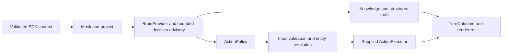
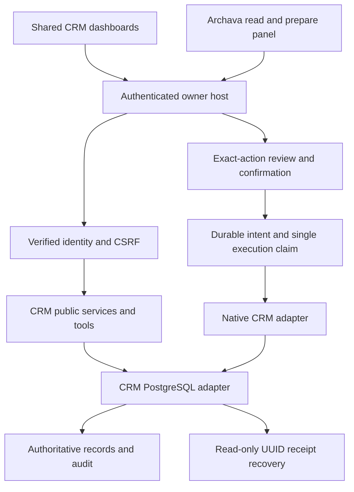

# Architecture

Reviewed against `80ea845`, 10 October 2026. The [repository re-audit](PROJECT_REAUDIT_2026-10-10.md) records findings and next priorities. [PRD §§40–50](../PRD.md) describes the target; this document describes the implementation. ARCHZXY's company website is a separate consumer project.

PRD v2.1 §50 orders the next local release work and its acceptance. Its six
execution requirements are specification, not additional implementation evidence.

## Folder and runtime map

```text
Archava_Platform/
  packages/             reusable assistant, business domains and adapters
  apps/crm/             authenticated local owner host; compiled-library consumer
  apps/web/             reference chat, Studio, marketing and browser-storage demos
  tools/configurator/   deterministic intake/configuration/quote tooling
  tools/decision-eval/  bounded decision evaluations and optional live commands
  tools/crm-reference/ isolated PostgreSQL and two-business reuse verification
  tools/act-integration/ installed-artifact durable-action verification
  tools/library/        private packaging and independent-consumer proof
  tools/scripts/        structure gate and platform verification runner
  tools/e2e/            browser harnesses; separate from unit tests
  examples/consumers/   independent hospitality/retail core references
  examples/crm-consumers/ independent hospitality/professional-service references
  Archava Template/     standalone npm/React/Node/Python realtime starter
  config/               authoritative pricebook and planning templates
  docs/                 current guides, dated audits and historical evidence
  delegation/           historical task/handoff records; not runtime configuration
```

There are 32 pnpm workspace projects: 26 packages, two apps and four tools with manifests. Script-only tool directories and examples are outside those workspace globs. The realtime template has its own npm lockfile and Python dependencies; its [AGENTS.md](<../Archava Template/AGENTS.md>) requires standalone operation without parent-repository imports.

Generated `dist/` and `node_modules/` are build/install output. Ignored `.local/` contains private database state, credentials, approvals and backups; it is not disposable source cleanup. The empty untracked `clients/generic-business/` placeholder implements no consumer. Current boundaries do not require directory relocation.

| Runtime              | Entry and command                                                       | Actual authority                                                                               | Limit                                                                                                           |
| -------------------- | ----------------------------------------------------------------------- | ---------------------------------------------------------------------------------------------- | --------------------------------------------------------------------------------------------------------------- |
| Reference web        | `apps/web/src/server/server.ts`; root `dev`, `build`, `start`           | Stateless quote endpoint; reference browser context/turn/UI actions                            | Workspace records are fictional browser-storage data, with no persistent CRM identity or business writes        |
| Persistent owner CRM | `apps/crm/src/server.ts`; `crm:build`, `crm:start`                      | Verified identity, authorized CRM services, PostgreSQL records and two approved native actions | Local POSIX/PostgreSQL host; external email/booking/payment not configured                                      |
| Realtime starter     | `Archava Template/server/index.mjs`, `backend/agent.py`, React frontend | Bounded anonymous guest sessions, approved facts and navigation tools                          | Separate intelligence/knowledge/session path; no shared core/CRM action authority or new live-provider evidence |

Root `start` serves the reference web app, not CRM. Template Python tools do not call `runTurn`. One source repository does not establish one shared runtime.

## Package ownership and dependencies

| Group                 | Packages                                                                                                | Responsibility                                                                                          |
| --------------------- | ------------------------------------------------------------------------------------------------------- | ------------------------------------------------------------------------------------------------------- |
| Assistant foundation  | `config`, `core`, `acl`, `knowledge`, `adapters`, `decision`, `assistant`                               | Configuration/context, policy/masking, knowledge/truth ports, bounded planning and turn orchestration   |
| Browser presence      | `sdk`, `chat`                                                                                           | Page awareness, consent/session contracts and shared rendering                                          |
| Business domain       | `crm`                                                                                                   | Contacts, activities, follow-ups, opportunities, authorized service/API/tools and shared DOM dashboards |
| Business persistence  | `crm-pg`                                                                                                | PostgreSQL records, membership/resource checks, migrations, command receipts and atomic audit           |
| CRM composition       | `crm-assistant`, `crm-act`                                                                              | Read/prepare conversation and panel; separately reviewed native creation/completion                     |
| Host infrastructure   | `identity-pg`, `provider-runtime`, `act-host`, `act-host-pg`, `act-confirmation`, `act-confirmation-pg` | Identity, provider admission/outcomes, atomic host intent and one-time confirmation                     |
| External Act adapters | `act`, `act-booking`, `act-email`, `act-storage`, `act-postmark`                                        | Booking/email dispatch, durable provider replay/outbox and injected mail transport                      |
| Commercial/reference  | `pricing`, `reference`                                                                                  | Deterministic pricing; fictional reference tenant/brain/truth                                           |

The assistant foundation has no mandatory CRM dependency. `crm` has no internal runtime package dependency and works through dashboards/APIs without an LLM. `crm-assistant` composes domain reads with the assistant; `crm-act` composes domain, PostgreSQL and approval infrastructure. The PostgreSQL-specific approval verifier belongs to that adapter.

No declared workspace dependency cycle was found at the audited revision. This is distinct from `pnpm structure`, which checks declared internal imports and relative-path escapes, not dependency direction or cycles. Actual edges include `core → config` and `apps/web → tools/configurator`; there is no claim that core depends only on Zod or that every tool is CLI-only.

## Assistant turn and authority



`packages/assistant/src/turn.ts` preserves masking, structured truth, action policy, confirmation, strict input validation and tenant entity resolution. `GatedAction` distinguishes policy permission, attempted execution and actual output. An allowed action is not a completed effect. Missing contracts/resolvers and unknown outcomes fail closed.

`BrainProvider` and `DecisionProvider` are separate ports. Rule decisions/reference brains are deterministic. The Jev server adapter has mocked transport coverage, not a live Jev result from this audit. The in-memory knowledge store is not a hosted ingestion/indexing product; production retrieval and external truth need separate adapters and evidence.

## Owner CRM and approved execution



The host binds principals from verified server sessions. `crm-pg` requires a non-owner/non-superuser role, forced tenant RLS and transaction-local tenant context. Operations recheck current memberships and resource scope. A delegated service receives the intersection of its grants and the initiating human's grants; assigned staff remain scoped to assigned records.

Contacts, activities, follow-ups, contact-linked opportunities and guarded stage history share one domain. Worklists and overview aggregates read authorized database records, not only the displayed page. Missing section grants are distinct from permitted zero counts. Dashboard mutations and assistant read/prepare tools use public business services.

Two native actions are supported: `crm.followup.create` and `crm.followup.complete`. Each has typed inputs and separate action-bound consent. Review itself creates no business task. Execution requires a one-time receipt, server MAC, current private approval epoch, active durable intent claim, current grants and matching resource revision. Approval is verified inside the CRM transaction before command, transition and audit commit together. Ordinary machine mutations/arbitrary model tools cannot write.

Lost responses recover through the original UUID receipt without another POST. An absent receipt remains unconfirmed. Restore invalidates identity sessions/accounts and holds native execution under a fresh epoch until explicit recovery. See [local pilot](LOCAL_OWNER_PILOT.md), [completion](CRM_COMPLETION.md) and [command recovery](CRM_COMMAND_RECOVERY.md).

## AI and local operations

The local planner handles supported CRM commands. Optional Gemini planning receives only exact committed synthetic examples; arbitrary owner text and CRM records stay local. Tool schemas/current grants constrain results. Historical thirteen-case live evidence is not general private-data planning acceptance and was not rerun here.

`provider-runtime` persists admission, daily pacing and metadata-only outcomes. No external booking, email or payment executor is configured in the owner host. Postmark/booking composition checks use fake gateways with real local persistence.

The host provides diagnostics and tested backup/restore. Its optional backup loop runs while the host is active, catches up once after restart, serializes captures with a PostgreSQL advisory lock and verifies private archive integrity/metadata. It does not provide an unattended OS service, off-machine storage, retention deletion, production monitoring or RPO/RTO guarantees. See [backup operation](CRM_BACKUPS.md).

## Packaging, configuration and compatibility

`tools/library/pack.mjs` compiles a selected dependency closure into 24 private ESM/declaration artifacts with exact internal versions and owned migrations. `pricing` and `reference` are workspace packages outside the current artifact set. Independent core/CRM consumers cold-install artifacts without parent source imports; the CRM host resolves installed packages rather than workspace aliases.

Browser subpaths separate DOM/contracts from PostgreSQL, identity, provider keys and server planners. Build metadata rejects server implementation in the CRM browser bundle. Workspace source exports support development; compiled artifacts establish independent installation. See [library consumption](LIBRARY_CONSUMPTION.md).

The thin host-owned registry validates IDs and resolves dependency IDs/disabled prerequisites. V2 deployment planning separates declared scope from template suggestions and trusted host connection/health evidence. `resolveLegacy` preserves V1 compatibility and is not provisioning authority. Metadata permissions, config flags and commercial entitlement never grant execution permission.

The registry is not yet the complete PRD §42 contract: version ranges, conflicts, optional dependencies, general environment/health/UI/event ownership and supported release profiles remain unfinished. Artifact hashes and checksummed migrations prove a tested combination, not arbitrary version mixes. Upgrades need compatibility and data recovery; reverting a binary does not reverse a schema migration.

## Verification and next architecture step

`pnpm verify` runs eight platform gates: install, structure, format, lint, typecheck, unit tests, reference-web build and independent core consumption. Actual CRM/Act PostgreSQL, authenticated Chromium and template checks are separate commands. CI has platform, CRM/runtime and template jobs; it does not currently run the Chromium owner suite or Python SDK integration suite.

Preserve the modular monolith and folder paths. Next establish one supported local package/config/schema profile, then design a versioned presence boundary so the standalone realtime consumer can use shared server-owned intelligence/action authority. Do not bridge through copied credentials, guest-provided roles or parent source imports. Public visitors and authenticated owner sessions require distinct tool access.

Further modules follow demonstrated demand. Company sales/delivery workflows, arbitrary plugins/version mixes, universal ERP and microservice infrastructure are not prerequisites for the current reusable library.
