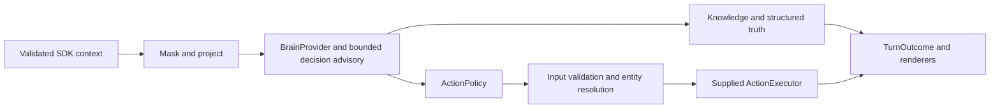
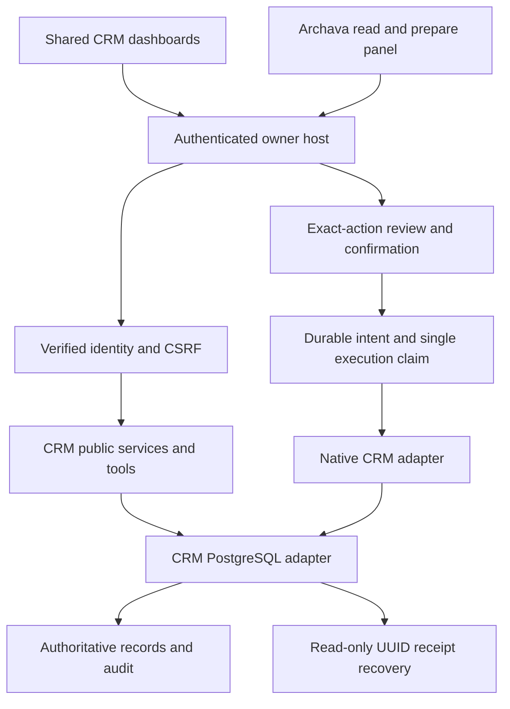

# Architecture

Updated for local profile `1.8.0`, 11 October 2026. Baseline re-audit source: `80ea845`. The [repository re-audit](PROJECT_REAUDIT_2026-10-10.md) records historical findings. [PRD §§40–50](../PRD.md) describes the target; this document describes the implementation. ARCHZXY's company website is a separate consumer project.

PRD v2.1 §50 bounds the implemented local library release.
[Acceptance and decisions](LOCAL_LIBRARY_RELEASE.md) map its six items to runnable
evidence; [handoff](LOCAL_LIBRARY_HANDOFF.md) defines supported operation.
Live providers and production operation keep their separate gates.

## Folder and runtime map

```text
Archava_Platform/
  packages/             reusable assistant, business domains and adapters
  apps/crm/             authenticated local owner host; compiled-library consumer
  apps/web/             reference chat, Studio, marketing and browser-storage demos
  tools/configurator/   deterministic intake/configuration/quote tooling
  tools/decision-eval/  bounded decision evaluations and optional live commands
  tools/crm-reference/ isolated PostgreSQL and two-business reuse verification
  tools/act-integration/ installed-artifact durable-action verification
  tools/library/        private packaging, deterministic assembly and consumer proof
  tools/security/       scoped controls, dependency inventory and advisory verification
  tools/scripts/        structure gate and platform verification runner
  tools/e2e/            browser harnesses; separate from unit tests
  examples/consumers/   independent hospitality/retail core references
  examples/crm-consumers/ independent hospitality/professional-service references
  examples/presence-consumers/ standalone Python synthetic transcript transport
  Archava Template/     standalone npm/React/Node/Python realtime starter
  config/               trusted local release catalogue, pricebook and planning templates
  docs/                 current guides, dated audits and historical evidence
  delegation/           historical task/handoff records; not runtime configuration
```

There are 44 pnpm workspace projects: 38 packages, two apps and four tools with manifests. Script-only tool directories and examples are outside those workspace globs. The realtime template has its own npm lockfile and Python dependencies; its [AGENTS.md](<../Archava Template/AGENTS.md>) requires standalone operation without parent-repository imports.

Generated `dist/` and `node_modules/` are build/install output. Ignored `.local/` contains private database state, credentials, approvals and backups; it is not disposable source cleanup. The empty untracked `clients/generic-business/` placeholder implements no consumer. Current boundaries do not require directory relocation.

| Runtime              | Entry and command                                                       | Actual authority                                                                               | Limit                                                                                                           |
| -------------------- | ----------------------------------------------------------------------- | ---------------------------------------------------------------------------------------------- | --------------------------------------------------------------------------------------------------------------- |
| Reference web        | `apps/web/src/server/server.ts`; root `dev`, `build`, `start`           | Stateless quote endpoint; reference browser context/turn/UI actions                            | Workspace records are fictional browser-storage data, with no persistent CRM identity or business writes        |
| Persistent owner CRM | `apps/crm/src/server.ts`; `crm:build`, `crm:start`                      | Verified identity, authorized CRM services, PostgreSQL records and two approved native actions | Local POSIX/PostgreSQL host; external email/booking/payment not configured                                      |
| Realtime starter     | `Archava Template/server/index.mjs`, `backend/agent.py`, React frontend | Bounded anonymous guest sessions, approved facts and navigation tools                          | Separate intelligence/knowledge/session path; no shared core/CRM action authority or new live-provider evidence |

Root `start` serves the reference web app, not CRM. Template Python tools do not call `runTurn`. One source repository does not establish one shared runtime.

## Package ownership and dependencies

| Group                 | Packages                                                                                                | Responsibility                                                                                          |
| --------------------- | ------------------------------------------------------------------------------------------------------- | ------------------------------------------------------------------------------------------------------- |
| Assistant foundation  | `config`, `core`, `acl`, `knowledge`, `adapters`, `decision`, `assistant`                               | Configuration/context, policy/masking, knowledge/truth ports, bounded planning and turn orchestration   |
| Browser presence      | `sdk`, `chat`                                                                                           | Page awareness, consent/session contracts and shared rendering                                          |
| Business domain       | `crm`                                                                                                   | Contacts, activities, follow-ups, opportunities, authorized service/API/tools and shared DOM dashboards |
| Business persistence  | `crm-pg`                                                                                                | PostgreSQL records, membership/resource checks, migrations, command receipts and atomic audit           |
| Additional domains    | `projects`, `projects-pg`, `scheduling`, `scheduling-pg`, `accommodation`, `accommodation-pg`, `kits`   | Independent project/reservation records and adapters; trusted bounded kit planning                      |
| CRM composition       | `crm-assistant`, `crm-act`                                                                              | Read/prepare conversation and panel; separately reviewed native creation/completion                     |
| Host infrastructure   | `identity-pg`, `provider-runtime`, `act-host`, `act-host-pg`, `act-confirmation`, `act-confirmation-pg` | Identity, provider admission/outcomes, atomic host intent and one-time confirmation                     |
| External Act adapters | `act`, `act-booking`, `act-email`, `act-storage`, `act-postmark`                                        | Booking/email dispatch, durable provider replay/outbox and injected mail transport                      |
| Commercial/reference  | `pricing`, `reference`                                                                                  | Deterministic pricing; fictional reference tenant/brain/truth                                           |

The assistant foundation has no mandatory CRM dependency. `crm` has no internal runtime package dependency and works through dashboards/APIs without an LLM. `crm-assistant` composes domain reads with the assistant; `crm-act` composes domain, PostgreSQL and approval infrastructure. The PostgreSQL-specific approval verifier belongs to that adapter.

No declared workspace dependency cycle was found at the audited revision. This is distinct from `pnpm structure`, which checks declared internal imports and relative-path escapes, not dependency direction or cycles. Actual edges include `core → config` and `apps/web → tools/configurator`; there is no claim that core depends only on Zod or that every tool is CLI-only.

## Kit planning and business domain ownership

Profile 1.4.0 added `kits`, `projects` and `projects-pg`. The immutable kit catalogue
has 40 candidate families. Its deterministic planner resolves explicit requirements
against a verified installed profile and trusted module policy. Missing domains,
unknown requirements and unsupported scopes block assembly. It supplies no prices,
permissions or execution authority.

The pure project domain owns internal project/task/milestone services, strict APIs,
read tools and a shared dashboard. Its PostgreSQL adapter owns `archava_projects`
with six forced-RLS tables and its own memberships, revision checks and atomic
audit/command receipts. It can run independently of CRM or an LLM. The existing
owner host additionally requires an authenticated session, CSRF, configured tenant
and active CRM workspace membership. Enabling the module never creates domain grants.

Assembly 2.0.0 adds the optional `projects` flag while preserving assembly 1.0.0
and previous four-module defaults. The historical 1.4.0 profile has 28 artifacts, 18
external pins and six owned database ledgers. Disabling project surfaces
retains their records and receipts.

Profile 1.5.0 adds `scheduling` and `scheduling-pg`: pure timed reservation
contracts/API/read tools/dashboard and the independent `archava_scheduling`
schema. Capacity-one resources serialize holds/confirmation/moves/cancellation
and maintenance blocks, with a database-clock expiry and SQL overlap guard. Five
forced-RLS tables own memberships, resources, reservations, commands and audit.
The adapter does not depend on CRM, LLMs or external booking providers. The local
host adds its existing session/workspace boundary and explicit scheduling grants.

The historical 1.5.0 inventory has 30 compiled internal artifacts, 18 unchanged external pins,
seven owned ledgers, host 0.8.0 and config 0.7.0. Assembly v3 adds optional
`scheduling`; v1/v2 and old defaults retain their original fields and behavior.
The new bounded `resource_reservations` scope supports K07/K10 composition, not
full appointment/rental operations or accommodation. See
[contract and integration](RESOURCE_RESERVATIONS_MODULE.md).

Profile 1.6.0 adds `accommodation` and `accommodation-pg`: property/room-type/room
records, calendar-night stays, immutable nightly IDR estimates, guest check-in/out
and dirty/clean/inspected readiness. Eight hotel tables have forced tenant RLS,
with independent grants. The PostgreSQL adapter composes capacity atomically with
the same scheduling resource lock and new occupancy table. Migration 002 backfills
old timed reservations without changing migration 001. Generic reservation APIs
hide/refuse hotel-managed rooms; the occupancy kernel contains no guest or rate
data. Calendar primitives remain in pure scheduling. No CRM or AI is required by
the standalone hotel domain.

Historical 1.6.0 inventory is 32 compiled artifacts, 18 unchanged external pins, eight
owned database ledgers, host 0.9.0, config 0.8.0 and kits 0.3.0. Assembly v4 adds
optional accommodation, requiring scheduling in the owner-host composition;
earlier contracts and defaults remain unchanged. K01 `accommodation_stays` is a
bounded local scope, without complete PMS, customer booking, payment or OTA
acceptance. See [contract and activation](ACCOMMODATION_MODULE.md).

Profile 1.7.0 adds `commerce` and `commerce-pg`: strict catalog/stock/order APIs,
private read tools and shared owner dashboard. Ten forced-RLS business tables
own memberships, products, derived stock balances, orders/lines, allocations,
commands, append-only stock movements, returns and audit. Header/product locks
serialize revision changes and sorted multi-SKU reservations. Catalog revisions
and stock revisions are independent. Prices come from backend products and freeze
in order lines; fulfillment consumes once, and returns explicitly restock or
discard. No event implies payment. The trusted transaction kernel is reusable by
future food-service without duplicating its stock ledger.

Historical 1.7.0 inventory is 34 compiled artifacts, 18 unchanged external pins, nine owned
ledgers, host 0.10.0, config 0.9.0 and kits 0.4.0. Assembly v5 adds optional
commerce and preserves earlier contracts/defaults. K03/K04 `commerce_orders` is
bounded retail/wholesale scope. Restaurant ownership is implemented by the next profile below. See
[commerce contract and activation](COMMERCE_MODULE.md).

Profile 1.8.0 adds `foodservice`/`foodservice-pg` 0.1.0. Nine forced-RLS tables
own physical tables, managed menus, sealed versioned recipes, frozen ticket lines,
kitchen/service state, memberships and immutable history. The commerce 0.2.0
transaction SPI owns managed product creation/updates and preparation receipts,
audit and stock writes. Food-service never writes commerce tables directly. Its
bounded read projections join the same transaction/tenant; deferred checks bind
recipe allocations and both lifecycle states. Shared stock remains the only
physical ingredient truth. No payment or customer signature follows from closing
service.

Current inventory is 36 compiled artifacts, 18 unchanged external pins, ten owned
ledgers, host 0.11.0, config 0.10.0 and kits 0.5.0. Assembly v6 adds optional
food-service requiring commerce in the owner-host composition. Earlier contracts
and defaults remain supported. Independent restaurant/catering consumers reuse
the same code; narrow K02 `foodservice_tickets` retains full-kit gaps. See
[domain contract](FOODSERVICE_MODULE.md). Shared support cases are
[the next capability](SUPPORT_CASES_MODULE_PLAN.md).

Accepted `crm_inquiry` (K01/K05) and `project_tracking` (K05/K31) are narrow scopes.
The latter shares internal tracking, not construction costing or full agency sales/
delivery operations. All 40 full operating kits remain unaccepted. See the
[module contract](PROJECT_DELIVERY_MODULE.md) and
[programme ledger](STARTER_KIT_IMPLEMENTATION.md).

## Assistant turn and authority



`packages/assistant/src/turn.ts` preserves masking, structured truth, action policy, confirmation, strict input validation and tenant entity resolution. `GatedAction` distinguishes policy permission, attempted execution and actual output. An allowed action is not a completed effect. Missing contracts/resolvers and unknown outcomes fail closed.

`BrainProvider` and `DecisionProvider` are separate ports. Rule decisions/reference brains are deterministic. The Jev server adapter has mocked transport coverage, not a live Jev result from this audit. The in-memory knowledge store is not a hosted ingestion/indexing product; production retrieval and external truth need separate adapters and evidence.

## Owner CRM and approved execution



The host binds principals from verified server sessions. `crm-pg` requires a non-owner/non-superuser role, forced tenant RLS and transaction-local tenant context. Operations recheck current memberships and resource scope. A delegated service receives the intersection of its grants and the initiating human's grants; assigned staff remain scoped to assigned records.

Contacts, activities, follow-ups, contact-linked opportunities and guarded stage history share one domain. Worklists and overview aggregates read authorized database records, not only the displayed page. Missing section grants are distinct from permitted zero counts. Dashboard mutations and assistant read/prepare tools use public business services.

Two native actions are supported: `crm.followup.create` and `crm.followup.complete`. Each has typed inputs and separate action-bound consent. Review itself creates no business task. Execution requires a one-time receipt, server MAC, current private approval epoch, active durable intent claim, current grants and matching resource revision. Approval is verified inside the CRM transaction before command, transition and audit commit together. Ordinary machine mutations/arbitrary model tools cannot write.

Lost responses recover through the original UUID receipt without another POST. An absent receipt remains unconfirmed. Restore invalidates identity sessions/accounts and holds native execution under a fresh epoch until explicit recovery. See [local pilot](LOCAL_OWNER_PILOT.md), [completion](CRM_COMPLETION.md) and [command recovery](CRM_COMMAND_RECOVERY.md).

## AI and local operations

The local planner handles supported CRM commands. Optional Gemini planning receives only exact committed synthetic examples; arbitrary owner text and CRM records stay local. Tool schemas/current grants constrain results. Historical thirteen-case live evidence is not general private-data planning acceptance and was not rerun here.

`provider-runtime` persists admission, daily pacing and metadata-only outcomes. No external booking, email or payment executor is configured in the owner host. Postmark/booking composition checks use fake gateways with real local persistence.

The host provides diagnostics and tested backup/restore. Its optional backup loop runs while the host is active, catches up once after restart, serializes captures with a PostgreSQL advisory lock and verifies private archive integrity/metadata. It does not provide an unattended OS service, off-machine storage, retention deletion, production monitoring or RPO/RTO guarantees. See [backup operation](CRM_BACKUPS.md).

## Packaging, configuration and compatibility

`tools/library/pack.mjs` compiles a selected dependency closure into 30 private ESM/declaration artifacts with exact internal versions and owned migrations. `pricing` and `reference` are workspace packages outside the current artifact set. Independent core/CRM consumers cold-install artifacts without parent source imports; the CRM host resolves installed packages rather than workspace aliases.

Browser subpaths separate DOM/contracts from PostgreSQL, identity, provider keys and server planners. Build metadata rejects server implementation in the CRM browser bundle. Workspace source exports support development; compiled artifacts establish independent installation. See [library consumption](LIBRARY_CONSUMPTION.md).

The thin host-owned registry validates IDs and resolves dependency IDs/disabled prerequisites. V2 deployment planning separates declared scope from template suggestions and trusted host connection/health evidence. `resolveLegacy` preserves V1 compatibility and is not provisioning authority. Metadata permissions, config flags and commercial entitlement never grant execution permission.

The registry is not yet the complete PRD §42 contract: version ranges, conflicts, optional dependencies and general environment/health/UI/event ownership remain unfinished. Supported fixed release profiles are verified; artifact hashes and checksummed migrations prove a tested combination, not arbitrary version mixes. Upgrades need compatibility and data recovery; reverting a binary does not reverse a schema migration.

## Verification and next architecture step

`pnpm verify` runs eight platform gates: install, structure, format, lint, typecheck, unit tests, reference-web build and independent core consumption. Actual CRM/Act PostgreSQL, authenticated Chromium and template checks are separate commands. CI has platform, CRM/runtime and template jobs; it does not currently run the Chromium owner suite or Python SDK integration suite.

Preserve the modular monolith and folder paths. Fixed profiles and offline presence now have local acceptance; shared project and exclusive resource reservation services now have scoped local acceptance; the next domain extension is accommodation. Template live-provider migration remains separate work. Public visitors and authenticated owner sessions require distinct tool access, with no copied credentials, guest-provided roles or parent source imports.

Further modules follow demonstrated demand. Company sales/delivery workflows, arbitrary plugins/version mixes, universal ERP and microservice infrastructure are not prerequisites for the current reusable library.

## Supported composition and presence

Profile `1.3.0` installs 25 private compiled packages and pins 18 external runtime
versions. The build embeds hashes/contracts/owned migration checks; install and
startup reject unsupported combinations. Config `0.5.0` exposes pure assembly
contracts separately from Node-only release verification. Four logical module
contracts cover contacts, pipeline, assistant and native actions within the
existing monolith. Selection closes UI/API/tool surfaces and native disable
refuses unresolved effects; records, audit and receipts remain stored.

`@archava/presence` has a pure versioned browser contract/client and a server-only
bounded session gateway. The owner host verifies its credential cookie and current
CRM grants; guests use a distinct server-issued cookie and public-only projection.
Chat and standalone Python synthetic transcript requests share session/revision/
replay policy and the existing `runTurn` implementation. Native consent still
travels through the original exact review/present routes. The Template LiveKit
worker remains independently packaged; its provider migration is a separate gate.

The isolated baseline measures this local host and its eight-connection database
pool with two synthetic tenants; it is not a new production service topology.
No framework, microservice, broker or cloud infrastructure was added.
