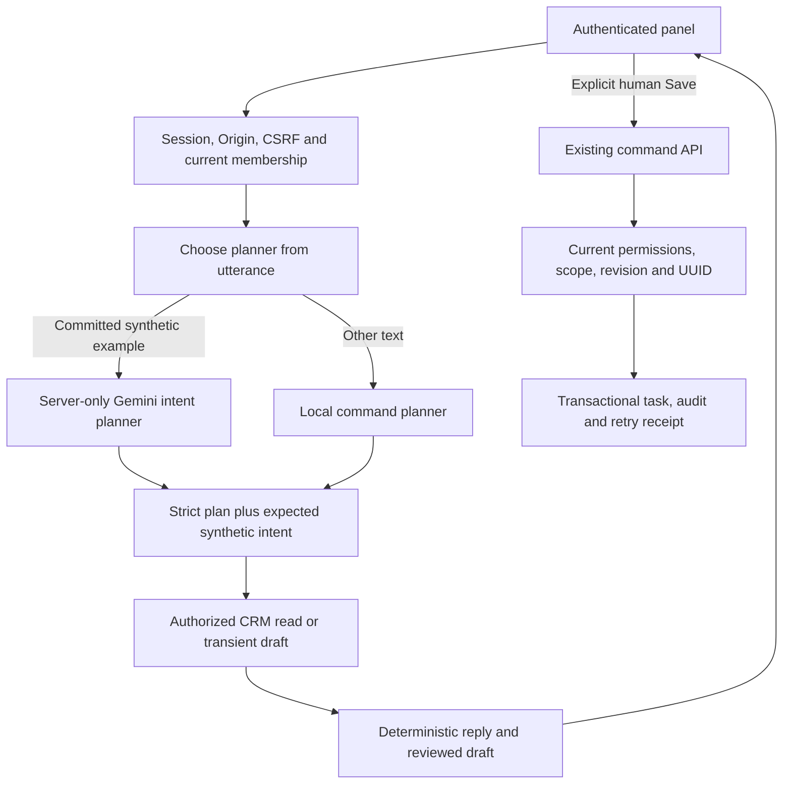

# Gemini CRM pilot — partial M3

`@archava/crm-assistant` 0.2.0 adds a server-only intent planner and opportunity
reads to the existing conversation adapter. Both independently installed
hospitality and professional-service consumers use the same compiled module.
The deterministic CRM and existing `runTurn` presentation remain authoritative.
This release adds no dependency, database migration or company website.

The subsequent [provider-runtime module](PROVIDER_RUNTIME.md) adds persistent
admission/diagnostics without changing this planner's data boundary.

## What can be tried

The authenticated local host at `http://127.0.0.1:4175` can show six example
buttons. Clicking an example fills the input; **Tanya Archava** submits it.
Only an exact committed synthetic example reaches Gemini. The response labels
whether understanding used Gemini or local commands. CRM record results always
come from authorized backend tools, including opportunity stage history.
Allow at least 15 seconds between Gemini submissions; provider errors stop the
request without an automatic retry or paid fallback.

For follow-ups, explicitly select a contact and supply the message and due time.
The planner requests a transient draft. Review the resulting message, contact and
date, then click **Simpan follow-up yang ditinjau**. The existing command API
stores one task with its audit/receipt. This is a human mutation; the model has
no write, send, financial or identity tool. Autonomous Act readiness is unchanged.

## Free-service boundary

The model is pinned to `gemini-3.5-flash-lite`, which Google currently lists with
free input/output pricing. Billing follows the Google project associated with
the key. An API key does not prove the account's tier; the operator must use a
project displayed as **Free** in AI Studio. The configuration's `projectTier`
field is an explicit declaration, not billing verification. No code enables
billing, switches models, retries quota errors or falls back to a paid provider.
[Pricing](https://ai.google.dev/gemini-api/docs/pricing),
[billing](https://ai.google.dev/gemini-api/docs/billing).

Google's unpaid-service terms prohibit submitting sensitive, confidential or
personal information and permit using submitted content to improve services.
Therefore this pilot forwards only the committed synthetic utterance and a fixed
instruction. Contact names, email, notes, draft contents/dates, selected IDs,
tenant identities, session credentials and CRM results never reach Google.
Arbitrary user text uses the local planner. No transcript is persisted by this
adapter. [Unpaid terms](https://ai.google.dev/gemini-api/terms).

This intentionally proves a narrow integration boundary. The declared expected
plan for each synthetic case is a hard gate: a schema-valid but semantically
wrong plan fails before CRM tools run. It does not prove general understanding,
free-form CRM reasoning or production model quality.

## Private configuration

The server reads `.local/crm/gemini-planner.json` or that file under
`ARCHAVA_CRM_HOME`. Directory ownership/mode 0700 and file ownership/mode 0600
are checked. The file is ignored by Git; credentials remain server-only. The
existing Archava env can supply the key privately without changing that env.

```json
{
  "provider": "gemini",
  "model": "gemini-3.5-flash-lite",
  "projectTier": "free",
  "enabled": false,
  "apiKey": ""
}
```

Set the key privately and evaluate before setting `enabled: true`. The live
evaluation accepts a disabled host configuration. Restart the host after
changing configuration. A missing/disabled configuration keeps local commands;
an enabled invalid configuration prevents startup. There is no public settings
endpoint. Startup failures and provider exceptions never expose the key.

The adapter permits one in-flight request, at least 15 seconds between starts
and at most 30 attempts per planner instance. A call has a 45-second deadline,
one candidate, at most 512 output tokens and a 32 KiB response body. These are
standalone planner limits. The host now adds a durable 30-attempt UTC-day budget
and shared lease through [provider runtime](PROVIDER_RUNTIME.md), so restarting
does not replenish its daily allowance. Neither layer replaces Google's
project-level quotas or token/cost accounting.
[Rate limits](https://ai.google.dev/gemini-api/docs/rate-limits).

## Architecture and security



The planner has no CRM service, executor or native provider tools. HTTP uses a
fixed Google HTTPS endpoint, header-only key, no redirects and no retries.
Malformed, oversized, partial, wrong-intent, write/role/tenant-bearing responses
fail closed. A safe snapshot exposes attempt/success counts, remaining process
budget, HTTP status and failure codes, never payloads or secrets.

Pipeline reads need `contacts.read` and `pipeline.read`; assigned scope and
tenant/resource isolation apply to every tool. Contact/opportunity IDs occupy
different selection fields. CRM text renders through `textContent` and is never
fed back to the model. A human Save retains one request UUID after an uncertain
response; a 409 disables the old draft. Tenant changes/logout destroy the panel
and prevent late reads or Save receipts from restoring old UI state.

## Evaluation and release gates

```sh
pnpm crm:gemini-eval --live
pnpm verify
pnpm crm:verify
pnpm crm:verify-runtime -- --browser
pnpm e2e:crm-runtime
```

Run artifact-building commands sequentially and stop the running local host
before rebuilding its runtime. The live evaluator alone reads the private key
and calls Google. It cold-installs two independent consumers, creates a private
disposable PostgreSQL cluster and alternates 13 synthetic cases across both
businesses. It asserts no CRM writes during model reads/draft preparation,
rejects unauthorized/private requests before provider calls, explicitly saves
one reviewed task with eight identical retries and verifies its receipt after
a real database restart. Results are written to `dist/crm-gemini-proof/proof.json`.
Provider/quota failures stop the run and record incomplete evidence.

Ordinary tests use simulated provider responses and never read the actual key.
SQL/runtime/browser checks cover grants, CSRF, record revisions, idempotency,
restart/backup restoration, inert record text and cleanup of late responses.
See [9 October verification evidence](CRM_GEMINI_2026-10-09.md) for exact results.

Still open: a broader model evaluation and approved data policy, durable usage
limits across deployments, production telemetry/alerts, deployment, shared voice/avatar, and
durable machine approval/execution/recovery. The three existing Act operational
tasks remain Pending. This is an incremental pilot, not completion of M3.
