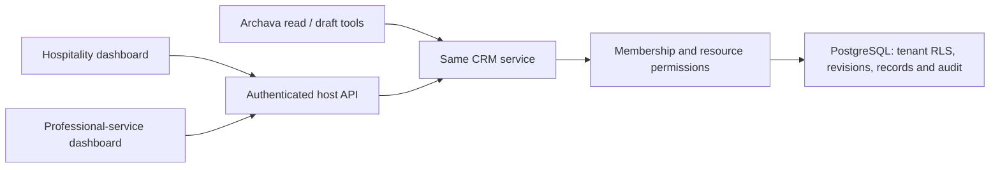

# Contacts, activities and follow-up — internal CRM slice

This is the first deterministic business module in the ARCHZXY internal library.
The same implementation serves hospitality inquiry and professional-service
inquiry references. Archava consumes authorized read/draft ports; the shared
dashboard works without an LLM. The company website remains a separate consumer.

The optional [sales pipeline capability](CRM_PIPELINE.md) extends this same domain
through explicit public subpaths. Current CRM/PG internal artifacts are 0.3.0;
contacts APIs remain available. Its additive migration and separate grants do not
turn the first contacts slice into a complete CRM/ERP. The additive
[command receipt recovery](CRM_COMMAND_RECOVERY.md) uses the existing schema.

| Package                  | Responsibility                                                                |
| ------------------------ | ----------------------------------------------------------------------------- |
| `@archava/crm`           | Strict schemas, trusted-principal service, JSON API and read/draft tools      |
| `@archava/crm/dashboard` | Shared DOM component: contacts, notes and follow-up create/complete           |
| `@archava/crm-pg`        | PostgreSQL repository, transactions, migration ledger and runtime role checks |



Contacts contain name, optional email/organization, owner, timestamps and revision.
Activities are immutable note/call/meeting records. Follow-ups have a due date and
open/completed lifecycle. Contact edits and activity/follow-up creation advance the
contact revision; completing a follow-up advances its own revision.

The dashboard lists contacts with keyset pagination/search. Detail shows the latest
20 activities and earliest 20 follow-ups. Extra fields, deletion, email sending,
bulk operations, sales stages and arbitrary workflows are outside this slice.
A guest inquiry is a contact reference, not a reservation or patient/student identity.

## Run and prove reuse

Use Node **22.22.3**, pnpm **10.15.1**, and PostgreSQL tools including `pg_config`.

```sh
pnpm crm:verify
pnpm crm:dev
# In a second shell, against the printed local origin:
CRM_BASE=http://127.0.0.1:PORT pnpm e2e:crm
```

The verifier packs internal modules, cold-installs two independent consumers
outside the workspace, checks browser/server declarations and compares whole
installed CRM package hashes including migrations. The backend runs with plain
Node and installed compiled exports, without workspace/tsx aliases. It creates a
private disposable PostgreSQL cluster with TCP disabled. It never reads an existing
database URL or user credentials. The CI CRM job runs this real database verifier.

`crm:dev` starts the shared API/component on loopback with fictional reference
accounts. Data persists across API/database restart within that environment,
then is removed when the command exits. It is a development fixture, not a
production login system or permanent installation. Keep real customer data out.

Results are generated in `dist/crm-proof/results.json`; dashboards are in
`dist/crm-demo`. Browser checks are separately runnable. Package/migration version
is now **0.3.0 / 001_crm_contacts + 002_sales_pipeline**; the contacts API contract
remains **1.0.0**. See [pipeline migration and scope](CRM_PIPELINE.md).

## Host integration and authorization

Use an operator-owned migration pool with `migrateCrm`, provision a separate
non-owner application login with `grantCrmRuntime`, and register memberships.
Create `PostgresCrmRepository` with that application pool and a stable secret
fingerprint key. Use at least 32 random bytes in secure runtime config; preserve
it across retries/restarts. Rotation needs explicit reconciliation.

The factory refuses superuser/BYPASSRLS/owner connections, unsupported migration
version/checksum and missing forced tenant policies. Migration locks and the ledger
make initial installation/re-entry atomic. The first migration does not import an
external CRM or implement a later-version upgrade path. Application privileges
cannot edit memberships or existing audit/activity records.

`createCrmApi(service, authenticate)` takes a trusted host identity resolver.
The host validates its real session/token and supplies the human/service identity.
Browser roles, actor ids, permissions and confirmation flags are not identity proof.
Cookie writes require a matching Origin. Hosts own TLS, secure cookies, session
expiry/revocation, rate limiting and enrollment before deployment.

Every operation checks active membership. A bounded tenant-checked security-definer
read function holds membership row locks without granting membership UPDATE rights.
Machine reads intersect machine and human-initiator permissions/scopes. Assigned
staff access only owned contacts; public identities without membership are denied.
Resource filters, composite tenant foreign keys and forced tenant RLS add isolation.
The database application credential remains trusted server infrastructure; RLS does
not authenticate a browser or protect against control of that credential.

## Writes, retries and tools

Commands use `{ requestId, command }`. An opaque UUID identifies one human intent.
Retain it for retries of an unknown response; use a new id for an intentionally
new action. HMAC fingerprints bind tenant, principal and canonical command.
Reusing an id with different input conflicts. Current permissions/resource scope
are rechecked on replay.

Claim, record mutation, metadata-only receipt and append-only audit commit in one
transaction. Revisions prevent stale overwrites; statement/lock timeouts bound waits.
Audit contains identities, operation, resource id and revision, not copied business
payloads. API errors omit SQL details. Contact fields remain authorized business
records and are not automatically ingested into prompts or knowledge.

Only humans mutate records in this slice. Machine writes are refused until a
verified Act/confirmation/durable-intent integration exists. The explicit tools
are `crm.contacts.list`, `crm.contact.summary` and `crm.followup.prepare`.
List projection omits email/organization. Preparation returns a revision-bound
draft with `requiresApproval`; it stores no task and sends nothing. These ports
do not automatically extend the existing action registry.

Register `CRM_CONTACTS_MANIFEST` with a host `ModuleRegistry` explicitly. Generic
`crm` stays planned. Code/metadata availability does not prove database readiness,
grant access or establish a price. No pricebook values changed.

## Release boundaries

This proves the offline M2 business slice. Production identity, deployment,
backup/restore, observability/SLA, privacy retention/export, later schema upgrade,
real enrollment and live Act/provider evidence remain M3 work. Pending Act tasks
and standalone template advisories still apply. No company website, universal ERP
or framework rewrite was added.

The implementation follows primary [node-postgres transaction guidance](https://node-postgres.com/features/transactions)
and [PostgreSQL row security guidance](https://www.postgresql.org/docs/current/ddl-rowsecurity.html).
