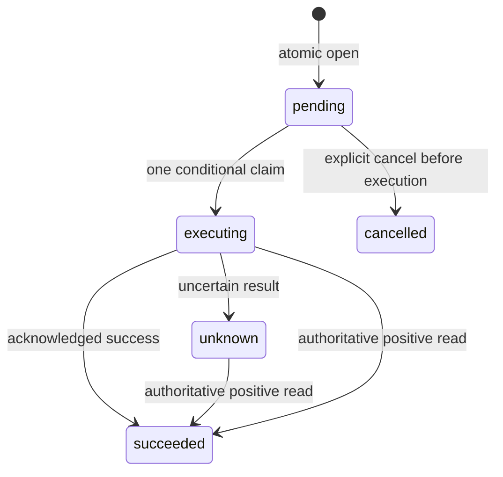

# Durable Act intent and read-only recovery

Checkpoint: 9 October 2026. This implements the operational library seams, not
a live owner CRM route, PMS connection or mail deployment. The existing local
CRM runtime and Gemini synthetic-only policy are unchanged.

## Execution boundary

Operational consumers use `DurableActHost` with
`PostgresActHostAttemptLedger.create(client, { tenantId, sessionId })`, durable
confirmation/provider stores, an authoritative entity resolver and a composed
tenant executor. `ActHost` and the memory ledger remain offline compatibility
options; their presence does not make a deployed workflow durable.

The server owns identity, role, capability, policy, credentials and every port.
The envelope contributes one candidate and, on presentation, the one-time token.
Policy, input validation, scoped entity resolution, consumed consent and the
final turn gate still precede the executor. The opaque intent UUID is correlation,
never permission. A binding description used during recovery is neither consent
nor an execution receipt.

One identity is tenant + session + action + keyed input digest. Atomic open holds
a database head lock and returns one intent and canonical timestamp while retaining
every issued challenge mapping. A conditional claim admits one executor. Success
is reported only after its settlement is durably acknowledged. Deadline, thrown
executor, malformed result or unacknowledged settlement remain unknown.

Review retry reuses the same intent and timestamp. An explicit predecessor may
open one successor only after success or cancellation; retrying that transition
reuses its child. Executing/unknown cannot advance, including after restart or
expiry. There is no lease expiry that grants a second execution. A late claimant
cannot replace reconciled success. A successor requires its own fresh approval.

The new owned schema has checksummed, repeatable migrations and forced RLS on
intent/head/challenge-mapping tables for both tenant and logical session. Its
runtime factory rejects an owner, superuser or BYPASSRLS role. Transaction-local
scope is set by invoker functions; runtime deletion is not granted. The injected
SQL client brings the deployment's driver, not a package-owned connection.
PostgreSQL documents [atomic conflict handling](https://www.postgresql.org/docs/current/sql-insert.html),
[row lock behavior](https://www.postgresql.org/docs/current/explicit-locking.html)
and [RLS owner bypass and FORCE](https://www.postgresql.org/docs/current/ddl-rowsecurity.html).

## Provider recovery

`composeTenantActExecutor().recover(request)` can only inspect an existing
provider attempt and consult its read port. It never claims a missing attempt,
reserves or sends. Optional `find` on legacy store ports preserves compatibility:
without that method recovery stays unknown. The PostgreSQL stores implement a
parameterized lookup using the same tenant/action-bound storage HMAC as claim.
The original request fingerprint must agree before a provider is consulted.

`DurableActHost.reconcile(intentId, graph, originalInputs)` revalidates inputs
and current resource access, matches the original keyed digest, then supplies
only transient validated context to a server-owned outcome resolver. It allocates
no challenge and invokes no executor. Missing original inputs can leave remote
recovery unknown. Receipt-based native adapters may use the intent UUID instead.
The host journal never persists the raw inputs or canonical idempotency key.

`PostmarkStatusPort` is offline by default. Explicit tenant-owned recovery config
enables one bounded metadata-search GET with the same opaque HMAC label as send.
It accepts only one matching message, exact metadata/stream/sandbox mode, a valid
MessageID and an accepted processing status. Missing, partial, duplicated,
malformed or failed searches stay unknown. No rejection or recipient delivery
is inferred. The read transport rejects redirects and caps response bytes; both
transports omit cookies and reject redirects. Credentials live in private fields.

The [official messages API](https://postmarkapp.com/developer/api/messages-api)
documents outbound metadata search, its counts and returned message fields. Its
retention and search limits mean a miss cannot establish that nothing was sent.
The [email API](https://postmarkapp.com/developer/api/email-api) supplies acceptance
MessageIDs; the metadata label itself is not vendor deduplication. Approved
server templates and the outbox retain authority over send.

## Evidence and limits

`pnpm act:verify` cold-installs identical compiled artifacts into two independent
consumers and starts a disposable PostgreSQL cluster. Four real Node processes
race open/claim; it checks canonical identity, explicit successor contention,
RLS, immutable identity, migration tampering and persistence after real restart.
It then composes installed policy, validation, turn, confirmation, intent and
provider stores through synthetic gateways for two tenants. A second installed
consumer recovers unknown mail after database restart with a mocked positive GET
and no further send. Its report is `dist/act-proof/results.json`.

Ordinary tests are offline, including Postmark acceptance/miss/ambiguity,
changed input and fingerprint rejection, deadlines, consent replay/expiry,
Assist denial, cross-scope refusal and settlement uncertainty. The database
verifier never opens the user's runtime database or reads private credentials.
No real reservation, mail, inbox delivery or production environment is verified.

Recorded checks: [database/composition proof](audit/2026-10-09-act-durable-proof.json)
and [root validation](audit/2026-10-09-act-validation.json). All eight root gates
passed with 1,420 tests in 95 files; existing CRM database regression passed 31
checks. The original local data and private configuration match their earlier
preservation snapshot.

## Remaining release work

**Must build now for the internal owner pilot:** one bounded native CRM approval
adapter and authenticated HTTP/UI review/present/status flow, current owner and
service grant intersection, resource-revision binding, restore execution hold,
and end-to-end receipt/audit tests. Keep ordinary CRM machine writes denied until
that path exists. Backups must not silently restore permission to repeat an
external effect.

**Should build next:** deployment-owned hardening/checksummed upgrades for legacy
confirmation/provider schemas, tenant credential lifecycle, hosted identity/TLS,
scheduled backup/restore drills and cost/queue diagnostics. The new intent schema
RLS does not establish RLS for those pre-existing public-schema adapters.

**Build later:** selected tenant-owned PMS/Postmark live fixtures, receipts and
operational runbooks, then demand-backed CRM/project/ERP modules.

**Do not build yet:** universal ERP, unattended financial authority, blind retries
of unknown effects, automatic paid AI fallback, microservice fleets or the
separate ARCHZXY company website inside this repository.
