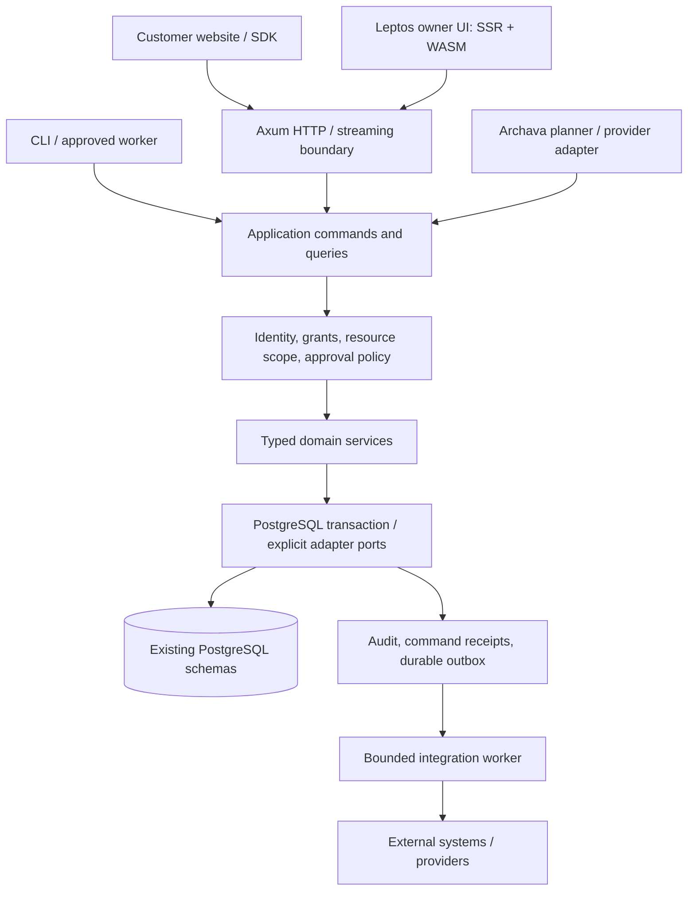

# Archava — PRD Full Rust

**Company:** ARCHZXY  
**Product:** Archava dan reusable business module library  
**Document version:** 1.2.0  
**Research/snapshot date:** 15 Oktober 2026  
**Status:** Target migrasi ditugaskan owner untuk implementasi lokal end-to-end; belum diimplementasikan atau diterima sebagai release.  
**Implementator:** Archxy. **Orchestrator/reviewer:** Codex saat diminta owner.  
**Product/commercial authority:** [Master PRD](../PRD.md), `agent.md`, dan pricebook existing. Versi dokumen ini tidak mengubah versi produk atau harga.

**Execution mandate:** [Archxy Full Rust execution task](../ARCHXY_FULL_RUST_EXECUTION_TASK.md).
Owner meminta seluruh R00–R11 dikerjakan berkelanjutan; Codex mengaudit setelah
candidate lengkap. Local self-verification per milestone tidak memerlukan pause
untuk review eksternal. Independent acceptance tetap fakta terpisah.

## 1. Keputusan dan penjelasan untuk owner

Target dokumen ini adalah **core, business modules, backend, operational tools, dan web UI first-party ditulis dalam Rust**. Server berjalan sebagai native binary. UI web memakai Leptos, menghasilkan HTML dari server dan WebAssembly untuk interaksi di browser. PostgreSQL tetap menyimpan data bisnis.

Bayangkan puzzle yang sama: CRM, booking, inventory, purchasing, dan modul lain tetap kepingan yang bisa dirakit. Rust adalah bahan untuk membuat kepingannya. Manifest, dependencies, izin, configuration, dan pengujian kombinasi menentukan apakah puzzle benar-benar cocok. Mengganti bahasa saja belum menyelesaikan hal itu.

Sampai UI juga bisa, bro. Manfaat yang dituju adalah berbagi tipe yang aman untuk browser, satu bahasa untuk aplikasi first-party, dan komponen UI yang mengikuti kontrak modul. Tradeoff-nya adalah memindahkan UI yang sudah berjalan, belajar ekosistem baru, build untuk server sekaligus browser, dan menangani SDK vendor yang berorientasi JavaScript. Halaman belum tentu lebih cepat karena ditulis dalam Rust.

**Scope eksekusi terbaru:** setelah membahas target sampai web UI, owner menugaskan
Archxy menyelesaikan seluruh migrasi lokal secara berkelanjutan, lalu Codex
mengaudit hasilnya. Scope mencakup core/backend/library dan first-party UI Rust.
Penugasan ini mengotorisasi implementasi end-to-end; status release acceptance,
live-provider readiness dan perubahan active owner data tetap mengikuti evidence
dan batas mandat eksekusi.

Full Rust berarti source aplikasi milik kita menggunakan Rust. HTML/CSS/assets, SQL migrations, konfigurasi JSON, generated JavaScript loader WASM, browser bindings, dan compatibility SDK untuk website eksternal tetap bagian sah dari produk. Website ARCHZXY merupakan consumer terpisah di luar folder ini dan boleh memakai stack apa pun.

**Keputusan engineering:** pilih Rust modular monolith + Axum/Tokio + SQLx/PostgreSQL + Leptos SSR/hydration sebagai target. Buktikan satu alur utuh sebelum memperluas migrasi. Backend Rust dengan UI TypeScript existing adalah intermediate yang valid bila UI Rust belum lolos gate; statusnya disebut partial migration.

## 2. Tujuan, batas, dan ukuran selesai

### 2.1 Tujuan produk

1. Archava tetap AI interface untuk customer, employee, dan owner dengan tools serta data yang berbeda menurut kewenangan.
2. Business modules dapat digunakan lewat dashboard/API tanpa LLM. Archava memakai kontrak yang sama untuk menjalankan tindakan yang diizinkan.
3. Dua consumer independen menggunakan core yang sama; CRM kecil yang sama digunakan pada dua model bisnis tanpa fork.
4. Library bisa dikomposisikan dengan manifest, konfigurasi, dependency resolution, permission policy, dan versi kompatibel.
5. Rust membawa manfaat yang dibuktikan: correctness, penggunaan resource, operasional, atau maintenance. Klaim speedup memerlukan pengukuran.
6. Tim kecil tetap dapat mengembangkan, menjalankan, memperbaiki, backup, dan meng-upgrade platform secara lokal.

### 2.2 Termasuk dalam target Full Rust

| Area              | Target akhir                                                                                                                  |
| ----------------- | ----------------------------------------------------------------------------------------------------------------------------- |
| Core/library      | Typed contracts, context, configuration, assembly, pricing, decision, permissions, actions, presence contracts                |
| Business systems  | Seluruh perilaku existing yang masuk inventory R00; per-domain scope jelas, termasuk adapters PostgreSQL                      |
| AI interface      | Knowledge, page context, assistant orchestration, tool planning/execution, provider budget/recovery, chat, voice/avatar seams |
| First-party web   | Owner/operator dashboard, domain screens, assistant panel, chat/widget view yang kita miliki                                  |
| Operational tools | Setup, users, doctor, modules, backup/status/policy/run, restore, action recovery, verification, assembly/release tooling     |
| Reuse             | Cargo-consumable library, packaged host, web assets, documented HTTP/event contracts, browser integration facade              |
| Migration         | Contract parity, approved bug corrections, upgrade/recovery/rollback, immutable release evidence                              |

### 2.3 Batas scope

Migrasi bahasa tidak menciptakan semua fitur ERP, 40 full kits, accounting lengkap, native mobile/desktop apps, atau provider capabilities yang belum ada. Requirement masa depan pada master PRD tetap backlog produk tersendiri. Yang sekarang prototype tidak boleh naik menjadi accepted karena diport.

Tetap lokal terlebih dahulu. Tidak perlu hosting berbayar, cloud deployment, remote push/publish, live payment/email, atau pemanggilan AI berbayar untuk menerima milestone. Gemini tetap pilihan pilot existing; tier, model availability, quota, dan biaya diverifikasi sebelum penggunaan live berikutnya.

### 2.4 Definisi Full Rust selesai

Semua baris inventory R00 berstatus `accepted` atau `retired_with_replacement`, termasuk API, UI, background jobs, SDK boundaries, dan operational tools. Host berjalan tanpa Node sebagai runtime wajib untuk aplikasi first-party; tooling browser tests atau generated compatibility package boleh membutuhkan Node. Tidak ada silent TS fallback pada jalur yang dinyatakan Rust.

Semua acceptance gates §23 lulus terhadap release identity yang sama. Perilaku/data existing terjaga, bug yang disetujui dikoreksi, dua consumer independen terbukti, dan recovery/upgrade teruji. Sisa compatibility bridge diumumkan beserta alasannya. **Full Rust selesai tidak berarti 40/40 operational kits selesai.**

## 3. A — Current state dan kualitas evidence

### 3.1 Snapshot repository yang diamati

Working tree sedang berisi implementasi lain. HEAD saja tidak merepresentasikan seluruh source. Angka berikut adalah inventory file pada saat penyusunan, bukan hasil release acceptance baru.

| Sumber                                              | Profile | Assembly | Artifacts/packages            | Database ledgers |
| --------------------------------------------------- | ------- | -------- | ----------------------------- | ---------------- |
| `config/library-release.v1.json`                    | 1.17.0  | 17.0.0   | 62 declared internal packages | 23               |
| `dist/library/release-profile.json`                 | 1.17.0  | 17.0.0   | 62 artifact entries           | 23               |
| `dist/releases/1.17.0/library/release-profile.json` | 1.17.0  | 15.0.0   | 58 artifact entries           | 21               |

HEAD saat observasi: `242549c`; source mempunyai perubahan tracked/untracked. Katalog mencantumkan 18 external pins. Ada 64 folder packages dengan `package.json`; `@archava/pricing` dan `@archava/reference` berada di luar daftar 62 release packages. Artifacts juga mencakup infrastructure/adapters/SDK, sehingga bukan 62 business modules.

Source baru `formal-education`/`formal-education-pg` sudah masuk candidate catalogue. Implementasi tambahan itu belum diterima oleh dokumen ini. Audit sebelumnya menyebut 60 artifacts/assembly16; perubahan denominator harus dicatat, bukan dianggap laporan lama membuktikan source baru.

Hash pembeda snapshot, SHA-256:

| File                             | Hash                                                               |
| -------------------------------- | ------------------------------------------------------------------ |
| Source release catalogue         | `acd39ff0252547e9d7ede7af90385ef11f175898a9cc835da06e8034bf80e164` |
| Current compiled release profile | `97c5d35b74b23ec4f5dcbbcd3af80237b0258e8e2f3962f82261ec23488a23c9` |
| Archived 1.17.0 release profile  | `05632c0177445f134cedeff10f3bca36389883524062fcf1fbab237ccefb9108` |

Inventory artefak di atas tidak membuktikan isi binary, freshness seluruh proofs, atau suitability untuk produksi. R00 harus membekukan ulang semua source/build inputs dan hasil audit terbaru.

### 3.2 Arsitektur yang benar-benar ada

- Monorepo pnpm/TypeScript, domain packages dan PostgreSQL adapters dengan raw SQL serta migration ledgers milik domain.
- `apps/crm` merupakan custom Node host dengan compiled packages dan browser dashboard. `apps/web` menggunakan TypeScript server/esbuild. Jangan menganggap keduanya sudah Next.js/NestJS.
- `packages/sdk`, `chat`, `presence`, dan domain panels mempunyai browser/DOM contracts. Standalone realtime template mempunyai jalur sendiri; inventory wajib membaca kontraknya sebelum menentukan replacement.
- ActionExecutor/GatedAction, confirmation, durable attempts/outbox, identity, tenant RLS, provider policy, page awareness, configuration, dan release proofs sudah ada. Migrasi mengembangkan konsep tersebut.
- Purchasing/commerce memakai satu physical stock pool dan transaksi bersama. Domain references dan scope checks belum semuanya terbukti benar.
- Katalog kit authoritative berada di `packages/kits/src/catalogue.ts`: 40 candidates. Last reviewed full operational acceptance tetap **0/40**; narrow domain proofs tidak menaikkan angka tersebut.

### 3.3 Audit yang wajib dibawa ke Rust

Baca [audit produk](PROJECT_AUDIT_2026-10-14.md) dan [review koreksi KIT-09](ARCHXY_KIT09_REVIEW_2026-10-15.md). Ini daftar temuan terakhir yang belum mempunyai penutupan review dalam PRD ini; recheck source terbaru sebelum menyimpulkan status aktual.

| ID      | Masalah yang ditemukan                                                      | Konsekuensi spesifikasi Rust                                                           |
| ------- | --------------------------------------------------------------------------- | -------------------------------------------------------------------------------------- |
| A01     | Receipt/replay melewati current grants/actor authority pada enam domain     | Otorisasi dilakukan sebelum mengembalikan cached result; request UUID bukan izin       |
| A02     | Assigned-resource scope tidak membatasi beberapa detail/mutations           | Cek resource/child/audit/write/recovery dengan scope aktual                            |
| A03     | Service reads tidak meng-intersect represented human                        | Effective grants dan resource scope harus memenuhi seluruh pihak yang relevan          |
| A04     | Attendance roster dapat dipakai pada session lain                           | Relationship validation dan constraint tenant/session/roster                           |
| A05     | Paid subscription mengaktifkan entitlement sebelum pembayaran benar         | Lifecycle entitlement memerlukan authoritative settlement sesuai policy                |
| A06     | Minimal consumer tidak mendapat dependency yang wajib                       | Proof declared dependency closure, tanpa seluruh workspace menutupi missing dependency |
| A07     | Release/profile identity berbeda dengan arsip bernama sama                  | Release baru immutable, identity/hash/proof konsisten; arsip lama dipertahankan        |
| A08     | Appointment/asset references belum authority-bound                          | Resolve melalui trusted adapter atau tampilkan sebagai reference-only                  |
| A09     | Status/docs/grants/gates drift                                              | Generated inventory + reviewed capability documentation                                |
| J01     | Unit CLI test membutuhkan ignored release evidence pada checkout tanpa dist | Unit tests menggunakan owned synthetic fixtures; build bootstrap tidak melingkar       |
| J02     | Beberapa failed standalone/advisory results hilang dari refusal reasons     | Verdict dan reasons menilai semua required proofs, exception exit code eksplisit       |
| J03/J04 | Docs bertentangan dan coverage lint pilot sempat diturunkan                 | Pelaporan sesuai snapshot; checks tidak dikurangi agar hijau                           |

Green test counts existing tidak menutup kasus negatif tersebut. Jangan membuat Rust meniru authorization atau financial bugs untuk mengejar parity. Tutup bug di baseline TypeScript terlebih dahulu, atau tulis corrected conformance expectation dan perubahan kompatibilitas yang direview sebelum port terkait diterima.

### 3.4 Pilot Rust: evidence yang ada dan batasnya

Lokasi prototype: `/home/haikaru/Archverse/Lab/Experiments/rust-pilot/`. Jangan menyalin caches/binaries prototype menjadi release produk. [Prompt pilot](../ARCHXY_RUST_PILOT_TASK.md) meminta pricing, deployment planning, dan capacity calculation; reference-rate slice tambahan tidak otomatis menggantikan dua slice terakhir.

Saat dibaca, `node/evidence/p1-parity.json` berisi 350 fixtures: 338 match, 12 error-class differences; `p2-parity.json` berisi 753 fixtures: 748 match, 5 divergences. `planning` dan `schedule` masih mempunyai `placeholder()` di entry point yang diamati. Report `docs/RUST_PILOT_RESULTS.md` kini tersedia di prototype dan mengakui batas slice.

Report tersebut menyebut benchmark pricing lokal: Rust lebih lambat saat reparsing pricebook dibanding TS construct-once, dan lebih cepat ketika keduanya parsing per call. Angka itu **laporan implementator yang belum direproduksi dalam pekerjaan PRD**, menggunakan TS source/tsx dan Node26; bukan bukti full product, compiled consumer, p95/RSS, atau runtime baseline Node22 repository.

Report juga mengaitkan lima reference-rate divergences dengan key `__proto__` pada baseline JS. Perlakukan sebagai finding yang perlu reproducer dan corrected expected behavior, bukan izin otomatis mengabaikan seluruh divergences. P1 error class harus dipulihkan pada compatibility boundary bila boundary itu dipertahankan.

**Kesimpulan evidence:** ada prototype yang relevan; belum ada dasar untuk menyatakan full migration lebih cepat, lebih murah, bebas bug, atau sudah diterima.

## 4. B — Target state dan pengalaman pengguna

### 4.1 Pengguna

| Pengguna                       | Kebutuhan                                                            | Batas authority                                                               |
| ------------------------------ | -------------------------------------------------------------------- | ----------------------------------------------------------------------------- |
| Public/customer                | Bertanya, navigasi, booking/order dan support yang diizinkan         | Public/customer tools dan data miliknya; tidak mendapat internal owner tools  |
| Employee                       | Tugas operasional sesuai peran/assignment                            | Tenant, grants, field visibility, dan resource scope saat request             |
| Owner/operator                 | CRM, proposals, projects, capacity, billing, configuration, recovery | Tetap memerlukan validasi/approval untuk tindakan terkait; bukan bypass audit |
| Independent consumer developer | Merakit domain dan UI lewat supported config/contracts               | Tidak perlu mengakses private platform internals atau fork engine             |
| Implementer/maintainer         | Upgrade dan incident recovery yang dapat diverifikasi                | Admin/migrator credentials terpisah dari request runtime                      |

### 4.2 Alur minimum yang harus terasa utuh

1. Owner login, memilih tenant, membuka kontak dan pipeline yang diizinkan.
2. Archava menerima pertanyaan dengan page context minimum; model menghasilkan structured plan.
3. Backend memvalidasi plan, membaca records yang diizinkan, dan menunjukkan hasil/draft.
4. Untuk mutation, UI menampilkan apa yang berubah dan meminta confirmation sesuai policy.
5. Commit menghasilkan durable receipt; jika response hilang, user melanjutkan status request yang sama tanpa double effect.
6. Owner dapat menelusuri proyek, agreed scope/amendment, capacity estimate, dan billing sesuai module composition.
7. Customer dari website eksternal menggunakan tools terpisah; mengganti UI owner tidak mengubah hak customer.

Chat/Voice/Human, Assist/Act/Transact/Enterprise, dan Digital Environment tetap dimensi independen. Avatar/voice failures harus memberi fallback yang sesuai; presence tidak meningkatkan permission.

## 5. C — Gap analysis dan pilihan teknologi

### 5.1 Temuan riset primer

| Temuan                                                                                                       | Implikasi untuk Archava                                                                                                                                                                                                                     |
| ------------------------------------------------------------------------------------------------------------ | ------------------------------------------------------------------------------------------------------------------------------------------------------------------------------------------------------------------------------------------- |
| Rust ownership memeriksa aturan memory melalui compiler; membutuhkan model programming yang berbeda          | Ada manfaat correctness/resource, tetapi bukan pengganti authorization atau domain tests. [Rust Book](https://doc.rust-lang.org/book/ch04-01-what-is-ownership.html)                                                                        |
| Rust ecosystem tetap melaporkan hambatan compile/resource dan learning complexity                            | Ukur build dan maintenance bersama runtime; survey bukan bukti kecepatan Archava. [State of Rust 2025, terbit 2026](https://blog.rust-lang.org/2026/03/02/2025-State-Of-Rust-Survey-results/)                                               |
| Axum menyediakan HTTP composition dan Tokio menjalankan asynchronous workloads                               | Cocok untuk satu backend modular; CPU-heavy work tetap dibatasi terpisah. [Axum](https://docs.rs/axum/latest/axum/), [Tokio](https://tokio.rs/tokio/tutorial)                                                                               |
| SQLx mendukung PostgreSQL, transaksi, dan prepared offline query metadata                                    | Pertahankan SQL/schema; query checking tidak membuktikan tenant policy. [SQLx](https://github.com/transact-rs/sqlx), [offline build](https://github.com/transact-rs/sqlx/blob/main/sqlx-cli/README.md)                                      |
| Leptos menyediakan full-stack SSR dan browser hydration dari Rust                                            | Pilihan target UI web first-party. Ada dua build targets dan web assets yang harus dikirim bersama. [Getting started](https://book.leptos.dev/getting_started/index.html), [page lifecycle](https://book.leptos.dev/ssr/22_life_cycle.html) |
| Dioxus juga mendukung fullstack Rust/Axum dan lintas platform                                                | Alternatif bila kebutuhan native menjadi prioritas; tidak perlu memelihara dua UI frameworks sekarang. [Dioxus Fullstack](https://dioxuslabs.com/learn/0.7/essentials/fullstack/)                                                           |
| Browser Rust memakai bindings ke Web APIs                                                                    | DOM, media, storage, dan JavaScript vendor integration masih perlu kontrak interop. [web-sys](https://wasm-bindgen.github.io/wasm-bindgen/web-sys/index.html)                                                                               |
| Server functions Leptos menjadi public API endpoints                                                         | Setiap endpoint tetap memerlukan authentication, authorization, validation, dan request protections. [Leptos security note](https://book.leptos.dev/server/25_server_functions.html)                                                        |
| Cargo features bersifat additive dan dapat di-unify                                                          | Feature compile bukan tenant permission atau batas keamanan. [Cargo features](https://doc.rust-lang.org/cargo/reference/features.html)                                                                                                      |
| Gemini menyediakan HTTP/SSE dan Live WebSocket APIs; daftar SDK resmi yang diperiksa tidak mencantumkan Rust | Gunakan first-party adapter ke documented protocol, bukan mengasumsikan official Rust SDK. [Gemini libraries](https://ai.google.dev/gemini-api/docs/libraries), [API reference](https://ai.google.dev/api)                                  |

Keputusan teknologi di bawah merupakan penilaian terhadap Archava, bukan kesimpulan universal dari sumber tersebut. Versi `latest` pada dokumentasi adalah bahan riset; versi produksi/toolchain harus dipilih dan dikunci pada R00/R01 setelah compatibility check.

Konflik dengan arah stack TypeScript pada master PRD/architecture existing adalah
perubahan teknologi yang disengaja dalam **proposal target** ini. Requirements
produk/harga dan kontrak yang masih supported tetap berlaku. Setelah migrasi
ditugaskan dan ADR diterima, update architecture/implementation sections secara
bertahap untuk slice yang terbukti; jangan mengubah dokumentasi current seolah
Rust sudah menggantikan TypeScript.

### 5.2 Keputusan stack

| Concern              | Pilihan                                                               | Yang harus dibuktikan                                                                   |
| -------------------- | --------------------------------------------------------------------- | --------------------------------------------------------------------------------------- |
| HTTP/runtime         | Axum + Tokio, Tower middleware                                        | API errors/status/limits, cancellation, shutdown/recovery, bounded concurrency          |
| Database             | PostgreSQL existing + SQLx                                            | Existing SQL/ledgers, RLS non-owner, atomic transactions, timestamp fidelity            |
| Contracts            | Rust DTOs + Serde + versioned JSON Schema/OpenAPI                     | Naming/defaults/null/unknown fields dan custom validation parity                        |
| UI                   | Leptos SSR + hydration + `cargo-leptos`                               | Login, CRUD, approval/recovery, media interop, accessibility, asset cache compatibility |
| Provider client      | Bounded Rust HTTP/WebSocket adapter; minimal vetted client dependency | Current provider semantics, budget reservation, timeouts, safe unknown outcomes         |
| Async durable work   | Existing PostgreSQL outbox/attempt model; bounded worker dalam host   | Restart, lease/reclaim, retry, idempotency, backlog visibility                          |
| Observability        | `tracing`, structured logs/metrics; OTel-compatible seam              | Redaction dan correlation; exporter opsional, bukan service fleet wajib                 |
| Distribution         | Native host binary + web assets + manifests + library crates          | Cold install/build, minimal dependency closure, immutable hashes                        |
| Packaging/deployment | Local release archive; Docker ketika diperlukan                       | Binary/libc/OS requirements jelas; tidak mengklaim static universal binary              |

Jangan menambah Redis/BullMQ, Temporal, Kubernetes, event bus eksternal, distributed transactions, atau microservices hanya untuk migrasi. Bila inventory menemukan dependency yang benar-benar digunakan, dukung transisi eksplisit; jangan menghapusnya berdasarkan tabel target.

### 5.3 Mengapa Rust UI, dan kapan menahan penggantiannya

| Pertimbangan         | Manfaat target                                                  | Biaya/risiko                                                                |
| -------------------- | --------------------------------------------------------------- | --------------------------------------------------------------------------- |
| Shared types         | DTO browser-safe dan shared validation helpers                  | Tipe DB/secret/internal policy tidak boleh ikut bundle                      |
| Satu bahasa aplikasi | Core/backend/UI memakai Rust                                    | Browser glue, CSS dan vendor APIs tetap ada; build matrix bertambah         |
| Reusable components  | Form/list/detail/approval components mengikuti module contracts | Port existing UI dan integrasi third-party perlu kerja nyata                |
| Performa             | SSR dapat memberikan HTML sebelum hydration                     | WASM download/startup dan DOM work dapat menghapus keuntungan; harus diukur |
| Maintenance          | Compiler memeriksa banyak refactor lintas layer                 | Shared crate besar dapat memperluas rebuild; framework upgrades perlu tes   |

Pilih **Leptos untuk web operational UI**, bukan egui/canvas UI sebagai default. Archava memerlukan forms, keyboard navigation, semantic HTML, assistive technology, dan browser integration. PhotoCraft adalah contoh engine Rust dengan egui/wgpu untuk workload editor; arsitektur graphics tersebut tidak menjadi bukti stack yang sama cocok untuk CRM. Yang dapat diambil adalah pemisahan engine/commands/interface. [PhotoCraft architecture](https://github.com/storytold/photocraft/blob/main/docs/architecture.md).

R01 harus membuktikan UI Rust pada slice kecil. Jika login/recovery/accessibility/media interoperability atau build experience gagal gate, lanjutkan backend yang lulus bersama UI existing dan catat UI migration tertunda. Perubahan framework memerlukan ADR berisi hasil pembanding; jangan menjalankan dua rewrite UI sekaligus.

## 6. D — Proposed architecture dan folder ownership



Diagram menunjukkan alur authority; implementasi harus menjaga boundary meskipun semua komponen berada dalam satu process. LLM planning adalah input, bukan privileged caller.

### 6.1 Folder target

```text
Archava_Platform/
  PRD.md
  docs/PRD_FULL_RUST.md
  config/                          # compatible public config/pricebook
  packages/                        # existing TS selama transisi
  apps/                            # existing consumers selama transisi
  rust/
    Cargo.toml                     # workspace members eksplisit
    Cargo.lock
    rust-toolchain.toml
    crates/
      contracts/                   # browser-safe public DTOs, stable codes
      kernel/                      # IDs, money/time, domain-neutral utilities
      policy/                      # principal/scope/approval decisions
      application/                 # use cases, registry, orchestration
      domains/                     # cohesive domain modules; split crates bila perlu
      postgres/                    # domain adapters + transaction composition
      providers/                   # Gemini/integration ports and adapters
      host/                        # Axum composition, CLI, worker lifecycle
      web-ui/                      # Leptos views + public widget view
      testkit/                     # synthetic fixtures/conformance support
    xtask/                         # repeatable build/pack/verify tooling
    tests/consumers/                # two independent consumer fixtures
  dist/                            # generated artifacts, never unit-test prerequisite
```

Ini folder proposal; tidak ada folder Rust produk yang dibuat oleh PRD ini. `domains/` mulai sebagai satu crate dengan internal modules yang jelas; pisah crate ketika independent reuse/dependency/build boundary membutuhkannya. Hindari menerjemahkan 62 npm artifacts menjadi 62 crates secara mekanis. Cargo workspace members harus cocok dengan layout nyata, termasuk `xtask`.

### 6.2 Arah dependencies

- `contracts`/`kernel` tidak bergantung Axum, SQLx, Leptos, Node, atau provider SDK.
- Domain rules bergantung kernel/contracts dan narrow ports; tidak mengirim email, memanggil LLM, atau membuka DB sendiri.
- `policy` mendefinisikan checks; application mengikat authenticated context dan repository authority. Low-level dispatch tidak dianggap authorization boundary.
- PostgreSQL adapter memiliki SQL per domain. Cross-domain writes memakai explicit SPI dan shared transaction, bukan akses tabel tetangga secara bebas.
- Host adalah composition root. UI hanya memakai browser-safe contracts dan application endpoints; tidak mendapatkan privileged repositories atau policy secrets.
- Existing SQL migration files tetap dimiliki lokasi/ledger existing sampai ada relocation terverifikasi; Rust packaging dapat menyertakan bytes yang sama beserta source path/checksum.

Tidak ada dynamic native plugin ABI pada release awal. Reuse Rust dilakukan lewat supported crates/API dan versioned runtime contracts, bukan memuat `.so` arbitrary dari client.

## 7. E — Module contract dan composition

**MC-01:** Setiap installed module memiliki machine-readable manifest yang divalidasi. Field berikut wajib tersedia atau eksplisit `not_applicable` dengan alasan:

| Field            | Isi                                                                                                  |
| ---------------- | ---------------------------------------------------------------------------------------------------- |
| Identity         | Stable module ID, SemVer, owner, maturity, contract versions                                         |
| Dependency graph | Required version ranges, optional capabilities, conflicts, platform/feature requirements             |
| Data ownership   | Schema/ledger IDs, immutable migration IDs/checksums, supported upgrade ranges                       |
| Security         | Registered permission IDs, scope predicates, tool/action definitions, risk/approval/recovery rules   |
| Contracts        | API/query/command schemas, stable error codes, event schemas/version                                 |
| Configuration    | Versioned config schema, required secret reference names, defaults, locale/timezone/currency support |
| UI extension     | Routes/navigation/components, access requirements, visibility policy, assets                         |
| Operations       | Health/readiness checks, jobs/outbox ownership, backup/restore coverage                              |
| Evidence         | Required conformance/independent-consumer/upgrade/browser proofs and exact artifact identity         |

Illustrative manifest; bukan kontrak existing yang diam-diam diubah:

```json
{
  "manifestVersion": "1.0.0",
  "id": "purchasing",
  "version": "0.1.0",
  "maturity": "candidate",
  "requires": {
    "identity": ">=0.1.0, <0.2.0",
    "commerce": ">=0.1.0, <0.2.0"
  },
  "optional": ["archava"],
  "conflicts": [],
  "permissions": ["purchasing.read", "purchasing.write"],
  "migrationLedgers": ["archava_purchasing"],
  "commands": ["purchasing.confirm", "purchasing.inspect_receipt"],
  "uiRoutes": ["/purchasing"],
  "requiredProofs": ["tenant-policy", "atomic-stock-receipt", "two-consumers"]
}
```

Example IDs harus dipetakan ke actual existing IDs pada R00; illustrative names tidak memberi izin mengganti grants pada data owner.

**MC-02:** Resolver menolak missing/incompatible dependencies, cycles, unknown modules, unsupported target features dan duplicate ownership. Output deterministic: resolved versions/features/config hash, permission requirements, schema compatibility dan deployment plan.

**MC-03:** Installed code, module enablement, commercial entitlement, user permissions, dan resource scope adalah lima hal berbeda. Cargo features hanya memilih code/dependencies saat compile. Runtime tenant config hanya mengaktifkan capabilities yang terpasang; tidak memberi grants.

**MC-04:** Disable module menolak dependent aktif dan memerlukan review pending jobs/commands. Menonaktifkan fitur tidak menghapus records/audit atau otomatis mencabut akses legal data export. Uninstall/destructive cleanup adalah lifecycle terpisah dengan migration plan.

**MC-05:** Extension memakai documented hooks/events/ports dan namespaced client data. Generalisasi fitur dilakukan setelah dua kebutuhan nyata menunjukkan shared invariant; hindari universal entity/EAV engine agar semua industri terlihat sama.

## 8. F — Tenancy dan identity strategy

**TEN-01:** Default lokal adalah satu PostgreSQL deployment dengan tenant-scoped rows dan domain-owned schemas. Schema-per-tenant atau DB-per-tenant menjadi deployment option ketika kebutuhan isolation/operations terbukti; jangan membuat fleet database sekarang.

**TEN-02:** Runtime menggunakan non-owner role tanpa `BYPASSRLS`/superuser. Tenant context diikat ke authenticated identity dan disetel dengan transaction-local settings pada koneksi yang sama untuk seluruh operation. Requests tidak memilih tenant lewat body tanpa membership check. Pool reuse, cancellation, rollback, dan error paths harus membuktikan tidak ada tenant context bocor.

**TEN-03:** Tenant tables memakai RLS yang sesuai dan `FORCE ROW LEVEL SECURITY` bila diperlukan oleh existing ownership model. Composite keys/FKs mencakup tenant serta relationship bisnis terkait. SQLx typed queries tidak menggantikan policy. PostgreSQL menjelaskan bypass oleh superuser/BYPASSRLS dan normal owner behavior; role design harus diuji dengan runtime role sungguhan. [PostgreSQL row security](https://www.postgresql.org/docs/current/ddl-rowsecurity.html).

**TEN-04:** Principal membedakan human, service, dan delegated/represented-human context. Effective grants dan scope merupakan intersection constraints yang relevan. Scope seperti `assigned`, `self`, `guardian`, atau `assigned_class` adalah predicates/set membership; jangan mengurutkannya sebagai numeric rank lalu memilih yang paling besar.

**TEN-05:** Lock/check authority dalam transaction yang melakukan mutation, dengan membership/resource changes memakai locking/revision discipline yang kompatibel. Revocation test menentukan hasil yang sah di commit boundary; permission snapshot dari login saja tidak cukup.

**TEN-06:** Migrator/backup operator credentials terpisah. `SECURITY DEFINER` functions, bila dipertahankan, memiliki qualified references, pinned safe search path, minimal execute grants, dan negative tests. Tidak ada admin pool yang dipakai untuk menambal request permission failures.

### 8.1 Compatibility identity yang harus dijaga

Existing password encoding menggunakan scrypt parameters `N=32768, r=8, p=3`, salt/key/base64url format dan bounded concurrency; sesi/CSRF memakai HMAC, dan host mempunyai HKDF-derived keys. Port harus memverifikasi synthetic golden fixtures dari algoritma existing dengan vetted crypto libraries, termasuk malformed encodings, constant-time comparison dan limits. Jangan mengubah hashing scheme, keys, settings atau membuat akun pengganti sebagai shortcut migrasi.

Session format boleh berubah hanya lewat versioned compatibility policy: preserve supported sessions atau explicit safe re-login, tanpa password reset/data loss. Selama mixed runtime, session/CSRF handling harus konsisten atau dipisahkan melalui origins/cookie paths yang didokumentasikan. Logout/revocation menutup akses pada HTTP, SSE/WS reconnect dan UI cache.

## 9. G — Configuration strategy dan kit library

**CFG-01:** Pertahankan supported existing client configuration melalui adapter. New Rust config memiliki schema/version, strict supported fields, config migrations, immutable resolved plan, dan secret references. Secret values tidak masuk prompts, browser payload, manifest, logs, archives public, atau Git.

**CFG-02:** Configurator menerima kebutuhan terstruktur, memilih kit/capabilities, memvalidasi dependencies/compatibility, lalu menghasilkan plan. Semua tools hanya tersedia setelah intersection module installed/enabled, tenant capability policy, principal grants/scope, dan request policy.

**CFG-03:** Public/customer dan owner surfaces mempunyai explicit allowed tool sets/origins. `avatar: true` atau `module: true` tidak menaikkan authority. Module toggles menjadi audited changes dengan expected config revision; plan preview tidak mengeksekusi migrations/deployment.

**CFG-04:** Existing 40-kit catalogue tetap authoritative. R00 merekam semua K01–K40, required capabilities/domain/adapters dan scope evidence; Rust resolver tidak mengganti katalog dengan hardcoded daftar baru. K14/formal education dan K22 serta specialist domains lain tidak otomatis complete karena source atau generic primitives tersedia.

**CFG-05:** Kit assembly berarti core + modules + config + explicit extensions. Missing capability menghasilkan declared gap/refusal/alternative scope, bukan LLM mengarang implementation atau menjanjikan paket complete. Catalog coverage dan operational readiness ditampilkan terpisah.

**CFG-06 — Owner self-service:** Reusable configuration juga harus dapat dioperasikan
owner lewat Archava/dashboard, bukan hanya developer/internal Studio. Targetnya
business-language discovery → validated composition → impact/cost preview → bound
confirmation → authoritative apply/status/recovery/history. Baca
[Owner configuration PRD](OWNER_CONFIGURATION_PRD.md) dan master PRD §51.
UI tidak memerlukan owner mengedit code/config file atau memakai terminal.
Modul/code availability, entitlement, dependencies, permissions, data lifecycle
dan domain invariants tetap wajib diperiksa. Ini explicit product clarification:
catat scope delta terhadap frozen migration inventory dan pisahkan new owner
features dari existing-behavior porting. Assembly helper atau config CLI saja tidak
membuktikan owner-facing flow sudah selesai.

## 10. H — Versioning dan distribution strategy

| Versi                                | Mengatur                                | Tidak boleh disamakan dengan                     |
| ------------------------------------ | --------------------------------------- | ------------------------------------------------ |
| PRD                                  | Requirements/decision revision          | Release acceptance                               |
| Product/release profile              | Immutable packaged combination          | Nomor master PRD/pricebook                       |
| Cargo crate SemVer                   | Supported source/API compatibility      | Stable native ABI atau DB compatibility otomatis |
| HTTP/event/manifest/config contracts | Wire semantics dan compatibility        | Rust struct layout                               |
| Migration ledger                     | Applied immutable SQL identity/checksum | Crate version saja                               |
| Pricebook                            | Deterministic commercial input          | Toolchain/backend language                       |

**VER-01:** Release manifest memuat source commit plus dirty snapshot identity bila candidate, toolchain/target, lockfile/config/pricebook hashes, resolved feature graph, exact binaries/assets/crates, migrations dan proof identities. Accepted release dibangun dari reviewable frozen source; jangan mengandalkan label branch.

**VER-02:** Binary dan browser asset set dirilis bersama dengan content hashes. Server harus mendeteksi incompatible stale UI/client version dan meminta reload/compatible response sebelum mutation. Rolling mixed client requests tidak boleh merusak command schemas.

**VER-03:** Support matrix menyebut exact prior profiles yang didukung berdasarkan inventory. Jangan mengasumsikan seluruh versi lama kompatibel atau memaksa semua client upgrade serempak. New contracts menggunakan explicit versioned adapter ketika diperlukan.

**VER-04:** Jangan menimpa archived `1.17.0` agar cocok dengan current candidate. Selesaikan identity collision memakai release identity baru yang direview dan recorded upgrade path. Dokumentasi menyebut actual catalog/assembly/artifacts/ledgers yang diuji.

**VER-05:** Reusable crates dapat didistribusikan lewat private source/versioned archive atau private registry nanti. Host releases mencakup executable, web assets, migration bytes/checksums, licenses/SBOM, config schemas dan offline operating guide. Tidak publish crates.io atau platform source otomatis. Platform IP tetap ARCHZXY; integration consumers memakai documented contracts.

**VER-06:** Two-consumer proof memakai shipped library package/source archive dengan supported dependency interface, bukan absolute workspace path imports atau undeclared sibling files. Masing-masing punya lockfile/config/DB tenant fixtures dan dapat build dari minimal declared dependency closure. Build source reuse sah untuk Rust; harus jelas berbeda dari precompiled host reuse.

## 11. I — Migration strategy dan data preservation

### 11.1 Urutan migrasi

Inventory → corrected conformance contracts → Rust foundations → satu vertical slice dengan UI → domain cohorts → assistant/presence completeness → operational tools → release/cutover → legacy retirement.

Port per accepted behavior, bukan transliterasi file. Jalur yang belum dipindah tetap dijalankan oleh runtime lama secara eksplisit. Jangan menamai mixed candidate sebagai Full Rust accepted.

### 11.2 Existing data dan migrations

**MIG-01:** Memindahkan runtime tidak memerlukan mengganti database. Pertahankan schema/table/column IDs, records, tenant relationships, row revisions, microsecond timestamps, existing ledgers/checksums, keys/settings, command receipts, provider IDs dan audit history. Jangan melakukan JSON round-trip lewat JavaScript `Date` untuk membuktikan presisi PostgreSQL.

**MIG-02:** Existing custom multi-domain ledgers tetap authority. SQLx digunakan untuk queries/transactions; jangan menjalankan default global migrator terhadap DB existing lalu menganggap seluruh migrations belum pernah diterapkan. Adapter migrator membaca ledger existing, memverifikasi bytes/checksums/dependency order dan mengambil lock sebelum additive changes.

**MIG-03:** Uji fresh database dan upgrade dari setiap supported prior profile memakai fixtures/backups sintetis. Perubahan untuk A04/A05 atau domain integrity lain bersifat additive, mempunyai preflight/report untuk inconsistent historical rows, dan tidak diam-diam menghapus/menormalkan data owner.

**MIG-04:** Owner DB tidak dipakai oleh test/benchmark/build. Jika kelak cutover owner diotorisasi, lakukan protected backup dan restore rehearsal ke isolated DB; verifikasi row/key/settings hashes tanpa mencetak nilai rahasia. Restore rehearsal tidak boleh menunjuk DB aktif.

### 11.3 Single writer dan atomic cohorts

**MIG-05:** Pada setiap tenant/domain cohort, hanya satu runtime yang menerima writes. Routing harus mencakup HTTP, server functions, CLI, background workers, webhooks, scheduled jobs, recovery dan internal tools. Flag UI saja tidak mengunci writer. Implementasikan ownership/fencing yang diverifikasi di persistence boundary; stale process harus ditolak.

**MIG-06:** Shared transaction invariants menentukan cohort. Purchasing stock receipt, commerce pool dan foodservice stock effects tidak boleh dipotong menjadi dua commits melalui TS↔Rust HTTP. Scheduling/accommodation shared occupancy juga harus dipetakan. Migrasikan bersama atau pertahankan seluruh atomic operation pada satu owning runtime/transaction port sampai cohort siap.

**MIG-07:** Shadow comparisons hanya membaca snapshots/isolated synthetic DBs atau melakukan read-only queries yang diizinkan. Dilarang dual-write ke owner records, payment, email atau provider untuk membandingkan hasil. Side effects dibandingkan lewat captured synthetic requests/transaction fixtures.

### 11.4 Rollback dan unknown outcomes

**MIG-08:** Rollback pertama mengembalikan binary/route ke writer lama hanya bila data/schema tetap dalam supported compatibility window dan writer baru telah drained/fenced. Database downgrade bukan default. Jika incompatible, lakukan forward fix atau reviewed restore/reconciliation plan; restore lama dapat kehilangan writes setelah backup.

**MIG-09:** Sebelum cutover, inventaris pending commands, outbox, confirmations, leases, subscriptions/settlements dan provider requests. New runtime harus membaca/recover historical states secara authorized tanpa membuat effect kedua. Error setelah commit/network loss adalah outcome unknown sampai authoritative status diperiksa.

**MIG-10:** Legacy packages/runtimes dihapus setelah inventory consumers/recovery/rollback membuktikan tidak ada dependency aktif. Jangan menghapus TypeScript pada milestone pertama atau merapikan working tree milik implementator lain.

## 12. J — Security model dan supply chain

**SEC-01:** Semua entrypoints menganggap inputs untrusted: browser, SDK, provider webhooks, page context, tool arguments, imported docs, CLI files, dan LLM output. Authentication context dibuat server, tidak dideserialize sebagai authority dari model/client.

**SEC-02:** Deny by default, server-side permission/resource checks, field minimization, tenant isolation, size/rate/concurrency limits dan typed errors. Public web tidak mendapatkan owner tool catalogue atau existence details records internal.

**SEC-03:** CSRF/origin checks untuk cookie-auth mutations; secure production cookie/TLS policy, loopback-only local default, parameterized SQL, escaped HTML, no arbitrary script execution. File/URL ingestion memakai destination/path policy dan limits. Prevent SSRF, path traversal, stored XSS, CSV/formula injection where applicable; test existing capabilities sebelum memperluas surface.

**SEC-04:** Prompt injection hanya dapat mengubah requested text/plan; backend tetap memvalidasi allowlist, tenant, grants, resource scope, approval, inputs dan budget. Tool results yang berisi instruksi diperlakukan sebagai data. Jangan memberikan raw DB query/shell/general HTTP execution tool ke public runtime.

**SEC-05:** Rust-owned production code memakai `forbid(unsafe_code)` bila feasible. Pengecualian FFI yang benar-benar diperlukan didokumentasikan kecil dengan owner/tests. Ini tidak membuktikan seluruh dependency graph bebas unsafe, logic bugs, deadlocks atau resource exhaustion. User input tidak boleh mencapai `unwrap/expect` yang dapat menjatuhkan process.

**SEC-06:** Lock toolchain/Cargo dependencies/build tools, audit package provenance/licenses/build scripts dan vulnerability advisories. Cargo build scripts dapat menjalankan code saat build; Rust juga mempunyai supply-chain risk. [Cargo build scripts](https://doc.rust-lang.org/cargo/reference/build-scripts.html), [RustSec](https://rustsec.org/).

**SEC-07:** Scans menghasilkan actionable findings dan exact artifact/dependency identity. No blanket lint/security ignores, no hook bypass, no all-warnings suppression. Reviewed exception harus spesifik, beralasan, mempunyai owner/expiry dan compensating controls; tidak boleh mengubah failed test menjadi PASS.

**SEC-08:** Build browser/WASM pada feature/dependency graph terpisah dari SSR server. Scan emitted HTML, serialized hydration payloads, JS/WASM/assets/source maps untuk synthetic secret sentinels. Query DTO field restrictions tetap berlaku pada SSR; menyembunyikan kolom CSS bukan data filtering.

## 13. K — Tool/action permissions dan execution model

### 13.1 Kontrak tools

**ACT-01:** Tool registry mendefinisikan stable ID/version, input/output schemas, module/capability requirements, read/write operation, resource resolver, permission/scope predicates, risk class, approval policy, idempotency/recovery behavior, timeout dan audit fields. Registry metadata tidak memberi authority dengan sendirinya.

**ACT-02:** Permission check wajib tetap berlaku bila command dipanggil langsung melalui internal API/CLI/server function. Dispatcher memilih executor; application policy boundary mengikat authenticated context dan execution port. Jangan mengandalkan LLM pipeline sebagai satu-satunya pengaman.

| Tipe operasi                   | Default policy                                                                                                                     |
| ------------------------------ | ---------------------------------------------------------------------------------------------------------------------------------- |
| Read                           | Current tenant/grants/scope dan field visibility pada setiap request/recovery                                                      |
| Prepare/draft                  | Authorized non-final data preparation; tampilkan scope dan side effects                                                            |
| Reversible mutation            | Explicit human intent/confirmation sesuai policy yang terdaftar                                                                    |
| Financial/external/destructive | Bound approval, revision/amount/recipient validation dan additional gates sesuai operasi                                           |
| Service/automation             | Read grants/intersection yang disetujui; writes ditolak kecuali workflow tertentu memang dirancang/diberi izin dan mempunyai proof |

Default tidak membuka machine writes yang sebelumnya human-only. Future automation adalah scoped product feature terpisah.

### 13.2 Alur command

1. Authenticate principal/tenant; validate input dan registered operation.
2. Resolve current resources; evaluate effective grants/scope/module policy.
3. Prepare preview; approval terikat input hash, tenant, actor/delegation, resource revision, amount/recipient bila relevan, expiry dan operation version.
4. Dalam transaction: recheck/lock authority dan relevant revisions, claim request identity, validate approval, lakukan domain effect + audit + receipt/outbox secara atomik.
5. External worker mengeksekusi outbox dengan stable provider idempotency key dan outcome reconciliation.
6. Return receipt yang diizinkan. Recover/replay melakukan current authorization, actor/type/fingerprint binding sebelum membaca cached result.

Ini spesifikasi target, bukan klaim existing dispatcher sudah melakukan seluruh langkah.

### 13.3 Replay, fingerprints dan concurrency

**ACT-03:** Unique command identity dan SQL transaction menjamin satu local domain effect untuk duplicate/racing requests yang identik. Request berbeda tidak boleh berkolisi. Different input/actor/tenant/type ditolak tanpa mengungkap receipt milik orang lain.

**ACT-04:** Pertahankan legacy fingerprint/HMAC framing byte-for-byte. Sebagian source memakai canonical JSON, sebagian memakai fixed-array `JSON.stringify`. Key ordering, Unicode, omitted/undefined/null, floating-point serialization dan timestamps memerlukan golden fixtures. Tidak ada blanket `serde_json` substitution yang dianggap otomatis sama.

**ACT-05:** Fingerprint scheme baru memiliki version tag dan legacy verifier. Jangan menulis ulang historical receipts. New HTTP errors menggunakan stable domain codes; compatibility SDK memetakan ke error shape/class existing ketika kontrak consumer memerlukannya.

**ACT-06:** External network delivery menggunakan at-least-once work + provider idempotency/reconciliation, bukan klaim universal exactly-once. Unknown payment/email/AI outcome tidak diubah menjadi failed-safe-to-repeat tanpa evidence authoritative.

**ACT-07:** Gunakan row/unique constraints/optimistic revision/locks sesuai invariant. Uji true concurrent requests, revoked membership race, restart dan lost response pada PostgreSQL nyata. In-memory fake repository saja tidak cukup.

## 14. L — Pricing engine architecture

**PRICE-01:** `config/pricing.v1.json` tetap machine-readable authority sesuai master PRD/agent rules. Rust menerima validated structured configuration dan menghasilkan deterministic quote. Tidak ada pricing invention oleh LLM atau hardcoded perubahan commercial numbers.

**PRICE-02:** Pertahankan Presence, Capability, Digital Environment, integration complexity, consumption dan recurring cost sebagai dimensi yang benar. Internal module costing tidak otomatis menjadi giant customer-facing price menu.

**PRICE-03:** Quote mencatat input/config/pricebook hash/version, currency, line items, total, recurring/usage assumptions, validity dan manual-review reasons. Unsupported configuration/custom scope menjadi explicit review, bukan angka tebakan atau default nol.

**PRICE-04:** Reproduce current rounding order, currency limits dan quote semantics. Untuk domain financial baru gunakan checked integer minor units/explicit currency dan vetted decimal strategy bila diperlukan. Jangan mengganti existing float behavior sekaligus tanpa versioned correction/parity proof. Nilai JSON melebihi safe JS integer range memerlukan versioned string representation pada browser boundary.

**PRICE-05:** Pure pricing API memungkinkan validated pricebook dimuat sekali. Benchmark engine steady-state dan setup+quote dilaporkan terpisah; jangan membandingkan Rust parse-per-call dengan TS construct-once sebagai klaim bahasa. Performance improvement tidak mengubah biaya token/voice/avatar/third-party secara otomatis.

## 15. M — CRM, organizations, project dan scope pipeline

**BUS-01:** CRM primitives tetap contacts, organizations/affiliations, leads/opportunities, pipeline, history, follow-up dan authorized actions. Configured labels/stages boleh berbeda menurut model bisnis; shared lifecycle/invariants tidak difork untuk setiap kit.

**BUS-02:** Project delivery menghubungkan won opportunity/accepted scope ke deliverables, tasks, milestones, risks, review dan handoff. Client-specific extensions menambah domain behavior melalui port, tidak menduplikasi CRM core.

**BUS-03:** Organizations menjaga affiliation history, unique primary contact sesuai existing specification, revision locking dan tenant authority. Proposal acceptance menghasilkan immutable agreed-scope snapshot/version; perubahan setelah acceptance masuk versioned amendment/change request dengan price/time impact dan client approval.

**BUS-04:** Warranty berarti defect terhadap agreed scope; maintenance/support merupakan service terpisah. Configuration dapat memodelkan durasi/terms tanpa LLM menjanjikan unlimited support. Kontrak legal final dan SLA bukan dihasilkan migration engine sebagai janji otomatis.

**BUS-05:** First independent consumer pair untuk milestone awal: Agency/project services (K05) dan Wholesale/distribution (K04) memakai contacts/pipeline core identik, label/config berbeda. Domain-only proof seperti proposals Agency/EPC tetap narrow slice, bukan full kit acceptance.

## 16. N — Delivery queue dan capacity estimation

**CAP-01:** Capacity pool memiliki explicit units, throughput/calendar, available windows, max concurrency, active allocations dan queued demand. Hours, days dan slots tidak bisa dijumlahkan tanpa conversion policy yang jelas.

**CAP-02:** Pure estimator menerima frozen clock, capacity/calendar snapshot dan demands. Output mencakup earliest start/finish, queue position, assumptions, bottleneck, snapshot revision dan expiry. Estimation berbeda dari reservation/commitment; reservasi memakai transaction dan concurrency controls.

**CAP-03:** Progress/complete/cancel memperbarui available capacity tanpa negative load/double release. Concurrency saturation dan slot handover mempertahankan resource constraints. Perubahan jam kerja, pekerjaan terlambat atau anggota tim tidak tersedia memicu recomputation yang diaudit.

**CAP-04:** Jangan menjanjikan date pasti dari LLM, data capacity kosong, atau persentase progress tanpa actual input. Tampilkan estimasi dan alasan confidence/unknown state secara jelas. Deposit tidak berarti unlimited capacity tersedia.

## 17. O — Proposal → contract → payment flow

**FLOW-01:** Library menyediakan domain contracts untuk requirement summary → confirmed scope → deterministic quote → proposal revision → acceptance/signature evidence → deposit request → verified settlement → capacity queue → delivery/review → warranty/maintenance. Website ARCHZXY yang memakainya tetap proyek lain.

**FLOW-02:** Sales state, agreement state, payment state dan delivery state disimpan terpisah serta dihubungkan melalui explicit transition policy. Display status seperti `AWAITING_DEPOSIT`/`QUEUED` dapat diturunkan dari authoritative facts; jangan membuat satu enum besar menyembunyikan failed/partial payment atau contract amendments.

**FLOW-03:** Deposit percentage adalah configuration/approved commercial input; sekitar 50% dari business context merupakan contoh kebijakan, bukan angka baru yang dipaksakan migration. Payment request mengikat accepted proposal/scope/amount/currency/customer dan expiry.

**FLOW-04:** Hanya verified signed provider events atau authenticated authoritative status reconciliation dapat menyatakan provider payment settled. Browser redirect, screenshot, chat statement, manual reference, atau LLM response tidak cukup. Out-of-order/duplicate/refund/failed/mismatched-amount events mempunyai tested transitions.

**FLOW-05:** Entitlements/project queue entry bergantung policy dan settlement state yang benar. Paid plan yang draft/unpaid tidak memberi paid usage. Free trial/grace/manual non-provider settlement, bila supported, menjadi explicit audited policy dengan authority terpisah; jangan menyamarkannya sebagai provider verification.

**FLOW-06:** Digital signature dan payment vendor adapters diinventaris: existing/sandbox/manual/draft/not_implemented. Jangan mengklaim legally executed contract atau live gateway hanya karena state diagram tersedia. Offline tests memakai signed synthetic events; real adapters baru memerlukan integration evidence.

## 18. Rust web UI, browser SDK dan realtime

### 18.1 Scope UI yang wajib dipindahkan

**UI-01:** R00 membuat route/component/action inventory dari `apps/crm/public`, `apps/crm/src/browser.ts`, domain panels, `packages/chat`, `sdk`, `presence`, `apps/web`, dan supported standalone-template flows. Existing screenshots/routes hanya baseline UX; permission semantics mengikuti corrected policy.

**UI-02:** Target Leptos meliputi login/logout, tenant/session states, contacts/pipeline, installed domain views, configuration/status, assistant conversation, prepare/review/confirm, receipts/recovery, errors/loading/empty states dan operational status yang memang tersedia. Tidak ada domain baru yang dinyatakan supported hanya karena navigation entry dibuat.

**UI-03:** Shared components: semantic forms, tables/pagination/filter, detail panels, money/date/locale display, validation messages, approval preview, pending/outcome-unknown receipt panel, permission-denied state dan accessible dialogs. UI extensions memiliki documented props/events; domain logic tetap server.

**UI-04:** Preserve usability: keyboard navigation, focus restore, labels, error association, screen-reader announcements, readable contrast, responsive layout, localized currency/timezone dan safe rendering imported content. Accessibility target awal WCAG 2.2 AA untuk flows yang dipindahkan; browser/manual checks melengkapi automated tools. Ini product acceptance target, bukan sertifikasi yang sudah ada. [W3C WCAG 2.2](https://www.w3.org/TR/WCAG22/).

### 18.2 SSR/hydration dan security

**UI-05:** Server mengirim authorized HTML. Browser menerima hanya sanitized DTOs yang diperlukan untuk view. Jangan serialize full records, hidden fields, provider keys atau owner tool registry untuk kemudian disaring di browser. Private responses tidak masuk shared cache.

**UI-06:** Leptos server functions memanggil application boundary yang sama dengan HTTP/CLI; bukan privileged shortcut. Enforce auth/CSRF/origin/resource policy pada actual endpoint dan direct invocation. Hydration mismatch, stale assets dan double-click tidak boleh membuat duplicate mutation.

**UI-07:** Basic login/read/form flows menyediakan usable SSR dan safe failure ketika hydration tertunda/gagal. Realtime/media membutuhkan browser features; tampilkan supported fallback. HTML, JS/WASM dan CSS dikemas dengan content hashes dan compatible server version. Deployment mencakup server binary plus web assets. [Leptos SSR deployment](https://book.leptos.dev/deployment/ssr.html).

### 18.3 Website eksternal dan JavaScript interoperability

**WEB-01:** Target ownership adalah Rust view/interaction code untuk first-party widget. Generated JS bootstrap/loader atau thin adapter ke SDK vendor tetap diperbolehkan. Rust/WASM widget harus lazy-load, namespaced, dapat mount/unmount dan tidak merusak router/CSS/focus website host.

**WEB-02:** Website client React/Next/Vue/plain HTML tidak wajib migrasi Rust. Sediakan compatible JS/TS-facing package atau embed/API facade atas Rust service/widget. Bedakan compatibility facade kecil dengan business engine TS tersembunyi. Public SDK tidak membawa owner credentials.

**WEB-03:** Page awareness mengambil approved metadata/context dengan user consent policy existing, batas ukuran dan field allowlist. Jangan mengekspor seluruh DOM, input password, payment fields atau hidden owner records ke model. Navigation/actions memakai allowed destinations dan trusted action contract.

**WEB-04:** Browser bindings untuk DOM/events/storage/microphone/audio/WebRTC/vendor avatar mempunyai owner dan tests. Cross-origin iframe/postMessage bila digunakan memvalidasi origin, source dan message schema. Gunakan cookie/origin/token policy yang sesuai integration; jangan menganggap cookie owner tersedia pada semua embedded origins.

### 18.4 AI/provider/presence contracts

**AI-01:** Pertahankan current Gemini request/model/tool schema behavior yang didukung. Provider adapter menggunakan configured documented API version, response validation, deadlines, bounded streams/backpressure, cancellation, retries dan redacted errors. Model ID/tier tidak dihardcode dari contoh internet.

**AI-02:** Reserve budget/lease sebelum invoke; finalize authoritative outcome setelahnya. Crash/cancel/timeout sesudah request terkirim dapat menjadi unknown usage/outcome, tetap fail closed sesuai existing policy sampai reconciliation. Provider state tidak berisi raw prompts/record identities bila current privacy policy melarangnya.

**AI-03:** SSE/WS reconnect tidak memberi replay mutation otomatis. Conversation/tool IDs, consent state dan receipt recovery survive refresh/restart sesuai supported contract. Mock provider membuktikan contract; live call opsional dengan key privat existing dan confirmed free policy, bukan syarat root tests.

**AI-04:** Voice/avatar migration mempertahankan session establishment, media permission handling, mute/interrupt/disconnect, cleanup, vendor timeouts dan Chat fallback. Jangan membangun speech codec/avatar renderer dari nol bila vendor/browser sudah menyediakannya. Vendor JS SDK bridge boleh menjadi documented exception yang diuji.

## 19. P — Observability, backups dan incident operations

**OBS-01:** Structured spans/events menghubungkan request, tenant-safe reference, actor category, command, domain, outbox/provider attempt dan release identity. Log field allowlist/redaction wajib; jangan mencetak API keys, passwords, raw tokens, prompts, payment secrets atau private business content. `tracing` menyediakan spans/events; storage/export policy milik aplikasi. [tracing](https://docs.rs/tracing/latest/tracing/).

**OBS-02:** Ukur request errors/latency, authorization denials, failed/unknown tool outcomes, provider budget/quota, DB pool/lock waits, migration failures, outbox age/retry, webhook signature/replay failures, stock/financial reconciliation, UI hydration/runtime errors, backup age dan restore results.

**OBS-03:** Health membedakan liveness, readiness, module/config compatibility dan dependency degradation. Doctor mengidentifikasi missing config/ledger/binary/assets tanpa membocorkan values. Restart graceful berhenti menerima writes, drain/record work dan melepas lease dengan aman.

**OBS-04:** Backup policy meliputi existing DB, settings/credential references, release/config/pricebook identity dan encrypted private material sesuai local policy. Backup bukan valid sampai isolated restore diuji. Restore tool mempunyai explicit target checks dan menolak accidental active-DB overwrite.

**OBS-05:** RPO/RTO dan uptime/SLA baru dipublikasikan setelah rehearsal/workload evidence; belum ada angka jaminan baru. Runbook incident mencatat symptom, impact, affected version, root cause, fix, verification dan prevention. Curated knowledge masuk KB; internal conversations tidak di-ingest otomatis.

## 20. Q — Test strategy dan evidence contracts

### 20.1 Lapisan verifikasi

| Layer                       | Membuktikan                                                                      | Bukan pengganti                            |
| --------------------------- | -------------------------------------------------------------------------------- | ------------------------------------------ |
| Rust unit/property tests    | Pure invariants, parsing/errors, money/time, deterministic rules                 | SQL policy atau browser correctness        |
| Differential contracts      | Supported input/output/error/event/fingerprint compatibility                     | Correctness baseline yang memang punya bug |
| PostgreSQL conformance      | Non-owner RLS, grants/scopes, relationships, transactions/races                  | UI request lifecycle                       |
| Packaged host tests         | Real binary/API/CLI, restart, recovery, stale client compatibility               | Independent consumer reuse                 |
| Browser tests               | Leptos SSR/hydration, SDK/embed, approval/recovery, accessibility                | Backend auth checks                        |
| Two-consumer proofs         | Same shipped core/domain reused via different config/model                       | Full industry kit acceptance               |
| Upgrade/restore tests       | Fresh install, prior profile upgrade, historical pending states, rollback window | Live owner cutover approval/evidence       |
| Supply-chain/release checks | Lockfile/feature closure, advisories, identity, artifacts and proofs             | Zero vulnerability guarantee               |

### 20.2 Mandatory negative cases

**TEST-01:** Zero-grant/different-actor/revoked-grant receipt lookup/replay; cross-tenant list/detail/child/audit/write/recovery; service versus represented-human mismatch; assigned/self/guardian/class scope outside allowed set; stale membership/resource revision.

**TEST-02:** Wrong roster/session/tenant relationship; draft-unpaid paid entitlement consumption; forged/mismatched payment event; nonexistent resource reference; incompatible config/module disable; duplicate/conflicting requests; concurrent receipt/stock/occupancy/billing effects and transaction rollback.

**TEST-03:** Lost HTTP response, crash before/after commit, provider timeout after delivery, partial stream disconnect, worker restart/lease expiry, replay by revoked user, old client/new server and new client/compatible prior server.

**TEST-04:** Missing/unknown/null fields, Unicode/escaping, enum/numeric boundaries, timestamps/timezones/DST where applicable, JSON safe integers, canonical/fixed-array fingerprint bytes, malformed password encoding and bounded hashing concurrency. Unknown fields follow each supported contract explicitly; Serde defaults are not assumed identical to Zod. [Serde attributes](https://serde.rs/container-attrs.html).

**TEST-05:** Browser unauthenticated server-function call, CSRF/origin forgery, SSR/hydration secret sentinel leak, wrong postMessage origin, two-tab stale approval, refresh during pending mutation, duplicate click, logout/reconnect, media permission denial, focus/keyboard/mobile states, widget mount/unmount on two different host stacks.

**TEST-06:** Minimal cold consumer with only declared dependencies; build without product workspace links/private `.env`/owner DB/generated `dist`; missing proof/artifact, wrong hash/profile, empty evidence, stale result, failed standalone check, advisory exit outside exact allowed set. Required failure must appear in verdict/reasons.

### 20.3 Corrected parity and evidence integrity

Each fixture records source behavior, expected target behavior, reason/version for any intentional change and reviewer disposition. Security/integrity regression expectations win over known-broken TS output. Do not silently count error-class differences or divergences as PASS. An explicit compatibility adapter can close a boundary difference only after consumer tests prove it.

Evidence contains source snapshot, toolchain/Node/browser/PG versions, binary/assets/config/migration hashes, command, environment class, counts and exit code. Do not record secrets or private row dumps. Final `accepted` is derived from required proofs for the exact profile; summary counts alone do not confer acceptance.

### 20.4 Clean bootstrap dan CI

1. Fresh source checkout/archive with no `dist`, `rust/target`, private env or owner DB. Install pinned tools/dependencies under controlled network policy.
2. Run format/lint/type/compile and unit tests using owned synthetic fixtures. Unit tests cannot require previous acceptance/security outputs.
3. Build native server and browser targets. Use SQLx offline query metadata prepared from synthetic schema; normal builds explicitly offline to prevent ambient private DB connections.
4. Run real PostgreSQL conformance and API/browser tests against isolated synthetic DBs; run selected supported feature/config combinations.
5. Pack artifacts, then cold independent consumers, prior-release upgrade/restore and release verifier. Hash each output/input and aggregate exact-identity evidence.

Proposed Rust commands include `cargo fmt --check`, `cargo clippy ... -- -D warnings`, `cargo test ... --locked`, browser-target checks/build, pinned dependency advisory audit and `xtask` verification. R01 must supply exact runnable scripts/features. Avoid blindly `--all-features` if server/browser combinations are intentionally incompatible; test supported target matrices explicitly. Existing pnpm gates remain during transition and are removed only when their responsibilities have accepted replacements.

## 21. Performance, build quality dan scalability evaluation

**PERF-01:** Register benchmark workloads, scripts, machine/OS/CPU/RAM, target/toolchain, current supported Node, PG setup, dataset/config hashes, iteration/warmup and decision thresholds before measurement. Report cold and warm separately. No SaaS/network cost for mandatory benchmark suite.

| Workload                              | Perbandingan yang adil                                                         | Metrics                                                                                   |
| ------------------------------------- | ------------------------------------------------------------------------------ | ----------------------------------------------------------------------------------------- |
| Pricing/planning/capacity pure engine | Compiled TS baseline vs optimized Rust; construct-once dan parse/setup dipisah | Throughput, CPU time, allocations/RSS, serialization/boundary overhead                    |
| Contacts/pipeline/API mutation        | Same PG/data/indexes/pool/authorization/isolation and offered load             | p50/p95, completed throughput, errors, CPU, RSS, DB wait                                  |
| Stock/occupancy/financial commands    | Same invariants and concurrent contention                                      | Correct effects/denials, lock time/retries, throughput/latency                            |
| Assistant streaming                   | Deterministic mock provider with same delays/chunks                            | Overhead, first chunk, cancellation/recovery, bounded memory                              |
| Web UI                                | Same flows/device/network/cache condition, full asset transfer                 | SSR first content, usable interaction, compressed bytes, hydration/errors, browser memory |
| Developer workflow                    | Equivalent scoped change and acceptance work                                   | Clean/incremental build time, disk usage, edit→visible time, reviewer effort/failures     |

**PERF-02:** Run at least five independent measured repetitions after warmup; collect adequate samples before claiming tail percentiles. CPU microbenchmark total wall time/iteration alone is not p95 production latency. Report median/range and variation; inconclusive is a valid result. No benchmark silently falls back to TS.

**PERF-03:** Proposed initial regression gate: workload p95 and UI time-to-usable no more than 10% worse than frozen baseline, measured under matching conditions; error/semantic outcomes must be correct. If baseline is noisy or metrics too short to resolve, increase sample size and classify inconclusive. UI asset size, host RSS and build-time limits are registered at R01 from measured baseline and local capacity, not invented afterwards to pass.

**PERF-04:** Claim meaningful runtime benefit only when repeatable CPU/RSS/throughput/latency improvement exceeds noise on a relevant workload. A 20% relative improvement can be a decision signal, not a universal migration requirement or promised result. Report absolute cost saved; sub-millisecond quote savings do not alone justify rewriting dashboards.

**PERF-05:** Correctness/security/data gates are absolute. A performance regression may require targeted optimization or a documented, reviewed product tradeoff before cutover. It cannot waive permission/data integrity failures. A strategic single-language benefit can justify migration without speedup, but must be described honestly and include build/maintenance cost.

**SCALE-01:** Scale module variation first: independent consumers, controlled feature/dependency combinations, version matrix, data migrations and upgrade testing. Traffic scale starts with query/index/pool/worker/backpressure/load measurements. Add processes/services only for demonstrated isolation or workload needs, with explicit operational cost.

## 22. R — Implementation roadmap dan sequencing

Milestones merupakan ordered acceptance units, bukan estimasi tanggal. Durasi baru dihitung dari throughput implementator pada R00/R01. Satu bounded slice aktif untuk production integration; tidak perlu tim microservices atau puluhan parallel rewrites.

Pada mandat end-to-end terbaru, urutan NOW/NEXT/LATER di bawah menentukan sequencing
dan prioritas; ia tidak meminta pause antar milestone. Setelah local checks lulus,
lanjut tahap berikutnya sampai seluruh candidate siap untuk final independent audit.

| Milestone                               | Deliverable                                                                                                                                                         | Exit evidence / dependency                                                                                                           |
| --------------------------------------- | ------------------------------------------------------------------------------------------------------------------------------------------------------------------- | ------------------------------------------------------------------------------------------------------------------------------------ |
| R00 — Freeze dan repair baseline        | Frozen inventory/hashes, reviewed A/J status, current contracts/consumers, corrected expectations, toolchain proposal, release identity plan                        | Resolve critical authority/integrity and clean-bootstrap/release blockers for affected work; prototype murni boleh lanjut terisolasi |
| R01 — Rust foundations + UI feasibility | Workspace, DTO/errors, authenticated policy seam, SQLx non-owner transaction, packaging skeleton, Leptos login/contact-list/one reviewed command/recovery prototype | Synthetic DB/API/browser negative cases, no secret in WASM/SSR, build/UI budgets registered; prototype belum owner cutover           |
| R02 — Pure engine completion            | Pricing, deployment/assembly planning dan capacity math (additional reference-rate slice recorded separately)                                                       | Approved parity including errors/bug corrections, compiled-consumer benchmarks, two cold consumers; no blanket full-domain claim     |
| R03 — First complete consumer slice     | Identity/sessions, contacts/pipeline, action confirmation/receipts, basic assistant chat/planning, minimal Leptos operational UI                                    | K05 + K04 independent consumers with identical shipped core/CRM; revoked-scope/replay/CSRF/restart evidence                          |
| R04 — Project/business agreements       | Organizations, proposals/amendments, projects, capacity reservations/queue                                                                                          | Immutable scope/history, revision/race tests, two supported consumers per accepted module; visible usable UI flows                   |
| R05 — Scheduling/occupancy cohort       | Scheduling + accommodation and asset boundary mapping                                                                                                               | Single authority for shared occupancy, overlap/race/cancel/recovery tests, packaged UI/API proof                                     |
| R06 — Stock cohort                      | Commerce + purchasing + foodservice; related fulfillment/asset effects mapped explicitly                                                                            | Single physical stock pool, partial accepted/rejected receipts, rollback/races, tenant scope, single writer across cohort            |
| R07 — Billing/subscription/operations   | Billing, subscriptions/entitlements, attendance, support, fulfillment; dependencies ordered by actual transaction graph                                             | Verified financial state, relationships/permissions, durable dispatch and UI; existing narrow scope only                             |
| R08 — Vertical extensions               | Laundry, field services, formal education candidate and other R00-inventory extensions                                                                              | Accepted specs first, authority-bound references and delegated scopes, independent consumers, API/UI/recovery proof                  |
| R09 — Archava interface completion      | Context/knowledge/decision parity, public SDK/widget, supported realtime voice/avatar/provider behaviors                                                            | Two host integrations, page consent/privacy, streaming/media lifecycle, Chat fallback, no public owner-tool access                   |
| R10 — Operations/release/cutover        | Rust CLI replacements, assembly/pack/verify, fresh install/prior upgrade/backup-restore, signed-off release candidate                                               | Exact identity proofs, drained/fenced writer handover, rollback rehearsal, local operator runbook                                    |
| R11 — Full Rust acceptance/retirement   | Complete inventory disposition, first-party runtime/UI Rust, documented compatibility exceptions, legacy cleanup                                                    | All required gates §23; no mandatory Node product runtime or hidden TS engine; 40-kit readiness stays separately evidenced           |

R01–R03 include working UI and assistant fundamentals so development does not produce only invisible backend crates. R09 means remaining supported Archava capabilities, not the first appearance of chat. R05–R08 order may change after transaction/dependency inventory; splitting an atomic cohort to match a table row is forbidden.

### 22.1 MUST BUILD NOW

- Complete this PRD/handoff and freeze R00 inventory without disturbing active candidate work.
- Recheck and close audit authority/integrity/bootstrap/identity blockers in corrected baseline; preserve meaningful negative tests.
- Finish isolated pilot evidence requested previously, including actual planning/capacity slices and fair compiled baseline; document results that disagree.
- Prove R01 small Rust backend + Leptos UI feasibility with synthetic data before full rewrite.

### 22.2 SHOULD BUILD NEXT

- R02/R03: usable Rust core/CRM + policy/action foundation, two independent consumers and UI workflows.
- Build manifest/resolver/packaging/contracts only to support these real compositions.
- Expand by actual dependency/transaction cohorts with working UI/API at each accepted slice.

### 22.3 BUILD LATER

- Remaining accepted domain migrations and realtime integration completeness, durable release/cutover/retirement.
- Private registry, additional deployment targets, advanced module combination testing when consumer count justifies it.
- New industry capabilities/specialist kits based on demand and evidence, separate from language completion.

### 22.4 DO NOT BUILD YET

- Simultaneous rewrite of all screens/domains, 40 full kits, universal ERP or generic workflow/database metaframework.
- Kubernetes/microservice fleet, Temporal/distributed event infrastructure without concrete requirement.
- Dynamic native plugins, custom language/ORM/auth/crypto/media engine, frontend framework of our own.
- Zero-JavaScript ideology that breaks client integrations; forcing independent websites to use Rust.
- Active-owner cutover yang belum tercakup otorisasi, destructive DB rewrite,
  archive overwrite, source publication atau paid/live provider tests di luar
  mandat lokal yang berlaku. Isolated local cutover/rollback rehearsal tetap
  bagian R10.

## 23. Acceptance gates dan status reporting

| Gate                      | PASS berarti                                                                                                                                | FAIL / belum cukup                                                                     |
| ------------------------- | ------------------------------------------------------------------------------------------------------------------------------------------- | -------------------------------------------------------------------------------------- |
| G01 Baseline              | Frozen inventory + reviewed corrected behavior + source/dirty input identity                                                                | Merujuk HEAD lama sambil memport dirty source yang berbeda                             |
| G02 Contracts             | Supported wire/error/rounding/fingerprint semantics preserved or versioned correction accepted                                              | Compile success, happy-path quote match saja                                           |
| G03 Authority             | Negative tenant/actor/grants/scope/revocation/service intersection tests pass at real entrypoints/DB                                        | UI hide button, administrator test role, cached receipt before auth                    |
| G04 Domain integrity      | Atomic cohort/financial/relationship/concurrency invariants pass                                                                            | Dual commits, draft paid entitlements, string-only unverified references claimed bound |
| G05 Reuse                 | Two independent cold consumers use identical shipped core/domain via supported minimal dependency closure                                   | Import source workspace/absolute machine paths, installing every package to hide gaps  |
| G06 UI/SDK                | Real browser SSR/hydration/approval/recovery/accessibility/embed/media tests for declared scope                                             | Navigation entry, static screenshot atau Rust `cargo test` saja                        |
| G07 Data/recovery         | Supported fresh/prior upgrade, microseconds/key/settings/history preservation, pending-action recovery, isolated restore/rollback rehearsal | Fresh empty DB only, backup file without restore proof                                 |
| G08 Quality/performance   | Pinned toolchain/deps, build/feature/lint/advisory checks and registered benchmark gates                                                    | Suppressed tests, changed workloads, unqualified microbenchmark claim                  |
| G09 Release identity      | All artifacts/config/migrations/proofs point to exact immutable profile; every required failure explained                                   | Reused profile label, stale/empty proof, missing failure in reasons                    |
| G10 Operations/retirement | Rust operating CLI/runbook, writer fencing, accepted inventory, documented exceptions                                                       | Silent TS fallback, unfinished worker/webhook/SDK path                                 |

Each milestone report must include scope, files/artifacts/versions, consumers, exact tests and failures, data access boundaries, performance results/limits, remaining gaps and next executable slice. Do not claim `zero bugs`, `zero vulnerabilities`, `100% scalable`, or `40 kits complete` from passing finite checks.

Report progress in separate denominators:

1. Migration inventory: accepted behavior/entrypoint groups versus frozen total, with risk/size weights if reporting percent.
2. Operational product readiness: accepted end-to-end supported scenarios versus declared scope.
3. Industry kit readiness: full accepted kits versus 40 catalogue candidates.
4. Security verification: tested controls/findings closed, with coverage limits; no universal security percentage.

Do not publish a percentage before the denominator and acceptance criteria exist. Status vocabulary: `researched`, `specified`, `prototype`, `locally_proven`, `release_candidate`, `accepted`, `retired_with_replacement`.

## 24. Risks, decisions dan change control

| Risiko                                   | Respon konkret                                                                | Trigger menghentikan perluasan scope                                 |
| ---------------------------------------- | ----------------------------------------------------------------------------- | -------------------------------------------------------------------- |
| Product delivery melambat karena rewrite | One vertical slice, record edit/build/review cost, keep explicit legacy paths | R01/R03 tidak menghasilkan usable accepted slice                     |
| Authorization bugs tersalin              | Corrected conformance tests sebelum affected port; no cached bypass           | Any cross-tenant/scope/replay leak                                   |
| Lost financial/stock/occupancy atomicity | Transaction cohorts, one writer, outbox/reconciliation                        | Duplicate/missing effect atau split-transaction invariant            |
| UI ecosystem/vendor gap                  | Leptos spike, thin documented browser bridge, preserve compatible UI          | Approval/recovery/accessibility/media contract tidak dapat dipenuhi  |
| Resource savings tidak material          | Fair baseline, absolute metrics, maintenance cost                             | Speed claim bergantung unequal work atau noise                       |
| Cargo/build dependency growth            | Minimal crates/features, locked tools, audit build scripts/advisories         | Unsupported target, undeclared dependency or failing clean bootstrap |
| Source bergerak saat riset               | Snapshot source hashes; regenerate R00 inventory on handoff                   | Report mencampur artifacts/source/proofs dari snapshots berbeda      |
| Dirty candidate dianggap accepted        | Exact identity verifier; preserve old archive, new release ID                 | Label version sama menyembunyikan incompatible contents              |

Pembatasan ini membekukan affected integration, bukan menghapus kerja yang sudah valid. Archxy dapat memperbaiki blocker atau mengerjakan independent synthetic prototype tanpa meminta ulang keputusan rutin. Scope/authority/data-destructive/commercial changes yang baru harus diputuskan berdasarkan instruksi owner yang berlaku; PRD bukan izin umum mengubah owner DB atau mengeksekusi vendor actions.

Decision log awal:

- **ADR-R01 proposed:** Rust end state mencakup backend/library dan first-party web UI; browser interop/compatibility facade diperbolehkan.
- **ADR-R02 proposed:** Modular monolith, same PostgreSQL schemas/ledgers, raw SQL adapters dan explicit transaction cohorts.
- **ADR-R03 proposed:** Leptos SSR/Axum untuk UI web; Dioxus alternatif hanya melalui feasibility evidence.
- **ADR-R04 required at R00:** Toolchain/dependency versions, supported targets, baseline contracts/bug corrections dan new release identity.
- **ADR-R05 required before cutover:** Writer fencing, pending-work ownership, rollback compatibility window, supported prior profiles dan exception inventory.

## 25. Handoff eksekusi untuk Archxy

Owner sudah menugaskan **seluruh R00–R11** melalui
[mandat eksekusi](../ARCHXY_FULL_RUST_EXECUTION_TASK.md). R00/R01 adalah awal
pekerjaan; setelah self-verification lanjutkan sampai complete local candidate
dan audit packet siap. Active product audit dalam
[task utama](../ARCHXY_IMPLEMENTATION_TASK.md) tetap menjadi prerequisite,
bukan kewajiban menunggu reviewer per milestone.

Mandat kelanjutan setelah laporan R02 juga memasukkan **OWN-V1 owner self-service**
sebagai explicit product delta. Selesaikan OWN-T01–OWN-T10, laporkan terpisah dari
frozen migration parity, dan sertakan real owner configuration flow pada audit
packet. OWN-V2/later serta 40 full kits tidak otomatis menjadi scope.

1. Baca master PRD, dokumen ini, audits terbaru, active task dan pilot prompt. Simpan pekerjaan yang sudah ada; jangan reset/stash/amend atau stage file orang lain.
2. Buat `docs/rust/MIGRATION_INVENTORY.md` dan machine-readable inventory dari source aktual: tiap package/domain/route/tool/job/CLI/SDK/realtime adapter, consumer, data owner/ledger, authority semantics, transaction cohort, current evidence, target/replacement, gate dan status. Sertakan semua 64 package directories pada snapshot atau explain perubahan inventory.
3. Reproduce/recheck outstanding A/J findings yang relevan dan tutup critical baseline issues. Jangan memakai unit counts atau report implementator sebagai penutupan otomatis.
4. Selesaikan remaining isolated pilot tasks tanpa mencampur reference-rate slice dengan requested deployment planning/capacity. Preserve negative findings; gunakan fair compiled baseline dan current supported runtime.
5. Buat ADR/toolchain/feature/contract plan dan isolated Rust/Leptos feasibility slice R01 dengan synthetic PostgreSQL fixtures. R01 prototype membuktikan flow; belum mengaktifkan Rust pada owner host.
6. Simpan bounded diffs, reproducible checks, identified gaps, budget measurements
   dan route/data/security proofs sebagai checkpoint; lanjut R02–R11 tanpa menunggu
   respons rutin. Pisahkan coherent changesets agar final audit dapat menelusuri
   migrasi. Final deliverable mengikuti execution task, termasuk complete candidate,
   migration inventory dan audit packet.

First checkpoint adalah **inventory + corrected conformance baseline + runnable
small UI/backend prototype**. Itu belum completion. Final independent audit Codex
dilakukan setelah seluruh candidate siap; jangan membuat placeholder crates atau
folder kit kosong sebagai pengganti implemented behavior.

## 26. Traceability A–R dan referensi

### 26.1 Cakupan architecture brief

| Requested output                             | Bagian       |
| -------------------------------------------- | ------------ |
| A Current state                              | §3           |
| B Target state                               | §§1–2, 4     |
| C Gap analysis                               | §§3.3–3.4, 5 |
| D Proposed architecture                      | §6           |
| E Module contract                            | §7           |
| F Tenancy                                    | §8           |
| G Configuration                              | §9           |
| H Versioning                                 | §10          |
| I Migration                                  | §11          |
| J Security                                   | §12          |
| K Tools/permissions                          | §13          |
| L Pricing                                    | §14          |
| M CRM/project pipeline                       | §15          |
| N Delivery queue                             | §16          |
| O Proposal/contract/payment                  | §17          |
| P Observability                              | §19          |
| Q Tests                                      | §20          |
| R Roadmap                                    | §22          |
| Full Rust web UI/SDK/realtime                | §§5.3, 18    |
| Performance, acceptance, implementer handoff | §§21, 23–25  |

### 26.2 Repository references

- [Master PRD](../PRD.md), [agent rules](../agent.md), [architecture](ARCHITECTURE.md).
- [Source audit 14 Oktober](PROJECT_AUDIT_2026-10-14.md), [KIT-09 review 14 Oktober](ARCHXY_KIT09_REVIEW_2026-10-14.md), [review 15 Oktober](ARCHXY_KIT09_REVIEW_2026-10-15.md).
- [Prior Rust tradeoff research](RUST_MIGRATION_RESEARCH_2026-10-14.md), [Archxy pilot task](../ARCHXY_RUST_PILOT_TASK.md), [active implementation task](../ARCHXY_IMPLEMENTATION_TASK.md).
- [Kit implementation ledger](STARTER_KIT_IMPLEMENTATION.md), [capability matrix](BUSINESS_CAPABILITY_MATRIX.md), [typed kit catalogue](../packages/kits/src/catalogue.ts).
- [Current source release catalogue](../config/library-release.v1.json), [assembly contract](../packages/config/src/assembly.ts), [release verifier](../tools/library/manifest.mjs).
- [Identity hashing](../packages/identity-pg/src/password.ts), [Act composition boundary](../packages/act/src/index.ts), [provider runtime](../packages/provider-runtime/src/index.ts).

Sumber internet primer ditautkan pada temuan yang didukung. Riset tidak memverifikasi semua dependency versions, tidak menjalankan ulang seluruh product suite/benchmark, dan tidak mengubah source aplikasi, owner data, toolchain atau release archives.

### 26.3 Mapping awal seluruh 64 package directories

Nama di bawah adalah folder existing dalam `packages/`, bukan nama crates Rust
yang harus disalin satu per satu. Notasi `x` + `x-pg` mencakup dua packages.
Mapping ini membantu R00 menghindari bagian library yang terlupakan; actual
entrypoints, supported behavior dan consumers tetap harus dicatat per package.

| Existing folders                                                            | Target responsibility                                                                                           | Milestone utama                           |
| --------------------------------------------------------------------------- | --------------------------------------------------------------------------------------------------------------- | ----------------------------------------- |
| `core`, `config`, `kits`, `pricing`, `reference`, `decision`                | Kernel/context, configuration/assembly, kit catalogue, quote/reference calculations dan deterministic decisions | R01–R03, R09–R10                          |
| `acl`, `identity-pg`                                                        | Authenticated principal, sessions/CSRF, grants/scope dan policy                                                 | R01–R03                                   |
| `act`, `act-storage`, `act-booking`, `act-email`, `act-postmark`, `crm-act` | Execution composition, attempts/recovery, explicit booking/email gateways dan native confirmations              | R03, R05, R09                             |
| `act-host` + `act-host-pg`, `act-confirmation` + `act-confirmation-pg`      | Durable intents/challenges, approval/receipt contracts dan PostgreSQL adapters                                  | R01–R03                                   |
| `assistant`, `crm-assistant`, `knowledge`, `adapters`, `provider-runtime`   | Conversation/planning, retrieval/context integration, provider budgets/leases dan vendor seams                  | R03, R09                                  |
| `sdk`, `chat`, `presence`                                                   | Browser integration/page awareness, conversational view dan presence session contracts                          | R01/R03 feasibility; R09 completeness     |
| `crm` + `crm-pg`                                                            | Contacts/pipeline core dan persistence                                                                          | R03                                       |
| `organizations` + `organizations-pg`                                        | Accounts/affiliations dan persistence                                                                           | R04                                       |
| `proposals` + `proposals-pg`                                                | Agreed scope/amendments dan persistence                                                                         | R04                                       |
| `projects` + `projects-pg`                                                  | Project delivery dan persistence                                                                                | R04                                       |
| `capacity` + `capacity-pg`                                                  | Pure estimates serta authoritative pools/allocations                                                            | R02 math; R04 operations                  |
| `scheduling` + `scheduling-pg`                                              | Reservations/shared occupancy dan persistence                                                                   | R05                                       |
| `accommodation` + `accommodation-pg`                                        | Room-night stay lifecycle dan persistence                                                                       | R05                                       |
| `assets` + `assets-pg`                                                      | Register/custody/maintenance; explicit scheduling/field references                                              | R05; cohort mapping R06/R08               |
| `commerce` + `commerce-pg`                                                  | Catalog/orders/stock authority dan persistence                                                                  | R06                                       |
| `purchasing` + `purchasing-pg`                                              | Suppliers/PO/inspection dan stock receipt SPI                                                                   | R06                                       |
| `foodservice` + `foodservice-pg`                                            | Tables/recipes/tickets dan shared commerce stock effects                                                        | R06                                       |
| `billing` + `billing-pg`                                                    | Invoice/settlement lifecycle dan persistence                                                                    | R07                                       |
| `subscriptions` + `subscriptions-pg`                                        | Subscription/entitlement/usage dan persistence                                                                  | R07                                       |
| `attendance` + `attendance-pg`                                              | Sessions/rosters/check-in relationships dan persistence                                                         | R07                                       |
| `support` + `support-pg`                                                    | Cases/notes/resolution dan persistence                                                                          | R07                                       |
| `fulfillment` + `fulfillment-pg`                                            | Dispatch/evidence lifecycle dan persistence                                                                     | R07; stock transaction mapping R06        |
| `laundry` + `laundry-pg`                                                    | Laundry-specific lifecycle di atas reusable primitives                                                          | R08                                       |
| `field-services` + `field-services-pg`                                      | Field dispatch/visits/scope dan trusted reference adapters                                                      | R08                                       |
| `formal-education` + `formal-education-pg`                                  | Candidate enrollment/session/results/retention dan delegated scope                                              | R08 setelah corrected specification/proof |

Host apps, standalone template, scripts/tools dan UI/domain extension points ada
di luar denominator 64 ini dan tetap masuk full migration inventory. R00 harus
memasukkan mereka agar persentase migration tidak naik hanya karena CLI, browser
atau realtime belum dihitung.
