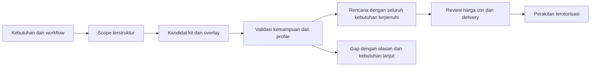

# Riset cakupan starter kit ARCHZXY / Archava

Ditinjau **10 Oktober 2026**, baseline repository `478ba43`.
Hasil ini merupakan katalog perencanaan, bukan release modul/kit yang terpasang.
[Data katalog](audit/2026-10-10-starter-kit-catalog.json) dan
[inventaris sumber](audit/2026-10-10-starter-kit-sources.json) menyimpan referensi,
status, komposisi kandidat, batas domain dan celah cakupannya.

[Validasi katalog/dokumen](audit/2026-10-10-starter-kit-validation.json) mencatat
pemeriksaan jumlah, ID/referensi, status kandidat, link dan format. Ini bukan test
operasional kit; runtime dan pricebook tidak diubah.

## Keputusan yang disarankan

Gunakan **40 keluarga starter kit** sebagai katalog discovery awal: **24 bisnis
umum + 16 sektor khusus**. Komposisinya memakai **20 kandidat kapabilitas bersama**
dan **10 dimensi konfigurasi/add-on**. Jumlah ini adalah keputusan desain ARCHZXY
dari analisis alur/ownership; tidak ada sumber yang menetapkan bahwa 40 adalah
jumlah minimum universal, atau bahwa seluruh bisnis pasti dapat dirakit darinya.

Tujuannya: permintaan bisnis yang masuk mempunyai jalur jelas menuju kit,
komposisi beberapa kit, integrasi authoritative system, atau celah yang tercatat.
Kemampuan yang belum tersedia tetap menjadi blocker. Tidak ada target cakupan
pasar 90/95/100% karena belum ada sampel permintaan dan pengukuran berbobot pasar.

Kit hotel memiliki operasi hotel; kit restaurant memiliki operasi restaurant.
CRM saat ini merupakan komponen yang dapat dipakai ulang. Delapan template aktif
di `config/templates.v1.json` mengatur perencanaan halaman/presence/capability dan
saran integrasi; delapan itu belum menjadi paket operasional lengkap.

## Metode dan kekuatan bukti

1. Pakai klasifikasi kegiatan ekonomi untuk mencari sektor yang terlewat. BPS
   KBLI 2025 memiliki 22 kategori, A–V, dan mengacu pada ISIC Rev.5. Klasifikasi
   ini mendeskripsikan kegiatan ekonomi, bukan kebutuhan software. [BPS](https://www.bps.go.id/id/news/2025/12/19/828/bps-rilis-klasifikasi-baku-lapangan-usaha-indonesia--kbli-.html),
   [UNSD](https://unstats.un.org/unsd/classifications/Econ/isic).
2. Bandingkan workflow yang didokumentasikan pemilik produk: commerce, scheduling,
   hotel/POS, rental, project, education, production, clinical, financial dan
   public-service systems. [Odoo industries](https://www.odoo.com/all-industries)
   merupakan pembanding katalog; [Medusa](https://docs.medusajs.com/learn/fundamentals/modules/commerce-modules)
   menunjukkan composition lewat public services/workflows.
3. Pisahkan kit ketika record owner, lifecycle atau invariants berubah. Sales
   properti dan pengelolaan lease dipisah; outpatient, inpatient dan diagnostic
   testing dipisah. Retail offline/online tetap satu keluarga dengan overlay
   channel; brand, bahasa dan tema UI tidak membuat kit baru.
4. Cocokkan kandidat dengan kode yang telah terbukti. Hanya slice
   `crm_contacts` dan `crm_sales_pipeline` punya bukti reuse bisnis lokal;
   lihat [acceptance profile 1.3.0](LOCAL_LIBRARY_RELEASE.md). Kandidat business
   capability lainnya belum menjadi implementasi hanya karena nama tercantum.
5. Catat residual gaps. Semua 22 kategori mempunyai disposition, tetapi banyak
   subsektor tetap membutuhkan discovery. Routing sektor tidak membuktikan
   operating coverage.

Ada **38 referensi resmi**: sembilan dokumen berhasil dibuka langsung, 29 melalui
cuplikan indeks resmi yang ditandai. Sebagian halaman Odoo timeout saat dibuka.
Halaman industri pemasaran mendukung keberadaan/penggambaran offering vendor,
bukan bukti interoperabilitas atau kualitas implementasi. Tidak ada wawancara
calon pengguna, benchmark vendor, live provider call, instalasi dependency,
perubahan harga atau perubahan runtime dalam riset ini.

Angka kelompok rinci KBLI pada siaran BPS dan kamus/buku berbeda (1.560/1.559);
riset ini tidak menyelesaikan selisih tersebut dan hanya memakai jumlah 22
kategori yang konsisten. Label sektor dalam crosswalk diringkas dari daftar isi
[buku KBLI 2025, halaman PDF 10–11](https://ppid.bps.go.id/upload/doc/Klasifikasi_Baku_Lapangan_Usaha_Indonesia_2025_1769138593.pdf).
Ini bukan konversi kode perizinan atau panduan kewajiban hukum.

## Dua tingkat cakupan

**Katalog discovery:** kita dapat menjelaskan kit yang relevan, kebutuhan yang
ditangani, resource owner, opsi komposisi dan celah yang belum didukung. Penamaan
40 keluarga memenuhi pekerjaan inventarisasi awal; bukan acceptance implementasi.

**Kit siap dirakit:** implementasi native atau adapter tersedia, kontrak/policy
tervalidasi, profile kompatibel, konfigurasi/readiness jelas, dan workflow punya
bukti operasional. Menambah manifest/folder kosong tidak memenuhi tingkat ini.

Saat riset dibuat, **0 dari 40 keluarga telah diterima sebagai kit operasional
lengkap**. Ini tidak menghapus acceptance shared library dan CRM slice yang sudah
selesai; denominator kit berbeda dari denominator paket/test/milestone sebelumnya.

## 24 keluarga bisnis umum

"Umum" berarti cocok dievaluasi untuk pasar komersial awal, bukan bebas aturan
khusus. Payroll, accounting lokal, minors/guardian access, offline POS dan
financial effects tetap mempunyai gate tersendiri. Semua baris berstatus
`research_candidate`; bagian yang dicantumkan adalah rancangan kebutuhan.

| ID  | Keluarga kit                               | Alur inti                                                               | Batas yang perlu dimiliki kit                           | Basis                                                                                                                                                                                                                                                                                                                                                              |
| --- | ------------------------------------------ | ----------------------------------------------------------------------- | ------------------------------------------------------- | ------------------------------------------------------------------------------------------------------------------------------------------------------------------------------------------------------------------------------------------------------------------------------------------------------------------------------------------------------------------ |
| K01 | Hotel, villa, homestay                     | Inquiry → reservation → stay → checkout                                 | room-night; stay/check-in-out; housekeeping             | [S11](https://www.odoo.com/industries/hotel), [S10](https://www.odoo.com/documentation/19.0/applications/sales/rental/rental_orders/pickup_return.html)                                                                                                                                                                                                            |
| K02 | Restaurant, cafe, food service             | Order → prepare → serve/pickup → settle                                 | table/service; kitchen routing; recipe/modifiers        | [S12](https://www.odoo.com/documentation/17.0/applications/sales/point_of_sale/restaurant/floors_tables.html), [S13](https://www.odoo.com/documentation/18.0/applications/sales/point_of_sale/preparation.html), [S32](https://www.odoo.com/documentation/19.0/applications/inventory_and_mrp/inventory/product_management/product_tracking/expiration_dates.html) |
| K03 | Retail dan e-commerce                      | Browse → order → allocate → fulfill → return                            | variant/checkout; return/exchange                       | [S05](https://docs.medusajs.com/learn/fundamentals/modules/commerce-modules), [S32](https://www.odoo.com/documentation/19.0/applications/inventory_and_mrp/inventory/product_management/product_tracking/expiration_dates.html)                                                                                                                                    |
| K04 | Distributor dan wholesale B2B              | Quote → confirmed order → procure/allocate → partial delivery → invoice | price list/UOM; partial supply/credit terms             | [S06](https://docs.frappe.io/erpnext/sales-order), [S19](https://docs.frappe.io/erpnext/delivery-trip)                                                                                                                                                                                                                                                             |
| K05 | Agency, studio, jasa proyek                | Lead → accepted scope → project → review → completion                   | deliverable acceptance; change request                  | [S08](https://www.odoo.com/documentation/saas-19.1/es/applications/services/project/project_management/project_milestones.html), [S35](https://www.odoo.com/industries/accounting-firm)                                                                                                                                                                            |
| K06 | Layanan profesional berbasis kasus         | Intake → engagement → restricted case work → review → close             | matter/engagement; document confidentiality/deadline    | [S35](https://www.odoo.com/industries/accounting-firm), [S36](https://www.odoo.com/industries/law-firm) — detail sebagian                                                                                                                                                                                                                                          |
| K07 | Salon, spa, appointment personal care      | Choose service → reserve staff/time → visit → completion                | practitioner/service duration; buffer/no-show           | [S07](https://www.odoo.com/documentation/19.0/applications/productivity/appointments.html)                                                                                                                                                                                                                                                                         |
| K08 | Gym, club, membership dengan kelas         | Enroll → membership → book class → check-in → renew                     | class passes; member check-in                           | [S34](https://www.odoo.com/industries/fitness-center), [S14](https://docs.stripe.com/billing/subscriptions/overview)                                                                                                                                                                                                                                               |
| K09 | SaaS dan produk digital berlangganan       | Signup → provision → usage → renew/change/cancel                        | seat/metering; digital provisioning                     | [S14](https://docs.stripe.com/billing/subscriptions/overview)                                                                                                                                                                                                                                                                                                      |
| K10 | Sewa kendaraan, alat, dan barang           | Reserve asset → handover → use → inspect return → settle                | handover/return; condition/deposit                      | [S10](https://www.odoo.com/documentation/19.0/applications/sales/rental/rental_orders/pickup_return.html)                                                                                                                                                                                                                                                          |
| K11 | Agency real estate dan penjualan properti  | Inquiry → viewing → offer → agreement reference                         | listing/viewing; offer/transaction reference            | [S18](https://www.odoo.com/industries/property-management), [S04](https://www.odoo.com/all-industries) — detail sebagian                                                                                                                                                                                                                                           |
| K12 | Pengelolaan sewa properti dan coworking    | Lease/reserve → occupancy → billing → maintenance → exit                | lease/occupancy; tenant/service charge                  | [S18](https://www.odoo.com/industries/property-management), [S10](https://www.odoo.com/documentation/19.0/applications/sales/rental/rental_orders/pickup_return.html)                                                                                                                                                                                              |
| K13 | Kursus, bootcamp, training cohort          | Apply → enroll → schedule → attend/assess → complete                    | enrollment/cohort; learning integration                 | [S15](https://docs.frappe.io/education/program-enrollment)                                                                                                                                                                                                                                                                                                         |
| K14 | Sekolah dan administrasi pendidikan formal | Admission → term enrollment → attendance/results → fees                 | academic year/term; guardian/student access; assessment | [S15](https://docs.frappe.io/education/program-enrollment)                                                                                                                                                                                                                                                                                                         |
| K15 | Event, ticketing dan venue                 | Plan → register/sell ticket → check-in → event → reconcile              | event capacity/ticket; registration/check-in            | [S16](https://www.odoo.com/documentation/19.0/applications/marketing/events/event_setup/create_events.html)                                                                                                                                                                                                                                                        |
| K16 | Tour, travel, dan aktivitas wisata         | Choose departure → reserve → confirm suppliers → operate → close        | departure/passenger; supplier allotment/itinerary       | [S04](https://www.odoo.com/all-industries), [S07](https://www.odoo.com/documentation/19.0/applications/productivity/appointments.html) — detail sebagian                                                                                                                                                                                                           |
| K17 | Teknisi, instalasi, layanan lapangan       | Request → assign → visit → work evidence → approval → invoice           | site visit/dispatch; work evidence/materials            | [S09](https://www.odoo.com/documentation/19.0/applications/services/field_service/planning_itinerary.html)                                                                                                                                                                                                                                                         |
| K18 | Bengkel dan servis barang                  | Receive asset → inspect/quote → repair → test → return                  | repair job/diagnosis; warranty/parts custody            | [S37](https://www.odoo.com/documentation/19.0/applications/inventory_and_mrp/repairs/repair_orders.html)                                                                                                                                                                                                                                                           |
| K19 | Laundry dan dry cleaning                   | Receive/count → tag → process → quality check → return                  | garment/item custody; processing batch/status           | [S30](https://www.cleancloudapp.com/api)                                                                                                                                                                                                                                                                                                                           |
| K20 | Gudang, fulfillment dan logistik barang    | Receive → store → pick/pack → dispatch → proof of delivery              | shipment/trip; stock owner/custody                      | [S19](https://docs.frappe.io/erpnext/delivery-trip), [S05](https://docs.medusajs.com/learn/fundamentals/modules/commerce-modules)                                                                                                                                                                                                                                  |
| K21 | Recruitment dan staffing agency            | Employer request → applicant → interview → placement → follow-up        | job/requisition/applicant; placement/assignment         | [S17](https://www.odoo.com/documentation/19.0/applications/hr/recruitment.html), [S33](https://docs.frappe.io/hr/payroll-entry)                                                                                                                                                                                                                                    |
| K22 | NGO, donasi dan asosiasi                   | Engage → pledge → verified donation → allocate/report                   | donor/campaign/fund allocation; member/grant            | [S21](https://docs.frappe.io/erpnext/donation)                                                                                                                                                                                                                                                                                                                     |
| K23 | Produksi sederhana dan made-to-order       | Order/demand → plan materials → produce → inspect → fulfill             | simple BOM/work order; materials/output                 | [S20](https://docs.frappe.io/erpnext/production-plan)                                                                                                                                                                                                                                                                                                              |
| K24 | Media, content studio dan penerbit         | Commission → produce → review → publish/distribute → track rights       | editorial approval; rights/content distribution         | [S02](https://ppid.bps.go.id/upload/doc/Klasifikasi_Baku_Lapangan_Usaha_Indonesia_2025_1769138593.pdf), [S08](https://www.odoo.com/documentation/saas-19.1/es/applications/services/project/project_management/project_milestones.html) — detail sebagian                                                                                                          |

Keluarga dapat digabung: hotel dengan restaurant dan spa memerlukan K01 + K02 +
K07. Gym yang menjual produk memakai K08 + K03. Kursus dengan subscription
menggabungkan K13 dan kontrak recurring yang sesuai. Gabungan tidak boleh
menduplikasi writable truth, stok, pembayaran atau identitas bisnis.

K06, K11, K16 dan K24 baru memiliki detail sebagian: daftar offering/classification
dan workflow terkait belum membuktikan seluruh case law, property transactions,
supplier travel atau publishing rights. Butuh domain discovery sebelum spesifikasi
eksekusi dibekukan. K09 mendukung rancangan subscription/provisioning interface;
tidak menjanjikan bahwa setiap produk SaaS sendiri dapat dibuat tanpa extension.

## 16 keluarga sektor khusus

Evaluasi **adapter ke sistem yang berwenang lebih dulu**. Generic foundation,
portal dan Archava interface dapat dipakai bersama; clinical/financial/industrial
truth tetap di backend yang disepakati. Adapter kandidat belum dihitung connected,
healthy atau supported.

| ID  | Keluarga kit                                 | Alur inti                                                                | Batas yang perlu dimiliki kit                                       | Basis                                                                                                                                                                                                                      |
| --- | -------------------------------------------- | ------------------------------------------------------------------------ | ------------------------------------------------------------------- | -------------------------------------------------------------------------------------------------------------------------------------------------------------------------------------------------------------------------- |
| K25 | Klinik dan dental outpatient                 | Register → appointment → encounter source → bill → follow-up             | patient/encounter integration; clinical consent/scope               | [S22](https://docs.frappe.io/erpnext/frappe-healthcare)                                                                                                                                                                    |
| K26 | Rumah sakit dan inpatient                    | Admit → allocate bed/service → care source → discharge → reconcile       | admission/bed transfer; discharge/care integration                  | [S22](https://docs.frappe.io/erpnext/frappe-healthcare)                                                                                                                                                                    |
| K27 | Lab diagnostik dan testing                   | Order → specimen → analyse source → validate → release report            | specimen/order chain; validated result release                      | [S23](https://fhir.hl7.org/fhir/diagnosticreport.html), [S22](https://docs.frappe.io/erpnext/frappe-healthcare)                                                                                                            |
| K28 | Apotek dan regulated health retail           | Receive lot → validate dispense source → supply → trace/recall           | batch/expiry/recall; dispensing authorization                       | [S24](https://www.gs1.org/1/gtinrules/en/healthcare), [S32](https://www.odoo.com/documentation/19.0/applications/inventory_and_mrp/inventory/product_management/product_tracking/expiration_dates.html) — detail sebagian  |
| K29 | Pertanian tanaman dan kehutanan              | Define productive unit → plan cycle → activities → harvest → trace       | land/crop/harvest cycle; yield/traceability                         | [S25](https://docs.frappe.io/erpnext/crop_cycle), [S02](https://ppid.bps.go.id/upload/doc/Klasifikasi_Baku_Lapangan_Usaha_Indonesia_2025_1769138593.pdf) — detail sebagian                                                 |
| K30 | Peternakan dan perikanan budidaya            | Define animal/cohort unit → care/feed → movement → harvest               | herd/pond/cohort; feed/health/harvest                               | [S02](https://ppid.bps.go.id/upload/doc/Klasifikasi_Baku_Lapangan_Usaha_Indonesia_2025_1769138593.pdf) — taxonomy saja                                                                                                     |
| K31 | Konstruksi, kontraktor dan EPC               | Contract → site work → change order → progress acceptance → close        | site/commitments; variation/progress claims                         | [S31](https://docs.oracle.com/construction-engineering/Prime_Open_Integration/PRIME/D144351.html)                                                                                                                          |
| K32 | Manufaktur industri dan regulated production | Demand → plan/routing → execute source → quality → release → trace       | MRP/routing/quality; lot genealogy/costing                          | [S20](https://docs.frappe.io/erpnext/production-plan), [S32](https://www.odoo.com/documentation/19.0/applications/inventory_and_mrp/inventory/product_management/product_tracking/expiration_dates.html) — detail sebagian |
| K33 | Pertambangan dan industri ekstraktif         | Plan site → operational source → production/quality → shipment           | site/production dispatch; extraction/quality/safety integration     | [S02](https://ppid.bps.go.id/upload/doc/Klasifikasi_Baku_Lapangan_Usaha_Indonesia_2025_1769138593.pdf) — taxonomy saja                                                                                                     |
| K34 | Utilitas listrik, gas dan air                | Connect service → measure source → validate usage → bill → service case  | meter/service point; usage validation/tariff                        | [S28](https://docs.oracle.com/en/industries/energy-water/customer-cloud-service/24a/ccs-overview-guide/CCS_OVERVIEW_24A/OUCCS_Overview_Guide.2.2.html)                                                                     |
| K35 | Pengelolaan limbah dan jasa lingkungan       | Service request → collect → weigh/classify → treatment source → evidence | collection/weight/material classification; manifest/treatment chain | [S02](https://ppid.bps.go.id/upload/doc/Klasifikasi_Baku_Lapangan_Usaha_Indonesia_2025_1769138593.pdf) — taxonomy saja                                                                                                     |
| K36 | Banking, lending dan layanan keuangan        | Verified intake → authoritative financial workflow → servicing/reconcile | account/loan integration; repayment allocation/ledger               | [S26](https://docs.frappe.io/lending/loan-repayment) — detail sebagian                                                                                                                                                     |
| K37 | Asuransi dan claims                          | Policy reference → loss intake → assess source → approved settlement     | policy coverage; loss/claim/settlement integration                  | [S27](https://docs.guidewire.com/cloud/in/20261/apiusage/PortalDevelopment/topics/c_submitClaim.html)                                                                                                                      |
| K38 | Marketplace dan transaksi multipihak         | Onboard seller → order → split/settle source → payout/dispute            | seller/account scopes; commission/payout/dispute                    | [S38](https://docs.stripe.com/connect)                                                                                                                                                                                     |
| K39 | Layanan publik dan administrasi pemerintahan | Application → verification → review/decision source → service/appeal     | constituent/permit/grant; records/decision workflow                 | [S29](https://www.servicenow.com/products/public-sector-digital-services.html), [S02](https://ppid.bps.go.id/upload/doc/Klasifikasi_Baku_Lapangan_Usaha_Indonesia_2025_1769138593.pdf) — detail sebagian                   |
| K40 | Residential care dan layanan sosial          | Referral → assessed intake source → care placement → review              | beneficiary/care-plan source; guardian/referral/placement           | [S02](https://ppid.bps.go.id/upload/doc/Klasifikasi_Baku_Lapangan_Usaha_Indonesia_2025_1769138593.pdf) — taxonomy saja                                                                                                     |

K30, K33, K35 dan K40 saat ini hanya punya dukungan taxonomy untuk keberadaan
sektor. Alur dan invariants yang ditulis merupakan hipotesis desain; belum ada
sumber operasional/domain expert yang cukup untuk menyatakan blueprint lengkap.
Keluarga lain juga memerlukan scope, provider, privacy, biaya dan acceptance
spesifik. Contoh evidence hanya membantu mengenali perbedaan domain:
[patient/encounter/inpatient](https://docs.frappe.io/erpnext/frappe-healthcare),
[diagnostic results](https://fhir.hl7.org/fhir/diagnosticreport.html),
[insurance claim](https://docs.guidewire.com/cloud/in/20261/apiusage/PortalDevelopment/topics/c_submitClaim.html),
dan [multi-party accounts/settlement](https://docs.stripe.com/connect).

## Kapabilitas bersama dan extension

Ini **20 label kandidat kapabilitas**, bukan perintah membuat 20 package baru
atau satu service per label. Batas implementasi diputuskan dari invariants dan
reuse. Contacts/pipeline tetap memakai implementasi existing; yang lain bertambah
secara incremental. Kandidat adalah referensi planning yang tidak didaftarkan
otomatis sebagai runtime module ID.

| Label kandidat           | Fungsi                                     | Status saat riset        |
| ------------------------ | ------------------------------------------ | ------------------------ |
| `crm_contacts`           | Kontak, aktivitas, follow-up               | Slice lokal diterima     |
| `crm_sales_pipeline`     | Peluang dan sales pipeline                 | Slice lokal diterima     |
| `organization_accounts`  | Account/perusahaan dan affiliation         | Belum diterima; kandidat |
| `catalog_products`       | Katalog produk/layanan                     | Belum diterima; kandidat |
| `commerce_orders`        | Pesanan, fulfillment/return references     | Belum diterima; kandidat |
| `inventory_quantities`   | Pergerakan/reservasi stok                  | Belum diterima; kandidat |
| `purchasing`             | Supplier, purchase/receipt                 | Belum diterima; kandidat |
| `invoicing`              | Invoice snapshot dan correction references | Belum diterima; kandidat |
| `payment_processing`     | Verified payment/settlement references     | Belum diterima; kandidat |
| `appointment_scheduling` | Resource/time/capacity scheduling          | Belum diterima; kandidat |
| `project_delivery`       | Proyek, task, milestone, review            | Belum diterima; kandidat |
| `proposals_scope`        | Scope/proposal version dan amendment       | Belum diterima; kandidat |
| `delivery_capacity`      | Capacity/queue/estimate evidence           | Belum diterima; kandidat |
| `asset_register`         | Asset identity/condition                   | Belum diterima; kandidat |
| `asset_maintenance`      | Maintenance work and history               | Belum diterima; kandidat |
| `subscriptions_usage`    | Recurring lifecycle/usage                  | Belum diterima; kandidat |
| `entitlements`           | Access/quota contract                      | Belum diterima; kandidat |
| `support_cases`          | Case/ticket routing dan status             | Belum diterima; kandidat |
| `fulfillment_dispatch`   | Custody, dispatch dan delivery evidence    | Belum diterima; kandidat |
| `attendance`             | Presence/attendance evidence               | Belum diterima; kandidat |

Foundation lintas kit: tenant/identity, authorization, audit/idempotency,
schema validation, secret handling, backup/restore, observability, files/notifications,
SDK/presence dan knowledge. Ketersediaan setiap foundation tetap mengikuti
implemented scope; daftar tersebut tidak menyatakan seluruh infrastructure selesai.

Setiap kit mengikat kontrak khusus: record owner, state transitions, forbidden
transitions, units/time, role/resource grants, supported config dimensions,
migrations/recovery, UI slots, action contracts dan source-of-truth adapter.
Kamar, patient, candidate pelamar dan sales contact tetap konsep berbeda.
Ekstensi membaca shared services melalui kontrak publik; tidak menulis tabel
internal module lain.

## Sepuluh dimensi yang mencegah ledakan kit

| Dimensi              | Contoh pilihan                                             | Batas                                                        |
| -------------------- | ---------------------------------------------------------- | ------------------------------------------------------------ |
| channel              | website, POS, mobile, marketplace, API                     | Offline writes/conflict recovery memerlukan gate tersendiri. |
| revenue              | one-time, project, recurring, usage, commission            | Verified financial/provider source wajib.                    |
| organization         | single/multiple locations, franchise, multi-company        | Tenant, legal entity dan branch bukan satu ID.               |
| audience             | customer, owner, employee, partner, guardian               | Server identity/resource scopes, bukan frontend role toggle. |
| product_constraints  | variant, serial, lot, expiry, units                        | Invariants/traceability harus tetap milik domain.            |
| capacity_constraints | staff/time, room-night, seat, asset, quantity              | Shared primitives boleh dipakai; rules tetap berbeda.        |
| localization         | language, currency, timezone, tax/accounting adapters      | Tidak menyatakan statutory localization tersedia.            |
| integration          | existing PMS/POS/ERP/accounting/clinical systems           | Adapter kandidat tidak dihitung sebagai connected/healthy.   |
| service_policy       | approval, cancellation, refund, warranty, support tier     | Policy config tidak dapat menambah authority.                |
| privacy_operation    | classification, retention/export, backups, deployment mode | Only supported contracts/profile; no invented compliance.    |

Ini menunjukkan cara menjaga jumlah kit terkendali. Hotel franchise multibahasa
tetap keluarga hotel dengan konfigurasi yang didukung; domain/regulatory change
dapat membutuhkan extension atau kit baru. Pilihan ini belum menjadi opsi
config yang dapat dikirim model/browser sekarang.

## Crosswalk sektor dan celah eksplisit

Kategori A–V berasal dari KBLI 2025. Mapping kit adalah inferensi ARCHZXY,
bukan klasifikasi resmi dan bukan klaim mendukung semua kegiatan dalam kategori.
Kandidat gabungan/admin interfaces tidak membuktikan dukungan operasi khusus.
U/V mendapat disposition yang jelas; tidak dipaksa masuk generic-business.

| Kategori                                 | Kandidat kit                           | Celah yang tetap perlu discovery                                                                       |
| ---------------------------------------- | -------------------------------------- | ------------------------------------------------------------------------------------------------------ |
| A — Pertanian, kehutanan, perikanan      | K29, K30                               | Wild capture fisheries, species/forestry-specific operations belum divalidasi.                         |
| B — Pertambangan                         | K33                                    | Operational extraction/assay/safety rules belum divalidasi.                                            |
| C — Industri                             | K23, K32                               | Continuous-process, MES dan quality-regulatory variants memerlukan backend khusus.                     |
| D — Energi                               | K34                                    | Grid/plant operation dan tariff-specific rules memerlukan backend khusus.                              |
| E — Air dan limbah                       | K34, K35                               | Treatment/remediation/hazardous-material rules belum divalidasi.                                       |
| F — Konstruksi                           | K17, K31                               | Heavy engineering, safety dan contract-claim variants belum divalidasi.                                |
| G — Perdagangan                          | K03, K04, K28, K38                     | Perishable/regulated product dan cross-border variants memerlukan extension.                           |
| H — Transportasi dan penyimpanan         | K20                                    | Passenger transport, airline/rail/port operations belum mempunyai kit tersendiri.                      |
| I — Akomodasi dan makan minum            | K01, K02                               | OTA/channel/restaurant-POS integration dan property variants belum terbukti.                           |
| J — Penerbitan/media/konten              | K09, K24                               | Broadcast distribution, royalties dan game/product engines perlu discovery.                            |
| K — Telekomunikasi/komputasi/informasi   | K05, K09, K38                          | Telecom OSS/BSS, cloud infrastructure control dan produk software khusus belum didukung.               |
| L — Keuangan/asuransi                    | K36, K37                               | Core banking, securities/investment dan actuarial/underwriting variants memerlukan integration khusus. |
| M — Real estat                           | K11, K12                               | Jurisdiction-specific property transactions belum divalidasi.                                          |
| N — Profesional/ilmiah/teknis            | K05, K06, K17, K27, K35                | R&D, technical testing dan regulated professional records memerlukan extension.                        |
| O — Penunjang usaha                      | K10, K12, K15, K16, K17, K21, K22, K38 | Security agencies, outsourced operations dan niche intermediaries perlu discovery.                     |
| P — Administrasi publik                  | K39                                    | Defence, social insurance dan sovereign identity/decision systems belum didukung.                      |
| Q — Pendidikan                           | K13, K14                               | Full SIS/LMS, statutory academic requirements dan learner protection perlu scope khusus.               |
| R — Kesehatan/sosial                     | K25, K26, K27, K28, K40                | Clinical/care records dan qualified decisions tetap milik authoritative systems.                       |
| S — Seni/olahraga/rekreasi               | K08, K15, K16                          | Museums/libraries, rights management dan gambling operations belum didukung.                           |
| T — Jasa lainnya                         | K07, K08, K18, K19, K22                | Religious/community/professional association variants perlu discovery.                                 |
| U — Rumah tangga untuk keperluan sendiri | Dedicated discovery / di luar scope    | Di luar target paket operasional bisnis; service providers dipetakan sesuai kegiatan komersialnya.     |
| V — Badan internasional                  | Dedicated discovery / di luar scope    | Dedicated discovery; mandate, privileges dan record obligations tidak diasumsikan.                     |

Passenger transport, telecom OSS/BSS, R&D, aviation, securities, museums/libraries,
royalty systems, hazardous materials dan defence menunjukkan mengapa jumlah
keluarga yang terbatas tidak dapat memberi jaminan "tidak pernah ada puzzle baru".
Catat kebutuhan tersebut sebagai unsupported sampai ada kontrak dan implementasi
yang dibuktikan; jangan menganggap keberadaan sector route menutup celahnya.

## Perilaku target Archava saat merakit

Alur berikut adalah rancangan, belum resolver baru yang dieksekusi:

1. Temukan workflow inti, actors/resources, channel, revenue, existing system dan
   kebutuhan yang wajib. Nama industri saja belum cukup.
2. Pilih kandidat kit, extension dan overlay. Model menghasilkan usulan scope;
   backend memvalidasi ID, kontrak, compatibility, dependencies dan conflicts.
3. Untuk setiap requirement, simpan hasil `supported_native`,
   `supported_adapter`, `needs_configuration`, `needs_extension`,
   `needs_integration`, `unsupported` atau `needs_domain_review`.
   Dua status supported memerlukan evidence/profile yang berlaku; config yang
   belum lengkap atau adapter belum healthy tetap menjadi blocker assembly.
4. Hanya requirement yang seluruhnya terpenuhi boleh menghasilkan
   `ready_to_assemble`. Missing critical requirement tidak boleh ditutupi
   pemilihan generic template. Ada manual-scope route yang transparan.
5. Rencana siap tidak memberi pricing/deployment/secret/action authority.
   Harga baru native kit yang belum ada di pricebook masuk manual review.
   Browser dan public visitor tetap mendapat safe projection tersendiri.
6. Bekukan scope/profile/pricebook evidence ketika disetujui. Perubahan scope
   berikutnya memakai perubahan terotorisasi; selection bukan hot-swap data.

Katalog riset di `docs/audit/` sengaja tidak dibaca runtime. Registry trusted dan
schema config existing tetap berlaku. Integrasi katalog ini ke configurator
memerlukan implementasi dan acceptance terpisah.

## Definisi kit selesai dan ukuran cakupan

Satu kit dapat dinyatakan siap hanya jika:

- Workflow dan batasnya ditulis; record owner, transitions dan roles jelas.
- Dashboard/API bekerja tanpa LLM; Archava memakai services/authorization sama.
- Minimal dua consumer/skenario memakai artifact yang sama tanpa fork dan
  tenant-name branches; domain variation yang diuji terdokumentasi.
- Happy path, refusal, concurrent/replay/recovery dan disable behavior terbukti.
- Persistent schema/migration dan upgrade/restore mempertahankan data/audit.
- Adapter/provider readiness serta unknown outcomes diuji pada target yang sesuai;
  fixture/mock tidak menjadi klaim live effect.
- Scope/unsupported variants, operasi, biaya, support owner dan handoff jelas.
- Exact supported release/config versions tercatat; existing gates tetap lulus.

Status bertahap: research candidate → scoped specification → implemented local →
reuse validated → operational pilot → production supported. Tiap tahap memerlukan
evidence; satu badge tidak menggantikan seluruh gate.

Ukur kebutuhan nyata yang dapat dipenuhi oleh artifact/profile yang diterima,
waktu integrasi, extension baru, failure/recovery dan maintenance burden.
Jangan melaporkan "24/40 kit = 60% seluruh pasar": family tidak berbobot sama,
hybrid workflows memerlukan kombinasi, dan requirement dalam satu family berbeda.

## Urutan pembangunan yang disarankan

Riset menyiapkan **seluruh katalog sekarang**. Implementasi mengikuti rilis
terbatas; urutannya dapat berubah mengikuti kebutuhan pelanggan yang tervalidasi.

| Gelombang | Scope kandidat                                                                                                           | Bukti yang harus keluar                                                                                                                  |
| --------- | ------------------------------------------------------------------------------------------------------------------------ | ---------------------------------------------------------------------------------------------------------------------------------------- |
| 1         | Delapan: K05 jasa proyek, K07 appointment, K03 retail, K02 restaurant, K01 hotel, K08 membership, K13 kursus, K10 rental | Selesaikan satu kit per rilis; operations, reuse dan tested composition. Pilih scope pertama dari workflow nyata.                        |
| 2         | Enam belas bisnis umum lainnya                                                                                           | Shared modules dipakai kembali; extension hanya untuk aturan yang berbeda; support/upgrade terdokumentasi.                               |
| 3         | Enam belas sektor khusus                                                                                                 | Native-versus-adapter ADR, domain validation dan scoped authoritative integration; tidak otomatis membangun full ERP/EHR/financial core. |

Delapan kandidat pertama mewakili project delivery, time slots, goods/orders,
food preparation, room-night, membership, enrollment dan asset custody. Ini
prioritas leverage desain, bukan hasil perhitungan market demand atau janji
tanggal delivery. K05 dekat dengan operasi ARCHZXY, tetapi website company tetap
dibangun di luar repository ini sebagai consumer.

**Must prepare now:** katalog, gap disposition, readiness vocabulary dan scope
kit pertama. **Should build next:** satu bounded kit dan kebutuhan kontraknya.
**Build later:** variasi/hybrid yang berulang dan adapter sektor khusus.
**Do not build yet:** 40 implementasi paralel, universal plugin/workflow engine,
atau automatic deployment yang menutupi missing capability.

## Referensi yang ditinjau

Inventory membedakan dokumen langsung dari cuplikan indeks resmi. Sumber mendukung
workflow/batas yang disebut, bukan jumlah 40, desain package kita, janji biaya
atau status support. Seluruh pembagian kit dan invariants tambahan adalah sintesis
ARCHZXY yang perlu divalidasi saat discovery.

- **S01 — BPS:** [Rilis KBLI 2025](https://www.bps.go.id/id/news/2025/12/19/828/bps-rilis-klasifikasi-baku-lapangan-usaha-indonesia--kbli-.html). 22 kategori ekonomi; taxonomy statistik tidak menentukan jumlah kit software. Akses: `official_indexed_excerpt`.
- **S02 — BPS:** [KBLI 2025, buku publikasi](https://ppid.bps.go.id/upload/doc/Klasifikasi_Baku_Lapangan_Usaha_Indonesia_2025_1769138593.pdf). Daftar isi kategori A–V (halaman PDF 10–11), batas kegiatan; crosswalk sektor, bukan verifikasi workflow. Akses: `primary_document`.
- **S03 — United Nations Statistics Division:** [ISIC Revision 5](https://unstats.un.org/unsd/classifications/Econ/isic). Klasifikasi kegiatan ekonomi; publikasi saat ditinjau masih dalam penyuntingan, bukan katalog solusi. Akses: `primary_document`.
- **S04 — Odoo:** [All industries](https://www.odoo.com/all-industries). Vendor mengelompokkan banyak industri dan varian; daftar vendor bukan bukti kesiapan Archava. Akses: `official_indexed_excerpt`.
- **S05 — Medusa:** [Commerce Modules](https://docs.medusajs.com/learn/fundamentals/modules/commerce-modules). Products, orders, inventory dan fulfillment dapat dikomposisi melalui services/workflows. Akses: `primary_document`.
- **S06 — Frappe:** [Sales Order](https://docs.frappe.io/erpnext/sales-order). Order-to-cash memisahkan confirmed order, delivery, invoice dan pembayaran. Akses: `official_indexed_excerpt`.
- **S07 — Odoo:** [Appointments 19.0](https://www.odoo.com/documentation/19.0/applications/productivity/appointments.html). Appointment memakai availability user/resource dan kapasitas. Akses: `official_indexed_excerpt`.
- **S08 — Odoo:** [Project milestones](https://www.odoo.com/documentation/saas-19.1/es/applications/services/project/project_management/project_milestones.html). Milestone berkaitan dengan task dan dapat menjadi dasar billing. Akses: `official_indexed_excerpt`.
- **S09 — Odoo:** [Field-service itinerary 19.0](https://www.odoo.com/documentation/19.0/applications/services/field_service/planning_itinerary.html). Kunjungan field service memiliki alamat, tanggal dan itinerary. Akses: `official_indexed_excerpt`.
- **S10 — Odoo:** [Rental pickup and return 19.0](https://www.odoo.com/documentation/19.0/applications/sales/rental/rental_orders/pickup_return.html). Reservasi, pickup/return dan tracking produk; physical goods dan service rental berbeda. Akses: `official_indexed_excerpt`.
- **S11 — Odoo:** [Hotel industry](https://www.odoo.com/industries/hotel). Hotel menawarkan operasi reservasi, room status/housekeeping dan channel integration; klaim vendor. Akses: `official_indexed_excerpt`.
- **S12 — Odoo:** [Restaurant floors and tables 17.0](https://www.odoo.com/documentation/17.0/applications/sales/point_of_sale/restaurant/floors_tables.html). Floor/table status dan order terkait meja; versi dokumentasi eksplisit. Akses: `official_indexed_excerpt`.
- **S13 — Odoo:** [Preparation display 18.0](https://www.odoo.com/documentation/18.0/applications/sales/point_of_sale/preparation.html). Order persiapan memiliki routing dan tahap kerja kitchen/display. Akses: `official_indexed_excerpt`.
- **S14 — Stripe:** [Subscription overview](https://docs.stripe.com/billing/subscriptions/overview). Subscription, invoice, payment dan akses mempunyai lifecycle terpisah. Akses: `primary_document`.
- **S15 — Frappe:** [Program Enrollment](https://docs.frappe.io/education/program-enrollment). Enrollment mengaitkan student, program/course, academic term dan fee. Akses: `primary_document`.
- **S16 — Odoo:** [Create events 19.0](https://www.odoo.com/documentation/19.0/applications/marketing/events/event_setup/create_events.html). Event mempunyai registration, attendee dan ticket/sponsor options. Akses: `official_indexed_excerpt`.
- **S17 — Odoo:** [Recruitment 19.0](https://www.odoo.com/documentation/19.0/applications/hr/recruitment.html). Applicant terkait job position dan recruitment stages. Akses: `official_indexed_excerpt`.
- **S18 — Odoo:** [Property Management](https://www.odoo.com/industries/property-management). Property listings, rental contracts dan recurring billing; klaim vendor. Akses: `official_indexed_excerpt`.
- **S19 — Frappe:** [Delivery Trip](https://docs.frappe.io/erpnext/delivery-trip). Trip memiliki vehicle/driver, delivery stops dan referensi delivery notes. Akses: `official_indexed_excerpt`.
- **S20 — Frappe:** [Production Plan](https://docs.frappe.io/erpnext/production-plan). Manufacturing menghubungkan demand, BOM, routing dan material procurement. Akses: `primary_document`.
- **S21 — Frappe:** [Donation](https://docs.frappe.io/erpnext/donation). Donor, donation dan payment entry/webhook memiliki hubungan eksplisit. Akses: `primary_document`.
- **S22 — Frappe:** [Healthcare / Marley Health](https://docs.frappe.io/erpnext/frappe-healthcare). Patient, encounter, inpatient, lab dan billing mempunyai workflow khusus; healthcare kini aplikasi terpisah. Akses: `primary_document`.
- **S23 — HL7:** [FHIR DiagnosticReport R5](https://fhir.hl7.org/fhir/diagnosticreport.html). Diagnostic report mengaitkan konteks, specimen, observations dan hasil; interoperabilitas bukan sertifikasi. Akses: `official_indexed_excerpt`.
- **S24 — GS1:** [Healthcare GTIN Allocation Rules](https://www.gs1.org/1/gtinrules/en/healthcare). Identity item bersama batch dan expiry mendukung traceability healthcare. Akses: `official_indexed_excerpt`.
- **S25 — Frappe:** [Crop Cycle](https://docs.frappe.io/erpnext/crop_cycle). Crop cycle mengaitkan land unit, crop, waktu dan project/tasks. Akses: `official_indexed_excerpt`.
- **S26 — Frappe:** [Loan Repayment](https://docs.frappe.io/lending/loan-repayment). Lending memiliki allocation principal/interest/fees dan repayment constraints, bukan invoice generik. Akses: `official_indexed_excerpt`.
- **S27 — Guidewire:** [Report and submit claims](https://docs.guidewire.com/cloud/in/20261/apiusage/PortalDevelopment/topics/c_submitClaim.html). Insurance claim mempunyai policy, loss-event type, detail dan submission boundary. Akses: `official_indexed_excerpt`.
- **S28 — Oracle:** [Utilities Customer Cloud Service overview](https://docs.oracle.com/en/industries/energy-water/customer-cloud-service/24a/ccs-overview-guide/CCS_OVERVIEW_24A/OUCCS_Overview_Guide.2.2.html). Utilities memisahkan customer/service orders, device/meter measurements, usage dan billing. Akses: `official_indexed_excerpt`.
- **S29 — ServiceNow:** [Public Sector Digital Services](https://www.servicenow.com/products/public-sector-digital-services.html). Public services mencakup case, permit, grant dan service-request workflows; klaim vendor. Akses: `official_indexed_excerpt`.
- **S30 — CleanCloud:** [Dry Cleaning and Laundry API](https://www.cleancloudapp.com/api). Order dapat memiliki individual garments/barcodes dan garment status. Akses: `official_indexed_excerpt`.
- **S31 — Oracle:** [Construction Change Orders integration](https://docs.oracle.com/construction-engineering/Prime_Open_Integration/PRIME/D144351.html). Perubahan approved contract/commitment mempunyai change-order API. Akses: `official_indexed_excerpt`.
- **S32 — Odoo:** [Expiration dates 19.0](https://www.odoo.com/documentation/19.0/applications/inventory_and_mrp/inventory/product_management/product_tracking/expiration_dates.html). Inventory perishable memakai lot/serial identity dan expiry. Akses: `official_indexed_excerpt`.
- **S33 — Frappe:** [Payroll Entry](https://docs.frappe.io/hr/payroll-entry). Payroll adalah proses tersendiri dengan employee/pay period dan salary-slip processing. Akses: `official_indexed_excerpt`.
- **S34 — Odoo:** [Fitness Center](https://www.odoo.com/industries/fitness-center). Membership, classes, appointments dan retail dapat dikomposisi; klaim vendor. Akses: `official_indexed_excerpt`.
- **S35 — Odoo:** [Accounting Firm](https://www.odoo.com/industries/accounting-firm). Client work menggabungkan projects/documents/invoicing; statutory accounting tidak dibuktikan. Akses: `official_indexed_excerpt`.
- **S36 — Odoo:** [Law Firm](https://www.odoo.com/industries/law-firm). Existence of specialized law-firm industry offering; detail domain perlu discovery. Akses: `official_indexed_excerpt`.
- **S37 — Odoo:** [Repair orders 19.0](https://www.odoo.com/documentation/19.0/applications/inventory_and_mrp/repairs/repair_orders.html). Return/repair/redelivery, serial identity, parts dan warranty mempunyai workflow khusus. Akses: `official_indexed_excerpt`.
- **S38 — Stripe:** [Connect](https://docs.stripe.com/connect). Platform/marketplace memodelkan beberapa akun dan perpindahan dana antar pihak. Akses: `primary_document`.
