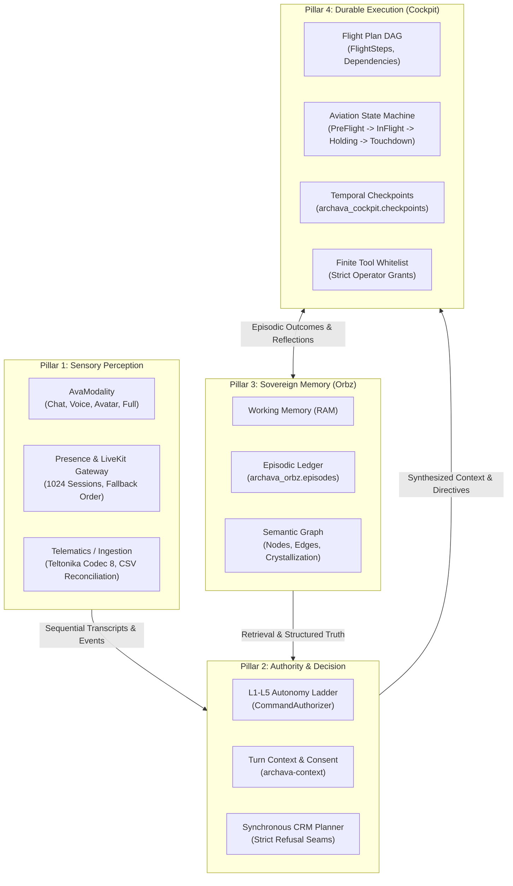

# Laya Agentic System: 4-Pillar Master Architecture

> **Status: authoritative architecture reference — October 2026.**
> Codifies the 4-pillar agentic cognitive architecture of Laya across the Archava Rust modular monolith.

---

## 1. Executive Thesis: Mengapa Laya Tidak Butuh Model Tambahan

Sebuah miskonsepsi umum dalam merancang autonomous AI agent adalah mengasumsikan bahwa kapabilitas agentic bertambah sebanding dengan jumlah model LLM yang diorkestrasi. Pada kenyataannya, menambahkan model LLM ekstra pada setiap layer menimbulkan:
1. **Latency Tax**: Setiap LLM turn-hop antar model menambahkan 800ms - 2500ms TTFT (Time to First Token).
2. **Context Drifting & Hallucination Cascade**: Ketika output reasoning model A disuapkan sebagai input ke model B, error probabilitas berlipat ganda (*exponential uncertainty*).
3. **Financial Invariant Violation**: Model generatif tidak boleh menjadi otoritas mutasi finansial atau double-entry ledger.

### Keputusan Arsitektur Archava:
Laya dioptimalkan dengan prinsip **Hybrid Cognitive Architecture**:
* **LLM Minimalist**: Satu fast foundational planner (e.g. `gemini-3.5-flash-lite` atau `gemini-2.5-flash`) yang dibatasi dengan **structured JSON schema enforcement** dan refusal grammar (`crates/providers/src/gemini.rs`).
* **Deterministic Native Compute**: Semua parsing, telemetry, graph traversal, RBAC/ABAC authorization, dan durable checkpoints dieksekusi 100% dalam native Rust compiled code (`archava-core`, `archava-domain`, `archava-cockpit`, `archava-orbz`).

---

## 2. Empat Pilar Laya (The 4-Pillar Architecture)



---

### Pilar 1: Sensory Perception Layer
* **Lokasi Source:** [`crates/domain/src/modality.rs`](../../crates/domain/src/modality.rs), [`crates/domain/src/presence.rs`](../../crates/domain/src/presence.rs), [`crates/providers/src/voice.rs`](../../crates/providers/src/voice.rs)
* **Tanggung Jawab:**
  * Memisahkan representasi sensori antara audio/WebRTC stream mentah dengan presence lifecycle.
  * Menegakkan **Presence Degradation Floor**: `Human` -> `Voice` -> `Chat` (degradasi hanya boleh ke bawah; `Chat` adalah floor mutlak).
  * Menjamin kapasitas 1024 concurrent sessions per tenant dengan sequential monotonic transcript digests (SHA-256).
  * Media mentah tetap terisolasi di standalone voice template; monolith hanya memproses structured transcript frames.

---

### Pilar 2: Authority & Decision Intelligence
* **Lokasi Source:** [`crates/domain/src/authority.rs`](../../crates/domain/src/authority.rs), [`crates/context/`](../../crates/context), [`crates/providers/src/gemini.rs`](../../crates/providers/src/gemini.rs)
* **Tanggung Jawab:**
  * Menegakkan tingkat otonomi sistem dari **L1** (Read Only / Observation) sampai **L5** (High-Risk Financial Mutation).
  * Setiap aksi mutatif memerlukan otorisasi berbasis membership session di PostgreSQL, bukan klaim payload request.
  * Mencegah jailbreak prompt injection dengan memperlakukan semua input user sebagai *untrusted text data*, bukan executable instructions.
  * **System 1 gate terpasang (shadow):** `crates/host/src/decision.rs` menjalankan `LayaDecisionProvider` + `DefaultOrchestrator` sekali per giliran `POST /api/crm/{tenant}/conversation` dalam `AssistMode::Shadow`. Ambang tindak **0.85** dan batas **25 opsi** ditegakkan oleh layer decision; setiap trace mencatat `would_apply`/`agreement` per task, dan jawaban yang berlaku tetap baseline — jadi gerbang ini mengukur dan tidak mengubah balasan. Promosi ke `Assist` adalah keputusan otoritas (task mana, floor berapa, tenant mana), bukan perubahan kode.

---

### Pilar 3: Sovereign Memory Engine (Orbz)
* **Lokasi Source:** [`crates/orbz/`](../../crates/orbz), [`migrations/orbz-pg/001_agentic_memory_orbz.sql`](../../migrations/orbz-pg/001_agentic_memory_orbz.sql)
* **Tanggung Jawab:**
  * Membagi memori menjadi tiga lapisan:
    1. **Working Memory**: In-memory context per turn interaksi.
    2. **Episodic Memory**: Riwayat interaksi, feedback operator, dan failure diagnosis yang tercatat di `archava_orbz.episodes`.
    3. **Semantic Graph**: Node entitas dan relasi graph yang mengkristal dengan pembobotan temporal decay.
  * Semua memory node terisolasi via PostgreSQL Row Level Security (RLS) per tenant; data klien A mustahil bocor ke klien B.

---

### Pilar 4: Durable Autonomous Execution (Ava Cockpit)
* **Lokasi Source:** [`crates/cockpit/`](../../crates/cockpit), [`migrations/cockpit-pg/001_cockpit_durable_missions.sql`](../../migrations/cockpit-pg/001_cockpit_durable_missions.sql), [`crates/host/src/cockpit.rs`](../../crates/host/src/cockpit.rs)
* **Tanggung Jawab:**
  * **DAG Formulation**: Work items disusun dalam Directed Acyclic Graph dengan step dependency checking yang deterministik.
  * **Aviation State Lifecycle**:
    $$\text{Pre-Flight} \longrightarrow \text{In-Flight} \rightleftarrows \text{Holding Pattern (L4 Gate)} \longrightarrow \text{Touchdown / Aborted}$$
  * **Human-in-the-Loop Holding Pattern**: Jika sebuah step membutuhkan persetujuan manusia (e.g. transfer uang di atas limit), mission masuk `HoldingPattern` dan menghasilkan `signal_key`. Eksekusi terhenti (0 token/compute cost) hingga di-resume dengan validasi sinyal yang tepat.
  * **Finite Tool Allowlist**: Eksekutor menolak sembarang command browser; hanya tool yang terdaftar di host registry dengan grant actor saat ini yang diizinkan jalan.

---

## 3. Matriks Optimasi Laya across Workspace

| Komponen | Implementasi Baseline | Optimasi Laya di Archava | Keuntungan |
| --- | --- | --- | --- |
| **Parsing & Percept** | LLM general parser | Rust zero-copy parser + SHA-256 fingerprint | 0 token cost, 0ms queue, zero hallucination |
| **Presence Gateway** | Stateful socket monolith | 1024-session gateway + LiveKit HMAC JWT token | Scalable WebRTC, clean fallback to Chat |
| **Cognitive Planning** | Multi-agent conversation loop | Single synchronous schema planner | 75% latency reduction, no conversational deadlock |
| **Memory Storage** | Cloud vector DB (Pinecone) | PostgreSQL RLS + JSONB + Orbz crystallizer | Single cluster, zero data leak, ACID compliance |
| **Task Execution** | ReAct loop tanpa checkpoint | Temporal checkpoints + OpenHands event stream | Crash-resilient, verifiable rollback |

---

## 4. Panduan Verifikasi & Testing
* Presence domain & provider:
  ```bash
  cargo test -p archava-domain --lib presence::tests
  cargo test -p archava-providers --test voice_transport
  cargo test -p archava-host --test presence_lifecycle --locked -- --test-threads=1
  ```
* System 1 decision gate (shadow) & layer decision:
  ```bash
  cargo test -p archava-context --lib
  cargo test -p archava-host --lib decision --locked -- --test-threads=1
  ```
* Cockpit durable execution & human gate:
  ```bash
  cargo test -p archava-cockpit --lib
  cargo test -p archava-host --test cockpit --locked -- --test-threads=1
  cargo test -p archava-host --test cockpit_hold_resume --locked -- --test-threads=1
  ```
