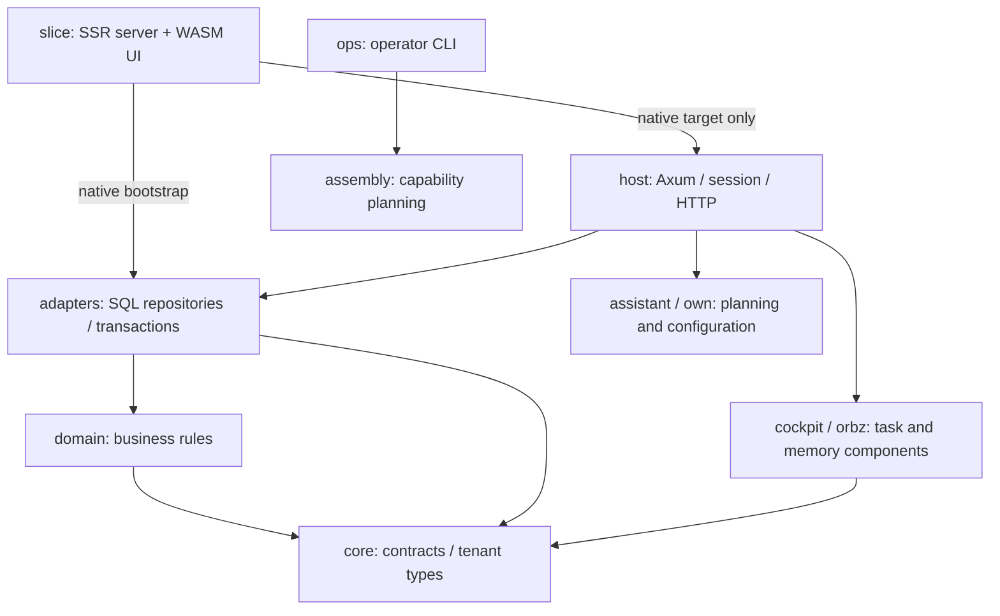

# Architecture

Archava is a modular Rust monolith: the root Cargo workspace contains 22 crates, and the application is assembled into the `archava-server` binary from `crates/slice`. Keeping the current code in these boundaries is more useful than splitting it into additional services for cosmetic reasons.

This document describes the source and entry points. It does not establish launch readiness, regulatory compliance, production latency, or completion of every domain's user workflow. The older aspirational blueprint is retained in [history](../archive/history/platform-2026-10-28/ARCHITECTURE.md).

## Dependency direction

Arrows below mean “depends on”.

`core` has no internal production dependency. `domain` depends on `core`; `adapters` depends on `core` and `domain`. HTTP and persistence must not leak into the portable business layers. `slice` imports the host and adapters only in its native target, keeping them out of the browser's WASM graph. The PostgreSQL fixture is a development dependency, not part of the production serving graph.

[tools/check-structure.mjs](../../tools/check-structure.mjs) enforces these key dependency rules, native-only UI/host binding, embedded-file paths, and active helper imports. It is a structural guard, not a complete semantic architecture audit.

## Ownership map

| Layer / purpose | Crates |
| --- | --- |
| Shared contracts | `core` |
| Business rules and portable planners | `domain`, `pricing`, `rates`, `assembly`, `capacity`, `assistant`, `own`, `context` |
| Database and provider infrastructure | `adapters`, `providers` |
| Task and memory components | `cockpit`, `orbz` |
| HTTP composition and authority | `host` |
| Product UI and server bootstrap | `slice` |
| Native bindings and operator CLI | `native`, `ops` |
| Protocols, evaluation, campaigns, browser automation | `mcp`, `evals`, `campaigns`, `rpa` |
| Test database lifecycle | `pg-fixture` |

A crate's existence does not mean the persistent host mounts all of its behavior. For example, the host directly composes `cockpit` and `orbz`, while the other protocol/automation crates have their own boundaries. Inspect [the router](../../crates/host/src/router.rs) and [server bootstrap](../../crates/slice/src/bin/archava_server.rs) for the actual mounted surface.

## Runtime and UI

The Leptos server renders the document and the browser hydrates the same view tree. The browser reads session-scoped HTTP APIs; it does not decide authorization. The host resolves session/grants and validates commands before tenant-bound transactions. All ERP and CRM persistence is unified inside `archava-adapters` under atomic `FORCE RLS` transactions (ADR-014, ADR-018). Existing receipt, idempotency, stale-revision, and uncertain-outcome contracts remain at those boundaries.

The current application includes sign-in, Home, Contacts, contact records, follow-up drafting, receipt recovery, Assistant, Settings, and a labelled Operations demo. Home derives a bounded first-page contact overview; it does not fabricate workspace-wide financial totals. See [the appearance guide](../design/WORKSPACE_APPEARANCE.md) for current composition and browser evidence.

The native server embeds migrations, shared styles, and selected assets. `target/site/pkg` holds the separately generated JS/WASM browser package. Changes to embedded assets or SQL require a native rebuild; changes to view markup require rebuilding both native and WASM targets.

## SQL ownership

All 38 SQL files are under `migrations/`, grouped by ledger. The owner migration is now `migrations/owner-pg/001_owner_config.sql`. Its migration ID, namespace, bytes, and checksum were preserved when its path changed.

The persistent bootstrap embeds its mounted files and the test fixture reads the same canonical directories. Migration files are append-only. Folder cleanup must not rename ledger identities, rewrite applied SQL, or imply that every ledger is mounted and every domain has a completed UI.

## Repository lifecycle

- Current code: root Cargo files, `crates/`, `migrations/`, `static/`, `config/`, and `deploy/`.
- Configuration ownership: `config/` holds the shared release/tooling catalogue; the pricing reference JSON lives in `crates/pricing/tests/fixtures/`; the retired template catalogue is in `docs/archive/history/config/`. The pricing engine accepts caller-supplied data rather than loading product prices from the repository.
- Current helpers: `tools/check-structure.mjs`, `tools/rust/{verify,build-slice,dev-slice,run-persistent}.mjs`, and `tools/release/sbom.mjs`.
- Removed TypeScript-era tooling and consumers: recoverable from git history, not part of the current gates.
- Current documentation entry points: `docs/README.md` and `docs/DEVELOPER_GUIDE.md`. Architecture, guides, modules, product planning, design, and archived records have six named subdirectories.
- Local database state/backups: ignored `.local/`. Generated compilation artifacts: ignored `target/`. These are not duplicate product layers and are not deleted as source cleanup.

## Maintenance priorities

Historical large coordinator files have been systematically decomposed into clean modular subtrees: `crates/host/src/router.rs` is decomposed into modular route trees under `crates/host/src/routes/` (ADR-015), `crates/host/src/crm.rs` persistence is extracted into `crates/adapters/src/crm.rs` (ADR-014), and CRM is normalized as a first-class domain of the ERP Monolith (ADR-018). The compile-time tripwire in `crates/host/src/extractors.rs` ensures all route extractions maintain strict extractor guarding.

The server bootstrap and fixture also carry parallel ledger-registration knowledge. Canonical file placement removes one path exception; it does not remove that registration duplication. A future shared typed ledger catalogue should be tested against migration IDs/checksums before replacing either reader.

The operator release verifier still expects the `dist/library` profile/artifact contract, while the current release workflow packages a native binary and site tarball. Aligning those contracts needs a dedicated release change and fresh evidence. Archiving old Node package verifiers does not close this gap.

See [the cleanup assessment](../archive/audits/ARCHAVA_REPOSITORY_CLEANUP_2026-10-29.md) for measured changes and the remaining work. The [build status](../archive/audits/BUILD_STATUS_2026-10-29.md) records the checks actually run for this pass.

## Subsystem references

These source maps distinguish implemented library behavior, host wiring and remaining proof.

| Document | Purpose |
| --- | --- |
| [COCKPIT_TASK_ARCHITECTURE.md](COCKPIT_TASK_ARCHITECTURE.md) | Mission state, host persistence, recovery and checkpoint limits |
| [DECISION_INTELLIGENCE.md](DECISION_INTELLIGENCE.md) | Decision policy, confidence floors, provider and host boundaries |
| [DURABLE_ACT_OPERATIONS.md](DURABLE_ACT_OPERATIONS.md) | Command receipts, pending state, recovery and provider composition |
| [ENTERPRISE_ENGINES.md](ENTERPRISE_ENGINES.md) | Ledger, tax, inventory, hardware, telematics and messaging components |
| [FRONTIER_AGENTIC_CRATES.md](FRONTIER_AGENTIC_CRATES.md) | MCP, evaluation, campaigns and RPA implementation boundaries |
| [ORBZ_MEMORY_ARCHITECTURE.md](ORBZ_MEMORY_ARCHITECTURE.md) | Memory tiers, access policy, reflection and persistence limits |

Earlier drafts are preserved byte for byte in [subsystem draft history](../archive/history/subsystem-drafts-2026-10-29/README.md). Current wording must follow source and dated evidence, rather than guarantees inferred from a crate or type name.

Serving persistence uses [fixed writer fencing](WRITE_FENCING.md) across product schemas; [native installation](../../deploy/NATIVE_INSTALL.md) owns operator drain, takeover and restore procedures.
