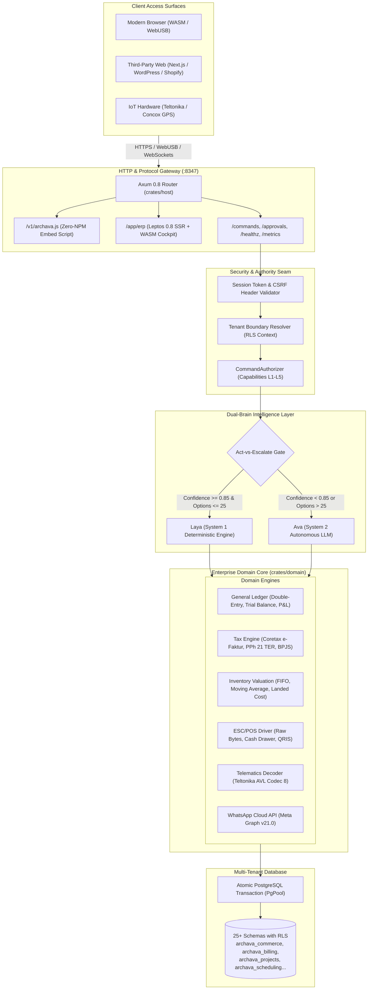
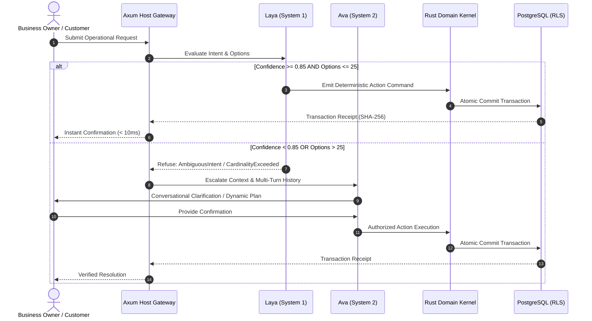

# Archava Technical Architecture & System Blueprint

> **Status:** Current Master Blueprint  
> **Release Profile:** 1.18.0 (Pure-Rust Kernel, Leptos 0.8 SSR/WASM, Dual-Brain AI)  
> **Authoritative Location:** `docs/ARCHITECTURE.md`

---

## 1. Architectural Philosophy & Invariants

Archava is built upon five non-negotiable architectural mandates:

1. **Zero-Mock Engineering:** Every calculation, financial equation, binary protocol parser, and regulatory formula must be mathematically authentic and executable under automated regression tests. No placeholder math or synthetic mocks.
2. **Deterministic Isolation:** Multi-tenancy is enforced at the database kernel via PostgreSQL Row-Level Security (`current_setting('archava.tenant_id')`). A query cannot accidentally read or leak cross-tenant records.
3. **Double-Entry Invariant:** All financial mutations balance debits against credits ($\sum \text{Debit} == \sum \text{Credit}$). Out-of-balance transactions are refused before disk commit.
4. **Assistant Proposes, Server Authorizes:** AI systems (Laya and Ava) never touch SQL pools or execute raw operations. The AI planner emits strongly-typed command submissions; the Rust kernel validates permissions, checks active membership scopes, stamps approvals, and executes within an atomic transaction.
5. **Dual-Brain Cognitive Separation:** High-frequency, deterministic decisions run through **Laya (System 1)** in sub-millisecond execution; ambiguous or complex strategic goals escalate to **Ava (System 2)**.

---

## 2. System Architecture Diagram



---

## 3. Dual-Brain Intelligence Layer: Laya vs. Ava

Production systems cannot afford unpredictable LLM behavior for routine transactions, nor can hardcoded regex trees handle nuanced human negotiations. Archava splits decision-making into two cognitive layers:

### The Act-vs-Escalate Workflow


### Cognitive Specifications
| Parameter | System 1: Laya | System 2: Ava |
| :--- | :--- | :--- |
| **Cognitive Mode** | Fast, pattern-matched, reflexive | Slow, analytical, contextual |
| **Latency** | $< 1\text{ ms}$ (pure deterministic evaluation) | $500\text{ ms} - 2\text{ s}$ (LLM stream) |
| **Cardinality Limit** | Optimal on $\le 25$ candidate actions | Unlimited arbitrary options |
| **Escalation Threshold** | Confidence score $< 0.85$ triggers escalation | Resolves ambiguity or asks user |
| **Hallucination Risk** | **0.0%** (mathematically closed action set) | Guarded by typed Tool Contracts |
| **Primary Code** | [`crates/context/src/decision/provider.rs`](../crates/context/src/decision/provider.rs) | [`crates/assistant/`](../crates/assistant/), [`crates/cockpit/`](../crates/cockpit/), [`crates/orbz/`](../crates/orbz/) |

---

## 4. Autonomous Agentic Core: Ava Cockpit & Ava Orbz

Beyond the basic Laya/Ava gateway, Archava deploys a state-of-the-art durable task engine and multi-layer memory architecture:

### 1. Ava Cockpit (`crates/cockpit`)
* **Task Metaphor:** Aviation lifecycle (`Pre-Flight` 🛫 ➡️ `In-Flight` ✈️ ➡️ `Holding Pattern` 🔄 ➡️ `Touchdown` 🛬 ➡️ `Aborted` 🛑).
* **Durable Execution:** Temporal.io-style checkpoints stored in PostgreSQL `archava_cockpit.checkpoints`. System crashes or reboots resume immediately without repeating completed flight steps.
* **Subagent Context Isolation:** Green thread workers process raw tool outputs and return 50:1 compressed `WorkerReport` summaries, eliminating LLM prompt context rot.
* **Holding Pattern Gate:** High-risk actions enter a holding pattern awaiting an authenticated signal key (via WhatsApp or webhooks).
* **Reference:** See [COCKPIT_TASK_ARCHITECTURE.md](COCKPIT_TASK_ARCHITECTURE.md).

### 2. Ava Orbz (`crates/orbz`)
* **Virtual URI Filesystem:** OpenViking-style URIs `orbz://{tenant}/{scope}/{category}/{resource}`.
* **Progressive Disclosure:** 3-tier progressive context rendering saving up to 63% in tokens (`L0Abstract` ~50 tokens, `L1Overview` ~500 tokens, `L2RawPayload` on-demand JSON).
* **Bi-Temporal Invalidation:** Graphiti-style `valid_from` and `valid_to` timestamps prevent using obsolete business facts or historical pricing.
* **Mathematical RLS:** Multi-tier authority gating (L1 to L5) guarantees sovereign executive memories never reach unauthorized staff or visitors.
* **Reference:** See [ORBZ_MEMORY_ARCHITECTURE.md](ORBZ_MEMORY_ARCHITECTURE.md).

---

## 4. Enterprise Domain Engines

### 1. General Ledger & Double-Entry Accounting
* **Rule:** An account is normal debit (Asset, COGS, Expense) or normal credit (Liability, Equity, Revenue).
* **Validation:**
  $$\sum \text{debits} == \sum \text{credits}$$
* **Journal Lifecycle:** `Draft` $\rightarrow$ `Posted` $\rightarrow$ `Reconciled` (or `Voided`).
* **Reporting Output:**
  * **Trial Balance:** Lists debit/credit sums per account.
  * **Balance Sheet:** Verifies $\text{Assets} == \text{Liabilities} + \text{Equity}$.
  * **Profit & Loss:** Computes $\text{Net Income} = \text{Revenue} - \text{COGS} - \text{Expenses}$.

### 2. Indonesian Regulatory Tax Engine
* **Coretax e-Faktur:**
  * Generates DJP compliant XML/JSON invoices.
  * NPWP format: 16 digits (NIK identity basis per PMK 136/PMK.03/2023).
  * VAT calculation: $11\%$ standard rate; dynamic $12\%$ switch.
* **PPh 21 TER (PP 58/2023 & PMK 168/2023):**
  * Evaluates PTKP status: TK/0 (Cat A), K/1 (Cat B), K/3 (Cat C).
  * Looks up bracket-based monthly withholding rate from gross pay in minor cents.
* **Pasal 17 Progressive True-Up:**
  * $0 - 60\text{M}: 5\%$
  * $60\text{M} - 250\text{M}: 15\%$
  * $250\text{M} - 500\text{M}: 25\%$
  * $500\text{M} - 5\text{B}: 30\%$
  * $> 5\text{B}: 35\%$
* **BPJS Statutory Splits:**
  * **BPJS Kesehatan:** $4\%$ employer / $1\%$ employee (wage cap: Rp 12.000.000).
  * **BPJS Ketenagakerjaan JHT:** $3.7\%$ employer / $2.0\%$ employee (uncapped).
  * **BPJS Ketenagakerjaan JP:** $2.0\%$ employer / $1.0\%$ employee (wage cap: Rp 10.042.300).
  * **JKK & JKM:** $0.24\% - 1.74\%$ and $0.30\%$ employer-funded.

### 3. Inventory Valuation & Landed Costing
* **FIFO Layer Queue:**
  * Inbound purchases push a layer `(qty, unit_cost_cents, received_at)`.
  * Outbound sales consume oldest layers first.
* **Moving Average Cost (MAC):**
  $$\text{New MAC} = \frac{(\text{Current Qty} \times \text{Current MAC}) + (\text{Incoming Qty} \times \text{Incoming Cost})}{\text{Current Qty} + \text{Incoming Qty}}$$
* **Landed Cost Allocation:**
  * Distributes shipping, customs, and duty costs across order items based on `ValueRatio`, `QuantityRatio`, or `WeightRatio`.
* **FEFO Expiry Sort:**
  * Perishables sorted by `expires_at ASC` before stock picking.

### 4. Hardware Thermal Receipt Driver (ESC/POS)
* Direct byte stream generator conforming to Epson specifications.
* Control bytes:
  * Initialize: `ESC @` (`[0x1B, 0x40]`)
  * Align Center: `ESC a 1` (`[0x1B, 0x61, 0x01]`)
  * Bold On/Off: `ESC E 1 / 0` (`[0x1B, 0x45, 0x01/0x00]`)
  * Double Height: `GS ! 1` (`[0x1D, 0x21, 0x01]`)
  * Cash Drawer Pulse: `ESC p 0 25 250` (`[0x1B, 0x70, 0x00, 0x19, 0xFA]`)
  * Paper Cut: `GS V 66 0` (`[0x1D, 0x56, 0x42, 0x00]`)
  * Native 2D QRIS: `GS ( k` Model 2 with error correction level M.

### 5. Fleet Telematics Protocol Engine
* **Teltonika AVL Codec 8:**
  * Big-endian binary frame parser.
  * Latitude & Longitude decoded as $\text{raw\_i32} / 10,000,000.0$.
  * IO elements: DIN1 (Ignition ID 239), AIN1 (Fuel Sensor ID 9), Total Odometer (CAN ID 16).
* **Concox GT06:**
  * Frame delimiters `0x78 0x78`, packet length, protocol number, GPS information bytes, terminal status.

---

## 5. Security & Permission Gates

Authority follows a five-tier capability ladder:
* **L1 (Query):** Read-only operations, reporting, inventory lookups.
* **L2 (Draft):** Creating uncommitted draft orders, proposal revisions.
* **L3 (Propose):** State transition proposals requiring workflow checks.
* **L4 (Transact):** Mutations that move inventory, commit journals, or issue invoices. Requires session token + matching CSRF header.
* **L5 (Authorize):** High-stakes operational mutations (e.g. refunding $> \text{Rp } 10.000.000$, deleting tenant records). **Never executes autonomously**; requires explicit bound human approval from the `archava_identity.approvals` table.

---

## 6. High-Speed Compiler Pipeline

To eliminate compilation bottlenecks during active development:
* **Linker:** `mold` 3.0.0 replaces single-threaded GNU `ld`, reducing link times from $15\text{ s}$ to $0.1\text{ s}$.
* **Cache:** `sccache` 0.19.0 caches compilation objects across workspace crates and branches.
* **Cargo Dev Profile:**
  ```toml
  [profile.dev]
  opt-level = 0
  debug = 1
  split-debuginfo = "unpacked"
  incremental = true

  [profile.dev.package."*"]
  opt-level = 2
  ```
  Result: Incremental rebuilds compile in **$70\text{ ms} - 150\text{ ms}$**.
