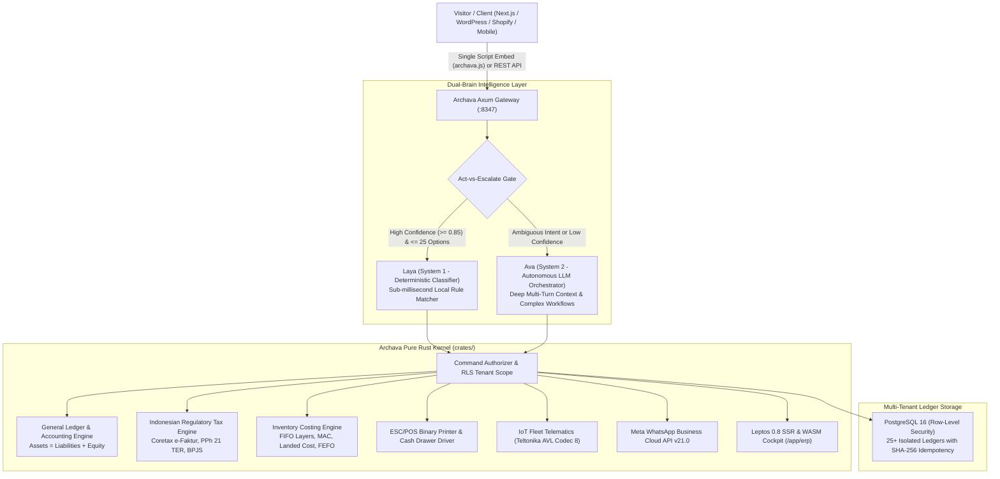

# Archava (by ARCHZXY)

[](Cargo.toml)
[](crates/host)
[](crates/slice)
[](crates/pg-fixture)
[]()

> **The Sovereign Autonomous ERP/CRM Platform & Real-Time Agentic Engine**  
> *Flagship Enterprise Product of ARCHZXY (`archzxy.com`)*

---

## 1. Executive Summary & Vision

**ARCHZXY** (`archzxy.com`) is the parent technology studio and ecosystem.  
**Archava** is its flagship enterprise software: an indestructible, memory-safe, 100% pure-Rust ERP/CRM engine paired with a **Dual-Brain Agentic Intelligence Architecture** (Laya System 1 + Ava System 2).

Archava bridges the gap between conversational AI avatars and mission-critical enterprise operations:
* **Customer-Facing:** A real-time, low-latency 3D/video avatar (Ava) that consults visitors, presents product catalogs, and conducts live checkout on the business owner's website.
* **Owner-Facing:** An AI-driven ERP cockpit where business owners operate complex business pillars (accounting, payroll, inventory, booking, laundry, telematics) via voice, natural text, or high-density reactive dashboards.
* **Industrial Backbone:** A high-throughput, compile-optimized Rust backend with strict double-entry ledger invariants, Indonesian Coretax/PPh 21 TER compliance, raw ESC/POS hardware control, and vehicle IoT telematics parsing.



---

## 2. Dual-Brain AI Architecture: Laya & Ava

Archava rejects naive single-prompt LLM wrappers. Production enterprise systems demand both deterministic speed and deep contextual reasoning. Archava implements Daniel Kahneman's Dual-Process cognitive architecture:

### System 1: Laya (The Reflexive Deterministic Decision Engine)
* **Role:** Sub-millisecond execution for known, high-frequency operational choices (e.g., menu categorizations, tenant routing, ticket assignments, status updates).
* **Guarantees:** Zero hallucinations, deterministic execution, and ultra-low cost.
* **Act-vs-Escalate Gate:** Operates optimally on $\le 25$ cardinality options. If intent confidence is $< 0.85$ or cardinality $> 25$, Laya refuses autonomously and escalates to Ava.
* **Location:** [`crates/context/src/decision/provider.rs`](crates/context/src/decision/provider.rs).

### System 2: Ava (The Reflective Autonomous Orchestrator)
* **Role:** Complex multi-turn negotiations, client consultation, multi-step contract drafting, and business problem-solving.
* **Architecture:** Operates via Gemini Realtime Voice WebRTC and deep LLM planners. Ava interfaces strictly through typed tool contracts and never touches database connections directly.

### Autonomous Agentic Execution & Frontier Systems
* **Ava Cockpit (`crates/cockpit`):** Autonomous Durable Flight & Task Engine synthesizing Temporal.io (immutable state checkpoints), LangGraph (state machine with Pre-Flight ➡️ In-Flight ➡️ Holding Pattern ➡️ Touchdown ➡️ Aborted), OpenHands (append-only event streams), and Claude Code (subagent context isolation with 50:1 token compression).
* **Ava Orbz (`crates/orbz`):** Sovereign Multi-Layer Agentic Memory Engine combining OpenViking (virtual URI filesystem `orbz://` with progressive L0/L1/L2 disclosure), Graphiti (bi-temporal fact invalidation), Letta (context paging & dreaming/reflection loops), and CoALA (4-quadrant cognitive taxonomy) strictly guarded by mathematical row-level security (RLS L1-L5).
* **Native Model Context Protocol (`crates/mcp`):** High-performance JSON-RPC 2.0 AAIF-standard server and gateway allowing frontier external models (Claude Desktop, Cursor, OpenAI) to safely query ledgers and trigger flights under RLS constraints.
* **Automated Evals & Red-Teaming Harness (`crates/evals`):** Continuous synthetic regression harness generating adversarial jailbreaks, ledger imbalance attacks, and privilege escalations with 0% data leakage tolerance.
* **Proactive Autonomous Campaigns (`crates/campaigns`):** Event-driven operational triggers (overdue AR debt with dynamic QRIS, low stock reorder POs) converted directly into Cockpit holding pattern flight missions.
* **Headless Vision & RPA Bridge (`crates/rpa`):** Sandboxed browser recipe automation for DJP Coretax e-Faktur downloads and corporate banking statement scraping with strict domain allowlists and credential masking.

---

## 3. Core Enterprise Engines (Zero-Mock Implementation)

All enterprise modules are 100% real, mathematically rigorous, and covered by comprehensive regression suites.

### 1. General Ledger & Double-Entry Accounting
* **IFRS / PSAK Compliant:** Enforces the fundamental invariant $\sum \text{Debit} == \sum \text{Credit}$ at the protocol level.
* **Standard Chart of Accounts (COA):** Pre-seeded with 5-digit enterprise accounts (10100 Cash, 10200 Bank BCA, 11100 AR, 12100 Inventory, 20100 AP, 21100 VAT Payable, 21200 PPh 21 Payable, 30100 Equity, 40100 Revenue, 50100 COGS).
* **Real-Time Financial Statements:** Dynamic generation of Trial Balance, Balance Sheet (`Assets = Liabilities + Equity`), and Profit & Loss statements.
* **Location:** [`crates/domain/src/erp/general_ledger.rs`](crates/domain/src/erp/general_ledger.rs).

### 2. Indonesian Regulatory & Coretax Engine
* **PPN (11% & 12%):** Dynamic VAT computation with official DJP Coretax XML/JSON e-Faktur schema generator supporting 16-digit NPWP (NIK-based format).
* **PPh 21 TER (Tarif Efektif Rata-Rata):** Full implementation of PMK 168/2023 & PP 58/2023 across Categories A, B, and C from gross income Rp 0 to hundreds of millions.
* **Pasal 17 Progressive True-Up:** Progressive annual tax calculation (5%, 15%, 25%, 30%, 35%) for December year-end reconciliation.
* **BPJS Statutory Contributions:** Exact statutory employer/employee splits and caps for BPJS Kesehatan (4% employer / 1% employee, cap Rp 12.000.000) and BPJS Ketenagakerjaan (JHT 3.7%/2%, JP 2%/1% cap Rp 10.042.300, JKK 0.24%-1.74%, JKM 0.3%).
* **Location:** [`crates/domain/src/erp/tax_indonesia.rs`](crates/domain/src/erp/tax_indonesia.rs).

### 3. Inventory Valuation & Landed Costing
* **FIFO Layer Cost Queue:** Real-time depletion queue ensuring oldest cost batches are cleared before newer layers.
* **Moving Average Cost (MAC):** Dynamic weighted-average cost adjustment upon purchase receiving.
* **Landed Cost Allocation:** Mathematical distribution of freight, customs, and insurance expenses across inbound purchase lines weighted by Value, Quantity, or Weight.
* **FEFO Expiry Prioritization:** First-Expired, First-Out queue sorting for pharmaceutical, clinic, and foodservice perishables.
* **Location:** [`crates/domain/src/erp/inventory_costing.rs`](crates/domain/src/erp/inventory_costing.rs).

### 4. Hardware ESC/POS Receipt Protocol
* **Raw Binary Command Serializer:** Generates Epson standard ESC/POS bytes (`ESC @`, `GS !`, `ESC a`, `GS V`).
* **Cash Drawer Kick Pulse:** Sends hardware pulse (`ESC p 0 25 250`) to trigger RJ11/RJ12 electronic cash drawers upon receipt cut.
* **Native 2D QRIS Generation:** Encodes dynamic QRIS payloads directly into native printer raster data without external canvas image rendering.
* **Location:** Native Rust generator ([`escpos.rs`](crates/domain/src/hardware/escpos.rs)) and embed runtime ([`archava.js`](static/archava.js)).

### 5. Real-Time IoT Fleet Telematics
* **Teltonika AVL Codec 8:** High-throughput big-endian binary frame decoder for FMB920, FMB120, and FMC130 GPS trackers. Extracts 7-decimal latitude/longitude, speed, satellites, ignition state (`DIN1`), fuel level (`AIN1`), and total CAN odometer.
* **Concox GT06 Protocol:** Binary tracking parser for commercial vehicle tracking units.
* **Location:** [`crates/domain/src/telematics/mod.rs`](crates/domain/src/telematics/mod.rs).

### 6. Omnichannel Meta WhatsApp Cloud Business API
* **Meta Graph API v21.0:** Strongly-typed builders for interactive templates (invoices, receipts, delivery confirmations) with IDR currency formatting.
* **Inbound Webhook Verification:** Real-time webhook parser handling delivery status receipts (`sent`, `delivered`, `read`, `failed`).
* **Location:** [`crates/domain/src/messaging/whatsapp.rs`](crates/domain/src/messaging/whatsapp.rs).

---

## 4. Repository Structure

```text
/home/haikaru/Archverse/Lab/Archava/
├── Cargo.toml                      # Master Rust Workspace Manifest
├── Cargo.lock                      # Pinned Reproducible Dependency Tree
├── rust-toolchain.toml             # Pinned Rust Compiler (1.88+)
├── crates/                         # Pure Rust Workspace Crates (22 Total)
│   ├── core/                       # Mathematical contracts, tenant types, & identifiers
│   ├── domain/                     # Pure domain business logic (Accounting, Tax, POS, IoT)
│   ├── adapters/                   # PostgreSQL repositories & RLS execution boundaries
│   ├── context/                    # Multi-tenant state, permissions, & Laya decision engine
│   ├── host/                       # Axum persistent HTTP server, routers, & webhooks
│   ├── slice/                      # Leptos 0.8 SSR / WASM universal web presentation
│   ├── pricing/                    # Deterministic pricebook & quoting engine
│   ├── rates/                      # Tax & FX exchange rate math
│   ├── assembly/                   # Product capability planner & dependency solver
│   ├── capacity/                   # Resource calendar & booking allocation
│   ├── assistant/                  # System 2 conversational intent router
│   ├── cockpit/                    # Ava Cockpit: Autonomous Durable Flight & Task Engine
│   ├── orbz/                       # Ava Orbz: Sovereign Multi-Layer Agentic Memory Engine
│   ├── mcp/                        # Native Model Context Protocol (MCP) server & client gateway
│   ├── evals/                      # Synthetic evals & adversarial red-teaming harness
│   ├── campaigns/                  # Proactive operations & autonomous campaign planner
│   ├── rpa/                        # Vision RPA & headless browser bridge with security sandbox
│   ├── own/                        # Owner lifecycle & configuration manager
│   ├── providers/                  # Outbound LLM & Postmark execution ledgers
│   ├── ops/                        # Operator CLI binary (archava-ops)
│   ├── native/                     # System native extensions & platform bindings
│   └── pg-fixture/                 # Owned disposable PostgreSQL integration test fixture
├── migrations/                     # 25+ Database Ledgers (Schema Migrations)
├── static/                         # Static Web Assets (archava.js, fonts, CSS)
├── config/                         # Runtime JSON configurations (pricing, templates)
├── deploy/                         # Production Deployment (systemd, Docker, Caddy)
├── docs/                           # Master Engineering Documentation Suite
└── tools/                          # High-performance developer & operational scripts
```

---

## 5. High-Performance Developer Setup

Thanks to modern linker and caching tuning (`mold` + `sccache`), incremental development rebuilds compile in **sub-second speed (~100ms)**:

### Prerequisites
* Rust 1.88+ (`rustup toolchain install stable`)
* `mold` 3.0.0 (High-Speed Linker) & `sccache` (Compiler Cache)
* PostgreSQL 16+

### Setup on Arch Linux / Ubuntu
```bash
# Arch Linux
sudo pacman -S mold clang sccache

# Ubuntu / Debian
sudo apt install mold clang
cargo install sccache
```

### Fast Verification Commands
```bash
# 1. Run all Rust domain tests (156 unit tests in ~0.1s!)
cargo test -p archava-domain --lib

# 2. Run all Rust host tests (63 unit tests)
cargo test -p archava-host --lib

# 3. Run all Pricing & Rate tests (56 unit tests)
cargo test -p archava-pricing

# 4. Run strict Clippy (Zero warnings enforced)
cargo clippy --workspace --all-targets -- -D warnings

# 5. Check code formatting
cargo fmt --all --check

# 6. Run the Archava Server
cargo run --bin archava-server
```

---

## 6. Third-Party Web Integration (The Stripe.js Pattern)

Third-party websites (Next.js, React, Vue, WordPress, Shopify, Laravel) can embed Archava without installing heavy npm dependencies:

```html
<!-- Include single lightweight script directly from Archava host -->
<script src="https://api.archzxy.com/v1/archava.js"></script>

<script>
  // Initialize with tenant slug
  const archava = Archava('tenant_dr_kevin');

  // Trigger high-performance modal checkout
  function payInvoice() {
    archava.openCheckout({
      orderId: 'INV-20261028-001',
      amountCents: 15000000, // Rp 150.000
      onComplete: (receipt) => alert('Payment completed successfully!'),
      onCancel: () => console.log('Checkout dismissed')
    });
  }

  // Or mount an inline interactive cockpit into any container
  archava.mount('#archava-dashboard', { view: 'erp', height: '750px' });
</script>
```

For complete integration details, read the [Integration Guide](docs/INTEGRATION_GUIDE.md).

---

## 7. License & Ecosystem Governance

* **Parent Ecosystem:** [ARCHZXY](https://archzxy.com)
* **License:** Proprietary enterprise distribution. All rights reserved by ARCHZXY.
* **Security & Audits:** Managed under [docs/audit/](docs/audit/).
