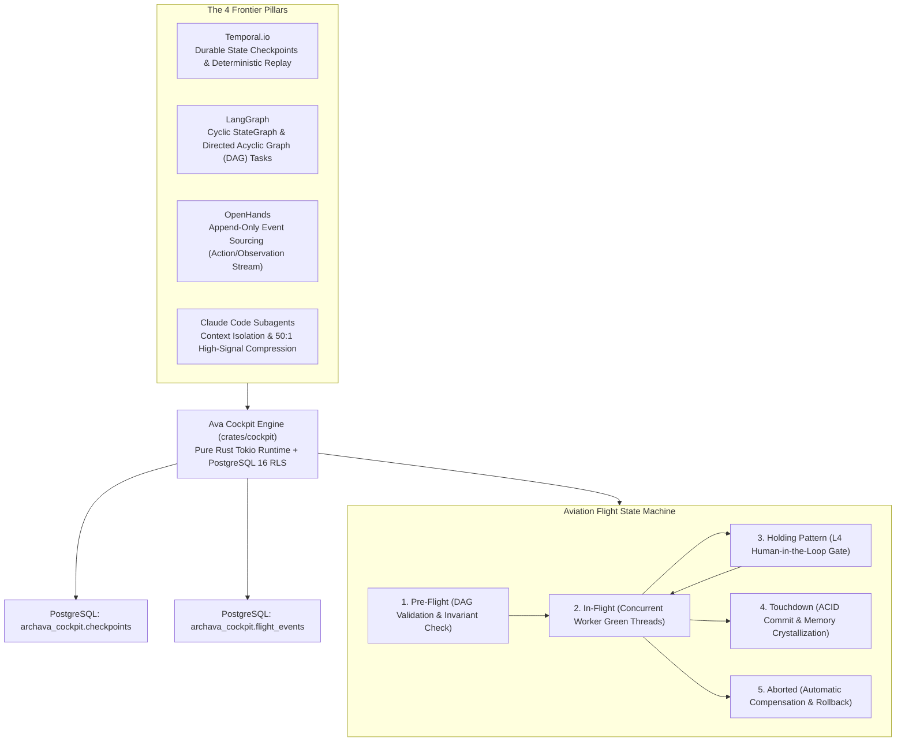
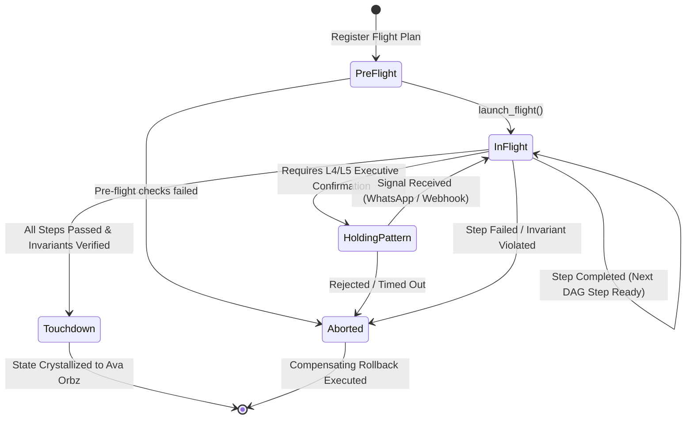

# Ava Cockpit: The Autonomous Durable Task & Flight Execution Engine

> **Unified State-of-the-Art Task Orchestration for Archava**  
> *Synthesizing Temporal.io (Durable Execution), LangGraph (StateGraph), OpenHands (Event Sourcing), and Claude Code (Context Isolation) into Pure Rust + PostgreSQL 16.*

---

## 1. Executive Synthesis & Architectural DNA

In enterprise multi-tenant software, naive agentic task management (such as basic Kanban boards, sequential ReAct loops, or unbounded terminal scripts) collapses under real-world pressure:
1. **Context Pollution & Context Rot:** When an agent attempts complex 10-step tasks in a single prompt window, tool outputs, stack traces, and database records pollute the context, causing catastrophic hallucinations and exponentially higher token costs.
2. **Crash Fragility:** If a network blip or process restart occurs mid-transaction, standard agents either restart from scratch (re-running costly side-effects like credit card charges or email dispatches) or abandon the work in a corrupt state.
3. **Lack of Human-in-the-Loop Authority Gates:** Unsupervised autonomous execution of high-risk actions (e.g., supplier wire payouts > Rp 50.000.000, filing Indonesian Coretax e-Faktur, or applying destructive schema changes) is unacceptable to business owners.

**Ava Cockpit** (`crates/cockpit`) solves these challenges by combining the four frontier paradigms into a single, high-throughput, pure-Rust execution engine:



---

## 2. Competitive Architectural Comparison

| Dimension | Hermes Agent (Kanban) | Claude Code (Subagents) | Temporal.io Workflows | **Ava Cockpit (`crates/cockpit`)** |
| :--- | :--- | :--- | :--- | :--- |
| **Language & Runtime** | Python / SQLite | TypeScript / Node.js CLI | Go / Java / Rust SDK | **Pure Rust 1.88+ / Tokio Green Threads** |
| **Architecture Metaphor** | Kanban Cards (`todo`, `doing`, `done`) | Browser-tab context subprocesses | Distributed Saga Workflow | **Aviation Flight Operations (`Pre-Flight` ➡️ `Touchdown`)** |
| **Context Management** | Flat prompt accumulation | Context window isolation per subagent | State passed via workflow input | **Context Isolation with 50:1 High-Signal Compression** |
| **State Durability** | SQLite database file | Ephemeral CLI session memory | Event history database | **PostgreSQL 16 RLS Checkpoints + Event Sourcing** |
| **Human Approval** | Canned interactive CLI pause | Terminal prompt `[y/N]` | External Signal Channel | **Holding Pattern with Asynchronous Signal Keys (WhatsApp/Webhook)** |
| **Multi-Tenancy** | Single-user local process | Single-user local developer CLI | Multi-tenant cluster | **Native Multi-Tenant RLS Kernel with Zero Cross-Tenant Leakage** |
| **Financial Safety** | Zero transactional rollback | No ACID guarantees | Compensating transactions | **ACID PostgreSQL Rollbacks + Immutable Event Streams** |

---

## 3. The Aviation Flight State Machine

Ava Cockpit replaces flat kanban boards with an **aviation metaphor** that reflects the seriousness of enterprise business operations:



### 1. `PreFlight`
- Evaluates the Directed Acyclic Graph (DAG) of the mission.
- Checks topological dependencies between flight steps (`depends_on_steps`).
- Verifies system invariants and tenant subscription entitlements.

### 2. `InFlight`
- Dispatches ready flight steps to isolated subagent worker green threads.
- Processes tasks concurrently where DAG dependencies permit.
- Streams live action and observation events to `flight_events`.

### 3. `HoldingPattern` (The Human-in-the-Loop Airspace)
- When a task touches high-risk operational territory (payments > Rp 50.000.000, inventory disposal, contract execution), Ava halts the flight.
- Ava enters `HoldingPattern` and emits an interactive notification (e.g., via Meta WhatsApp Business Cloud API or the Leptos owner dashboard).
- The mission stays safely parked until an authenticated human sends a resumption signal matching `signal_key`.

### 4. `Touchdown`
- Reached strictly when $100\%$ of DAG steps have succeeded and all financial/operational invariants pass verification.
- Triggers database transaction commit.
- Crystallizes procedural insights into **Ava Orbz** (`archava_orbz.trajectories`).

### 5. `Aborted`
- Triggered immediately upon unrecoverable subagent failure, explicit user rejection during `HoldingPattern`, or integrity violations.
- Executes automatic compensating actions and preserves complete diagnostic telemetry.

---

## 4. Subagent Context Isolation & 50:1 Compression

Context rot is the #1 killer of autonomous agents. Ava Cockpit adapts **Claude Code's subagent isolation pattern**:

```text
+-----------------------------------------------------------------------------------+
| Ava Master Cockpit Context (High-Level Strategic Invariants & Flight Plan)         |
+-----------------------------------------------------------------------------------+
      |                                              ^
      | Spawns Isolated Green Thread                | Injects 50:1 Condensed Summary
      v                                              |
+----------------------------------------------------+------------------------------+
| Subagent Worker Context (Clean 200k Token Window)                                  |
| - Tool: invoice.extract_line_items                                                |
| - Executes OCR, parses 150 item lines, matches taxes, generates 12kb raw JSON     |
| - Generates WorkerReport:                                                         |
|     success: true                                                                 |
|     high_signal_summary: "Extracted 150 lines from INV-902, Total Rp 45.200.000"  |
|     output_payload: { raw_json_stored_in_durable_checkpoint }                     |
+-----------------------------------------------------------------------------------+
```

### Data Compression Guarantee:
- The master context receives only `high_signal_summary` (approx. 50 tokens), avoiding the thousands of tokens generated by raw subagent tools.
- The raw output payload is safely stored in `archava_cockpit.checkpoints`, accessible on-demand when downstream steps explicitly declare a dependency.

---

## 5. PostgreSQL Schema Definition

Located in [`migrations/cockpit-pg/001_cockpit_durable_missions.sql`](file:///home/haikaru/Archverse/Lab/Archava/migrations/cockpit-pg/001_cockpit_durable_missions.sql):

```sql
CREATE SCHEMA IF NOT EXISTS archava_cockpit;

-- 1. Missions Table
CREATE TABLE IF NOT EXISTS archava_cockpit.missions (
    id UUID PRIMARY KEY DEFAULT gen_random_uuid(),
    tenant_id VARCHAR(64) NOT NULL,
    mission_code VARCHAR(64) NOT NULL,
    title VARCHAR(255) NOT NULL,
    description TEXT NOT NULL,
    status VARCHAR(32) NOT NULL DEFAULT 'pre_flight',
    holding_reason TEXT,
    signal_key VARCHAR(128),
    created_at TIMESTAMPTZ NOT NULL DEFAULT NOW(),
    updated_at TIMESTAMPTZ NOT NULL DEFAULT NOW()
);

-- 2. Flight Steps (DAG Elements)
CREATE TABLE IF NOT EXISTS archava_cockpit.flight_steps (
    id UUID PRIMARY KEY DEFAULT gen_random_uuid(),
    mission_id UUID NOT NULL REFERENCES archava_cockpit.missions(id) ON DELETE CASCADE,
    step_index INT NOT NULL,
    step_name VARCHAR(128) NOT NULL,
    tool_target VARCHAR(128) NOT NULL,
    payload_input JSONB NOT NULL DEFAULT '{}',
    payload_output JSONB,
    status VARCHAR(32) NOT NULL DEFAULT 'pending',
    depends_on_steps INT[] NOT NULL DEFAULT '{}',
    subagent_role VARCHAR(64) NOT NULL,
    isolated_context_summary TEXT,
    error_message TEXT,
    created_at TIMESTAMPTZ NOT NULL DEFAULT NOW(),
    updated_at TIMESTAMPTZ NOT NULL DEFAULT NOW(),
    UNIQUE(mission_id, step_index)
);

-- 3. Flight Event Stream (OpenHands Event Sourcing)
CREATE TABLE IF NOT EXISTS archava_cockpit.flight_events (
    id UUID PRIMARY KEY DEFAULT gen_random_uuid(),
    mission_id UUID NOT NULL REFERENCES archava_cockpit.missions(id) ON DELETE CASCADE,
    sequence_num BIGINT NOT NULL,
    event_type VARCHAR(64) NOT NULL,
    actor VARCHAR(64) NOT NULL,
    payload JSONB NOT NULL,
    emitted_at TIMESTAMPTZ NOT NULL DEFAULT NOW()
);

-- 4. Durable State Checkpoints (Temporal.io Pattern)
CREATE TABLE IF NOT EXISTS archava_cockpit.checkpoints (
    id UUID PRIMARY KEY DEFAULT gen_random_uuid(),
    mission_id UUID NOT NULL REFERENCES archava_cockpit.missions(id) ON DELETE CASCADE,
    current_step_index INT NOT NULL,
    step_outputs JSONB NOT NULL DEFAULT '{}',
    snapshot_timestamp BIGINT NOT NULL,
    created_at TIMESTAMPTZ NOT NULL DEFAULT NOW(),
    UNIQUE(mission_id)
);
```

---

## 6. Live HTTP & Axum Router Surface

Mounted in [`crates/host/src/cockpit.rs`](file:///home/haikaru/Archverse/Lab/Archava/crates/host/src/cockpit.rs):

### 1. `POST /api/v1/cockpit/missions`
Creates a new mission flight plan with topological dependency steps.
- **Headers:** `Authorization: Bearer <session_token>`, `x-archava-csrf: <csrf_token>`.
- **Payload:**
```json
{
  "tenant_id": "acme-corp",
  "mission_code": "TAX-RECONCILE-2026-Q1",
  "title": "Quarterly Coretax e-Faktur Reconciliation",
  "description": "Cross-references purchase ledger against DJP VAT records",
  "steps": [
    {
      "step_index": 1,
      "step_name": "Fetch Purchase Invoices",
      "tool_name": "billing.query_invoices",
      "payload_input": { "period": "2026-Q1" },
      "depends_on": []
    },
    {
      "step_index": 2,
      "step_name": "Match DJP e-Faktur XML",
      "tool_name": "tax.match_coretax_xml",
      "payload_input": {},
      "depends_on": [1]
    }
  ],
  "auto_launch": true
}
```

### 2. `GET /api/v1/cockpit/missions/{id}`
Returns live flight status, completed steps, current active step, holding reason (if in holding pattern), and checkpoint timestamp.

### 3. `POST /api/v1/cockpit/missions/{id}/steps/{step_index}/complete`
Submits a `WorkerReport` from an isolated subagent worker, updating durable checkpoints and unlocking dependent DAG steps.

### 4. `POST /api/v1/cockpit/missions/{id}/abort`
Gracefully aborts flight operations, records the abort reason, and emits cancellation events.
