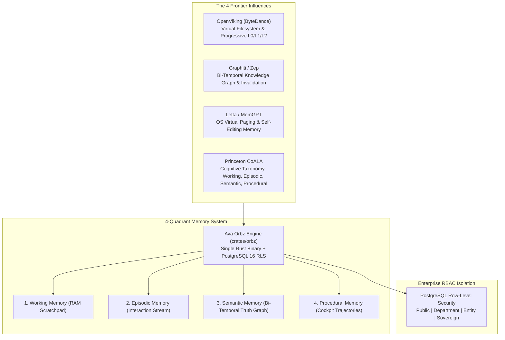
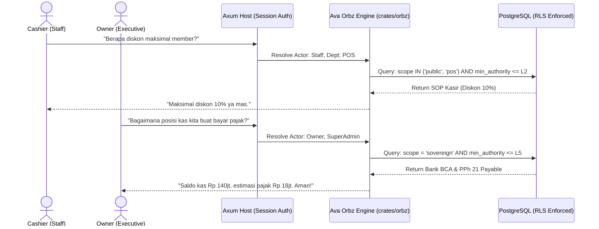

# Ava Orbz: The Sovereign Multi-Layer Agentic Memory Architecture
> **Unified State-of-the-Art Memory Synthesis for Archava**  
> *Combining OpenViking, Graphiti (Zep), Letta (MemGPT), and Princeton's CoALA into a Pure Rust + PostgreSQL 16 Engine.*

---

## 1. Executive Synthesis & Architectural DNA

Traditional AI agent memory is broken: dumping conversation histories into flat vector databases (naive RAG) causes context fragmentation, token bloat, temporal contradictions, and catastrophic security leaks in multi-user enterprise software.

**Ava Orbz** synthesizes the best four frontier agentic memory breakthroughs into one cohesive, indestructible Pure Rust engine:



### The 4 Borrowed Breakthroughs:
1. **From OpenViking:** Virtual URI filesystem (`orbz://`) and **Tiered Progressive Disclosure** (L0 Summary $\to$ L1 Overview $\to$ L2 Raw Details), reducing token consumption by up to 63%.
2. **From Graphiti (Zep):** **Bi-Temporal Knowledge Invalidation** (`valid_from`, `valid_to`, `superseded_by`). Prevents historical state conflicts (e.g., when a vendor updates a price or a customer changes addresses).
3. **From Letta (MemGPT):** **OS-Inspired Context Paging** via internal tools (`orbz_page_in`, `orbz_crystallize`) and asynchronous background **Consolidation Loops** ("Dreaming").
4. **From CoALA (Princeton):** Formal cognitive division into **Working, Episodic, Semantic, and Procedural** memory.

---

## 2. The 4 Cognitive Memory Quadrants

| Quadrant | Storage Backend | Lifecycle | Description |
| :--- | :--- | :--- | :--- |
| **1. Working Memory** | Rust `Arc<RwLock<ActiveTask>>` | Session / Transient | Active scratchpad, current Cockpit mission status, intermediate tool outputs. |
| **2. Episodic Memory** | PostgreSQL `archava_orbz.episodes` | Append-Only Log | Time-series interaction history, user dialogues, chronological audit records. |
| **3. Semantic Memory** | PostgreSQL `archava_orbz.nodes` + `pgvector` | Bi-Temporal Mutable Graph | Business facts, SOPs, customer profiles, vendor terms, catalog knowledge. |
| **4. Procedural Memory** | PostgreSQL `archava_orbz.trajectories` | Self-Evolving Workflows | Step-by-step Cockpit mission execution recipes learned from past successful tasks. |

---

## 3. The `orbz://` Virtual URI Hierarchy & Progressive Loading

Ava navigates memory like an operating system filesystem using the `orbz://` URI scheme:

```text
orbz://{tenant_id}/
├── public/                     # L1 Authority (All Users & Visitors)
│   ├── catalog/products.json
│   └── sop/return_policy.md
├── department/{dept_id}/       # L2/L3 Authority (Role-Gated)
│   ├── warehouse/suppliers.md
│   └── finance/tax_brackets.md
├── entities/{type}/{id}/       # L2/L3 Contextual (Customer/Vendor Gated)
│   ├── customers/cust_101/preferences.json
│   └── vendors/vend_barokah/payment_terms.json
└── sovereign/owner/            # L4/L5 Authority (Owner Only - Top Secret)
    ├── financial_targets.md
    └── private_notes.md
```

### Progressive 3-Tier Disclosure (L0 $\to$ L1 $\to$ L2)
When Ava answers a query or plans a mission in Cockpit, she **never** dumps raw L2 data into the prompt:
1. **L0: Abstract (~50 tokens):** Quick intent filter. Stored in `summary_l0`. Used during initial router matching.
2. **L1: Overview (~500 tokens):** Synthesized knowledge map. Stored in `overview_l1`. Injected into Ava's active reasoning context.
3. **L2: Raw Payload (On-Demand):** Full document, invoice JSON, or PDF text. Loaded into context **only** when a mission moves to `In-Flight` and explicitly executes a tool.

---

## 4. Bi-Temporal Fact Invalidation (Graphiti Paradigm)

In business, facts have an expiration date. If Supplier X charges Rp 18.000 in January and raises prices to Rp 20.000 in October, naive RAG will retrieve both prices and hallucinate.

Ava Orbz resolves this by maintaining **Bi-Temporal Validity** in PostgreSQL:
* `tx_timestamp`: When the fact was recorded by Ava.
* `valid_from`: When the fact became true in the real world.
* `valid_to`: When the fact ceased to be true (`NULL` if currently active).
* `superseded_by`: UUID of the newer Orbz node that replaced this fact.

```sql
-- Query only currently valid active facts
SELECT id, summary_l0, overview_l1 
FROM archava_orbz.nodes
WHERE tenant_id = $1 
  AND valid_to IS NULL 
  AND scope = $2;
```

---

## 5. Enterprise Multi-Tenant RBAC & Anti-Leak Boundary



**Zero-Leak Mathematical Guarantee:**  
Cashier sessions cannot extract Owner Sovereign memories because the SQL query filter excludes `sovereign` rows before the LLM context is even constructed. Prompt injection attacks cannot leak what the model never received.

---

## 6. Self-Evolving Reflection & Dreaming Loop (Letta + Hermes)

Ava continuously updates Orbz through two autonomous loops:

### A. The Online Reflection Loop (Post-Turn Synthesis)
1. User provides a correction or tacit rule: *"Mulai sekarang kalau pesan ayam potong ke UD Barokah, bukan ke CV Maju."*
2. Ava responds immediately in the foreground.
3. A background Tokio worker (`tokio::spawn`) extracts the tuple:
   * `Entity`: `UD Barokah`
   * `Predicate`: `PreferredSupplierFor`
   * `Object`: `Poultry`
   * `Authority`: `Owner` $\to$ **Auto-Commit to Semantic Memory**.

### B. The Offline "Dreaming" Worker (Nocturnal Consolidation)
During idle hours (e.g., 02:00 AM local time), an operational task consolidates episodic conversation logs:
* Merges redundant customer interaction rows.
* Updates customer sentiment and frequency metrics.
* Refines procedural Cockpit trajectories (culling failed paths, keeping fast paths).
* Re-computes vector embeddings for newly updated L1 overviews.

---

## 7. Rust Crate Architecture (`crates/orbz`)

```text
crates/orbz/
├── Cargo.toml
└── src/
    ├── lib.rs                  # Public exports & OrbzClient
    ├── uri.rs                  # Parser for orbz:// virtual filesystem
    ├── progressive.rs          # L0, L1, L2 tiered loader
    ├── temporal.rs             # Bi-temporal validity & supersession engine
    ├── security.rs             # RLS scope validator (Public vs Sovereign)
    ├── store/
    │   ├── postgres.rs         # sqlx repository for nodes & episodes
    │   └── vector.rs           # pgvector semantic similarity search
    └── dreaming/
        ├── synthesis.rs        # Post-turn tacit preference extractor
        └── consolidation.rs    # Periodic nocturnal memory cleanup
```

With **Ava Orbz**, Archava achieves an unprecedented standard: an enterprise AI agent that **never forgets**, **never leaks**, **never hallucinates outdated facts**, and **adapts uniquely to each business owner**.
