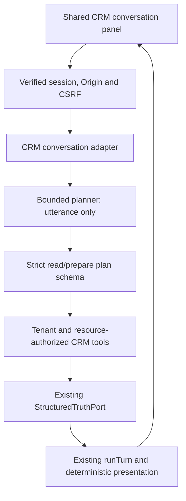

# Reusable CRM conversation — controlled read/draft slice

<!-- documentation-status -->
> **Status: legacy platform contract reference.** Reviewed for documentation ownership on 29 October 2026. Use the [current architecture](../ARCHITECTURE.md) and [developer guide](../DEVELOPER_GUIDE.md) for the active workspace. Original versions, commands, and acceptance statements below describe their recorded context; this page is not fresh release evidence.

`@archava/crm-assistant` connects the existing `runTurn` pipeline to the CRM
read/prepare tools. `apps/crm` consumes its compiled server export and shared
browser panel. Core, CRM and identity remain separate: neither core nor the
deterministic CRM package imports this optional adapter.

The shipped `LocalCrmPlanner` recognizes bounded Indonesian/English commands.
It makes zero language-model/provider requests. An optional server-only Gemini
planner uses that same port for a committed synthetic pilot corpus; arbitrary
user text remains local. See [Gemini pilot boundaries](CRM_GEMINI_PILOT.md).
This slice does not establish general natural-language production readiness.

## Try it

Use the existing authenticated host at `http://127.0.0.1:4175`:

```sh
pnpm crm:build
pnpm crm:start
```

Sign in and open the Archava panel below the dashboard. Records come from the
selected business and current permissions.

| Request                                             | Behavior                                                                         |
| --------------------------------------------------- | -------------------------------------------------------------------------------- |
| `tampilkan kontak` / `list contacts`                | One page of up to 20 authorized contacts; next-page control when available.      |
| `cari Budi` / `find Budi`                           | Search authorized contacts.                                                      |
| `ringkas Budi` / `summarize Budi`                   | Authorized notes/follow-ups, up to 20 of each; no email/organization projection. |
| `ringkas`                                           | Use an explicitly selected contact.                                              |
| `tampilkan peluang` / `list opportunities`          | One page of authorized sales opportunities; separate pipeline read permission.   |
| `ringkas peluang` / `summary opportunity`           | Use an explicitly selected opportunity and read its persisted stage history.     |
| `siapkan follow-up Budi` / `prepare follow-up Budi` | Require a permitted contact and user-supplied draft message/date.                |
| `kirim`, unsupported writes or other requests       | Explain the supported commands; no mutation or external send.                    |

For a draft, fill **Detail draft follow-up** with the message and date/time.
The date uses the browser's displayed timezone and is serialized as UTC.
Missing fields prompt clarification. No default deadline is invented.
Duplicate/truncated matches require explicit selection. An explicit name takes
precedence over a previous selection. Changing business or signing out destroys
the panel, aborts its request and clears its record/selection/draft state.

Drafts exist only in the response and browser memory. They carry the contact
revision, `status: draft` and `requiresApproval: true`. A revision change during
preparation requires a retry. The host can supply `commandsBase` to show an
explicit **Simpan follow-up yang ditinjau** button. That human click submits the
verified draft through the existing authenticated command API. One UUID is
retained across uncertain responses; stale drafts require a fresh review.
No conversation turn saves a task automatically, and saving does not send a
message. Machine writes still require the separately verified Act integration.

## Boundaries



`POST /api/crm/:tenant/conversation` accepts only `utterance`, optional
`contactId`/`opportunityId`/`after`, and optional `draft: {summary, dueAt}`. The host constructs
identity, tenant scope, turn id and timestamp. Browser role, principal, action
confirmation and routing fields are rejected. Every turn rechecks membership;
each tool rechecks its own resource/permission boundary. Staff assignment scopes
and tenant isolation remain repository responsibilities. Viewers can read but
cannot prepare drafts without `followups.write`. Pipeline requests also require
`pipeline.read`; contact and opportunity selections remain distinct. Saving
rechecks current membership, permissions, scope and revision.

The planner receives only bounded text. It never receives a repository, executor,
private CRM records, session token or provider secret. Its strict plan cannot
name SQL, another tenant/principal, arbitrary tools or write operations. CRM
record text is returned as data and rendered with `textContent`; it is never fed
back into planning. The browser import uses `/panel` and `/contracts`, keeping
server adapters and identity/database implementations outside the bundle.

The assistant's optional `authoritativeSubjects` is a trusted host routing input.
It can add live-source requirements, preserves lexical live subjects and never
permits retrieval fallback when live truth is unavailable. Existing consumers
that omit it keep their prior behavior. The CRM adapter uses the existing
`customer_or_order` subject, capability `assist`, no available page actions and
no executor. Replies expose a small CRM projection and source indicator, not
internal turn events or authentication state.

## Verification and next work

`pnpm crm:verify` cold-installs identical compiled CRM conversation artifacts
for hospitality and professional services and reads their real isolated
PostgreSQL data. `pnpm crm:verify-runtime` tests the authenticated host, read/draft
permissions and unchanged business/audit/receipt counts. Hold that private fixture
with `-- --browser`, then run `pnpm e2e:crm-runtime` for the shared panel.
`pnpm verify` retains all existing platform and independent-core gates.

The [8 October verification report](../audit/CRM_CONVERSATION_2026-10-08.md) records the
passed gates and preserved artifact hashes. These artifact builders share
`dist/library`; run the verifier commands sequentially.

The optional [Gemini pilot](CRM_GEMINI_PILOT.md) evaluates a bounded live planner
without transmitting user CRM data. Next: expand provider quality and data
boundaries deliberately; add deployment observability; complete durable Act approval/execution/recovery before enabling
machine writes. Transcript retention, proactive message sending, financial
reporting and broader CRM/ERP are separate capabilities. The ARCHZXY company
website remains outside this project.
