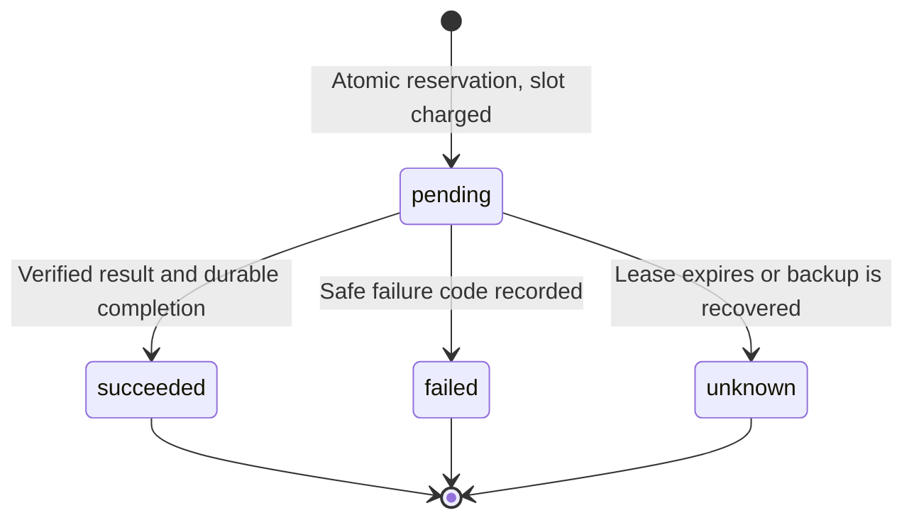

# Durable provider budget and diagnostic metadata

<!-- documentation-status -->
> **Status: legacy platform contract reference.** Reviewed for documentation ownership on 29 October 2026. Use the [current architecture](../ARCHITECTURE.md) and [developer guide](../DEVELOPER_GUIDE.md) for the active workspace. Original versions, commands, and acceptance statements below describe their recorded context; this page is not fresh release evidence.

`@archava/provider-runtime` 0.1.0 is an optional reusable server module for
admission and outcome recording around a bounded provider request. Its generic
`runProvider<T>` accepts an invocation callback and an injected attempt store;
it imports no CRM, model SDK or identity module. `/postgres` supplies the adapter
and one checksummed migration in its own `archava_provider` schema. Existing
CRM/identity schemas and migrations remain unchanged.

## CRM pilot integration

The authenticated host shares one policy across both businesses: scope
`crm-gemini-pilot`, 30 admitted attempts per UTC day, at least 15 seconds between
starts and one active 60-second lease. The existing Gemini deadline is 45 seconds.
CRM reading authorization precedes admission. Arbitrary text still uses local
commands without consuming the budget; only committed synthetic pilot examples
reach Gemini. The model cannot choose policy, scope, identity or SQL.

Every admitted request consumes a slot before invocation, including timeout,
invalid output, provider failure and interrupted processing. No refund or
automatic retry occurs. A duplicate request UUID cannot invoke the provider
again; results are not cached/replayed. A new question has a new server UUID.
Stored policy mismatches fail instead of silently changing a shared allowance.

These limits begin when this module is installed. They do not reconstruct earlier
usage, measure tokens/cost or cap all requests sharing the key/project across
other deployments. Google quotas and the operator-confirmed Free tier remain
separate provider boundaries. No paid model/provider fallback is introduced.

## Atomicity and recovery



PostgreSQL locks the scope row during reservation and completion. Independent
consumers share its allowance and lease. Admission denial commits expiry cleanup
instead of undoing an old `unknown` outcome. Late completion cannot overwrite a
terminal outcome or finalize another request. A result reaches CRM tools only
after durable success recording. Ambiguous reservation/completion fails closed.

Terminal records cannot be updated through normal SQL. Runtime lacks DELETE and
migration privileges. Forced RLS scopes both tables to the provider budget and
transaction-local settings do not leak through the pool. The factory rejects
owner/superuser/BYPASSRLS pools, wrong migration history and absent forced RLS.
Privileged migration operators remain trusted.

Restart preserves counters and outcomes. Expired leases are reaped on the next
reservation, completion or status read; no worker/Redis is needed. The caller
must bound invocation below its lease, as the Gemini host does. This primitive
does not provide durable business-action execution, one-time human approval or
financial reconciliation. Existing Act gates remain Pending.

Backup/restore preserves metadata. A restored database holds provider admission
until the next UTC midnight because counters may predate requests on the original
database. Pending records become `unknown`; nothing automatically resends. Local
CRM commands remain available, with normal identity recovery. Historical backups
without this schema receive its additive migration and the same recovery hold.

## Operator diagnostics

```sh
pnpm crm:ai-status
```

The command uses the private runtime profile and operator DB connection. It
reports UTC day, allowance/remaining count, active request, recovery hold and up
to 20 recent UUIDs with timestamps, state, elapsed time, safe failure code and
HTTP status. It has no public HTTP/dashboard endpoint. A recovered profile uses
the existing `ARCHAVA_CRM_PROFILE=restored-runtime.json` convention.

No prompts, model output, CRM records, tenant/user identifiers, credentials or
provider error bodies are stored. Elapsed time spans reservation to recorded
completion; interrupted requests include recovery delay and do not establish
provider response latency. Automated metadata retention remains later work.

Provider-backed conversation success and usage/unavailable responses include an
opaque `x-archava-request-id` for correlation. Usage denial returns 429 with
`Retry-After` before invoking the provider. The panel explains that local commands
remain available. These records describe provider planning, not completion of
subsequent CRM actions or messages.

## Upgrade and verification

Stop the host before rebuilding. Preserve a private backup, then run
`pnpm crm:build`, `pnpm crm:setup`, and `pnpm crm:start`. Setup adds the separate
migration/grants without replacing keys, accounts, memberships or business data.
Changing a persisted policy requires an explicit operator migration/change plan.

`pnpm verify` checks generic boundaries and independent packaged consumption.
`pnpm crm:verify` exercises both cold-installed adapters, concurrency, charged
failures/interruption, RLS, rollback, UTC rollover, checksums and restart.
`pnpm crm:verify-runtime` checks the actual host/recovery with an external-network
blocker. Browser checks cover quota messaging and existing CRM flows.

Exact results are recorded in [9 October verification](../audit/PROVIDER_RUNTIME_2026-10-09.md).

Still open: broader model/data approval, token/cost accounting, automated alerts,
cross-deployment/project budgets, production hosting and durable autonomous Act
execution. This advances M3 evidence without completing M3.
