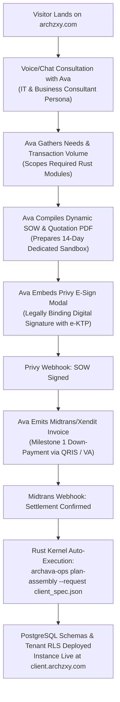
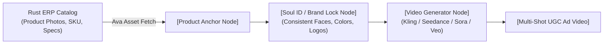

# Archava & ARCHZXY: Master Strategic Evolution & Architecture Blueprint

<!-- documentation-status -->
> **Status: requirements/proposal reference; implementation acceptance is separate.** Reviewed for documentation ownership on 29 October 2026. Use the [current architecture](../architecture/README.md) and [developer guide](../DEVELOPER_GUIDE.md) for the active workspace. Original versions, commands, and acceptance statements below describe their recorded context; this page is not fresh release evidence.

> **Date:** October 27, 2026  
> **Original designation:** Active Master Reference — retained as a proposal, not current runtime documentation  
> **Ecosystem:** `ARCHZXY` (`archzxy.com`)  
> **Flagship Product:** `Archava`  
> **AI Digital Representative:** `Ava`

---

## 1. Executive Summary & Brand Positioning

**ARCHZXY** is the parent technology studio and ecosystem.  
**Archava** is its flagship product: an intelligent, voice-driven AI Avatar paired with a modular, pure-Rust ERP/CRM engine.

### Target Market
* **Primary (Phase 1):** Mid-to-High B2B Enterprise, Luxury & Boutique Brands, Funded Startups, and High-Ticket Service Businesses (Beauty Clinics, Specialty Healthcare, Boutique Hospitality, Custom Logistics, High-End Retail).
* **Secondary (Phase 2):** Mass-market SMEs (UMKM) once custom self-hosted neural rendering clusters are deployed to eliminate 3rd-party per-minute GPU costs.

---

## 2. The 100% Autonomous Onboarding Funnel

A complete zero-touch B2B acquisition pipeline where **Ava acts as an Autonomous Account Executive**:



### Key Technical Enablers:
1. **Privy Digital Signature API:** Provides Kominfo-accredited digital signature and e-Meterai. Replaces paper contracts and legal friction.
2. **Milestone Payment Automation:** Milestone 1 (DP 30-50%) triggered directly in the consultation interface.
3. **Automated Provisioning:** `archava-ops plan-assembly` runs in Rust to derive exact dependency graphs, apply schema migrations, and generate tenant JWT keys in milliseconds.

---

## 3. Creative Studio & Higgsfield Canvas Integration

Archava is not just an ERP for operations—it is a **Full-Stack Commerce Operating System** integrating transaction data with generative creative workflows.



### Role-Based Access Control (RBAC) in Tenant Dashboard:
* **Owner / Executive:** High-level metrics, cashflow, net margins, and executive summaries generated by Ava.
* **Creative / Marketing Team:** **Studio Canvas Tab** (Higgsfield node-based workspace). Ava reads live ERP product records, injects product imagery as anchor nodes, suggests marketing scripts, and sets up video generation pipelines.
* **Warehouse / Operations:** Inventory, purchasing POs, supplier receipts, and fulfillment tickets.

---

## 4. AI-Driven Legacy Data Migration Pipe

To solve the #1 barrier to ERP adoption (data migration friction):

### The Ava AI Ingestion Pipeline
1. **File Drop:** The client uploads raw, messy Excel/CSV files exported from legacy software (Odoo, SAP, Accurate, or custom spreadsheets).
2. **LLM Schema Reconciliation:** Ava inspects headers, data types, and values using an LLM schema matcher:
   - Maps messy column names (e.g., `"Kode_Brg"`) to deterministic Rust schema fields (`sku`).
   - Identifies missing fields, duplicate SKUs, and irregular date formats.
3. **Diff Preview & Approval:** Ava presents a structured diff card:
   *"Found 1,200 products. 15 items lack categories—assigned to 'Uncategorized'. Confirm import?"*
4. **Atomic Ingestion:** Upon confirmation, the Rust ingestion engine commits all 1,200 records in a single PostgreSQL transaction with SHA-256 idempotency locks in under 50ms.

---

## 5. The SDK vs. Full ERP Architecture

Resolution of the "Can Archava be an SDK?" dilemma:

```
                            ARCHAVA PLATFORM
                                   │
         ┌─────────────────────────┴─────────────────────────┐
         ▼                                                   ▼
┌─────────────────────────────────┐         ┌─────────────────────────────────┐
│     TIER 1: SDK EMBED WIDGET    │         │   TIER 2: FULL RUST ERP ENGINE  │
│  (For clients with existing web)│         │   (For clients replacing legacy)│
│                                 │         │                                 │
│ - 1-line script tag embed       │         │ - 19 domain modules             │
│ - Proven in ArchavaXopenshopee  │         │ - 25 PostgreSQL RLS ledgers     │
│ - Page Awareness via Scout DOM  │         │ - Multi-user RBAC dashboard     │
│ - Custom Event communication    │         │ - archava-server binary         │
│ - Zero server credentials given │         │ - Aimed at replacing Odoo/SAP   │
└─────────────────────────────────┘         └─────────────────────────────────┘
```

### Evidence from `ArchavaXopenshopee` (DOPAMINE):
* Embedded cleanly in `ArchavaXopenshopee/index.html` (historical external-consumer example; no repository-local source) via `/assets/archava/widget.js`.
* Dispatches DOM events: `window.dispatchEvent(new CustomEvent('archava:open', { detail: { question } }))`.
* Connects via WebRTC to hosted Ava, keeping client storefront and AI runtime completely decoupled.
* Standard Webhook hooks handle cart checkout sync without exposing internal databases.

---

## 6. Pure Rust Engine Status (as recorded on October 27, 2026)

This list is the state recorded on October 27, 2026. It is not an audit result and has not been re-verified; what is mounted today is in [`config/modules.v1.json`](../../config/modules.v1.json) and [`migrations/manifest.v1.json`](../../migrations/manifest.v1.json).

* **Domain Modules (19 listed):**
  - CRM: Contacts, Pipelines, Confirmation Receipts, Assistant Desk, Authority, Pricing Engine, Rates, Assembly Planning, Capacity Math.
  - R04: Organizations, Proposals, Projects.
  - R05: Scheduling, Accommodation, Assets.
  - R06: Commerce Pool, Purchasing, Foodservice.
  - R07: Billing, Subscriptions, Attendance, Support, Fulfillment.
  - R08: Laundry Cohort, Field Services Dispatch, Formal Education.
* **Database Isolation:** 25 PostgreSQL schemas with forced non-owner Row Level Security (RLS) and SHA-256 idempotency locks.
* **Code Quality:** Zero warnings on `cargo clippy --workspace --all-targets --locked --offline -- -D warnings` and `cargo fmt`.
* **Binaries Operational:**
  - [`archava-server`](../../crates/slice/src/bin/archava_server.rs): Unified Axum REST API + Leptos SSR/WASM.
  - [`archava-ops`](../../crates/ops/src/cli.rs): Release doctor, status, backup/restore, assembly planner.
  - [`archava-assembly`](../../crates/assembly/src/lib.rs): Dependency solver across 17 release contracts.

---

## 7. Concrete Next Implementation Roadmap

```
[ Phase 1: Tool Execution Bridge ]
    - Wire Axum endpoints (/erp/*, /crm/*) to Ava Agent function tools in Python/LiveKit.
    - Implement strict "Assistant proposes, server authorizes" request envelopes.

[ Phase 2: Data Ingestion Pipeline ]
    - Build Excel/CSV schema parser in rust/crates/adapters.
    - Connect Ava schema-matching dialogue to batch PostgreSQL commits.

[ Phase 3: Autonomous Closing Engine ]
    - Implement Privy Digital Signature webhook listener in Axum.
    - Integrate Midtrans / Xendit milestone payment callbacks to trigger archava-ops.

[ Phase 4: Creative Canvas Studio ]
    - Build the node-based visual canvas interface in the dashboard.
    - Connect Higgsfield API to ERP product catalog assets.

[ Phase 5: archzxy.com Rebuild ]
    - Design 3D Awwwards-style cinematic front door.
    - Integrate WebRTC Ava consultation avatar with lazy-loading performance optimization.
```
