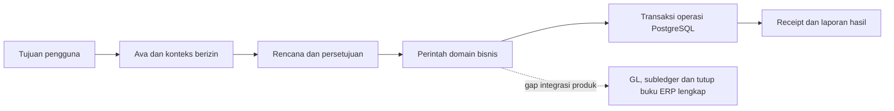

# Archava dibandingkan ERP global — riset 6 November 2026

**Kesimpulan: Archava belum setara sebagai pengganti ERP matang secara menyeluruh.**
Archava mempunyai fondasi produk agentic AI for business dengan operasi bisnis
nyata, otorisasi, persetujuan dan pemulihan transaksi yang sudah diuji. Bukti yang
tersedia belum mendukung klaim lebih unggul dari SAP, Oracle, Dynamics, Odoo atau
ERPNext sebagai sebuah sistem ERP lengkap. Untuk akuntansi inti, bahkan produk
keuangan UKM Indonesia menyediakan fungsi operasional yang belum dipasang pada
host Archava.

Kekuatan Archava berada pada implementasi alur **tujuan → konteks berizin → rencana
→ persetujuan → aksi domain → bukti hasil**, ditambah beberapa proses operasi
yang dijaga ketat. Keunggulan kompetitif pada biaya, kemudahan, keamanan relatif,
akurasi agen atau hasil bisnis masih perlu dibuktikan dengan pembanding langsung.
Keberadaan AI sendiri sudah menjadi pola kompetisi, termasuk pada ERP matang.

Laporan ini merupakan riset produk dan pemeriksaan source. Ia tidak mengubah
kode runtime atau mengulang pengujian Rust, browser, provider, pajak dan beban.
Rencana pembuktiannya ada di [protokol benchmark dan backlog](ERP_PARITY_ACCEPTANCE_2026-11-06.md).
Matriks kerja tersedia dalam [CSV kemampuan](ERP_CAPABILITY_MATRIX_2026-11-06.csv).

## 1. Lingkup dan cara mengambil kesimpulan

Riset memetakan **18 kelompok produk/suite** yang mewakili ERP enterprise,
midmarket, industri, open source, keuangan UKM Indonesia dan ERP keuangan berbasis
AI. Ini bukan sensus seluruh vendor ERP di dunia. Nama produk dalam satu suite
tidak berarti semua fungsinya termasuk dalam satu lisensi.

Sumber pasar diprioritaskan pada dokumentasi, release notes, bantuan produk dan
halaman resmi vendor. Halaman pemasaran diperlakukan sebagai kemampuan yang
dinyatakan vendor, bukan hasil pengujian independen. Riset ini tidak menjalankan
akun berbayar pesaing, membuktikan uptime mereka atau menghitung TCO berdasarkan
quotation. Kecepatan, kualitas AI dan usability antarsistem belum diukur pada
dataset dan tugas yang sama. Karena itu, laporan tidak memberi persentase
kesetaraan atau skor numerik yang seolah-olah merupakan hasil benchmark.

Untuk Archava, urutan buktinya adalah:

1. Kontrak dan tipe domain menunjukkan kemampuan yang dimodelkan.
2. Adapter, migrasi terdaftar dan router menunjukkan kemampuan yang dipasang.
3. UI dan aksi operator menunjukkan permukaan yang bisa digunakan.
4. Log pengujian yang benar-benar dieksekusi menunjukkan kasus yang telah lulus.
5. Bukti provider langsung menunjukkan sampel integrasi nyata.
6. Bukti operasi pelanggan diperlukan untuk klaim produksi pada beban dan proses tertentu.

Keenam hal tersebut tidak saling menggantikan. Banyaknya file, crate, tabel,
perintah, halaman atau tes tidak langsung menunjukkan kedalaman ERP.

### Snapshot Archava yang diperiksa

Source SHA-256 saat riset:
`c299a8e192bcdbbe68a270ea7ada189cd6a856790c6a4a6c8e940c7c16e2a8dd`.
Hash ini cocok dengan kandidat terakhir yang memiliki bukti pengujian langsung.

| Bukti | Hasil yang benar-benar tersedia |
| --- | --- |
| Katalog produk | 18 domain bisnis; 141 operasi kanonis; 139 formulir operator; 2 operasi khusus integrasi pembayaran |
| Penyimpanan produksi | 24 namespace ledger terdaftar, 40 migrasi terpasang; 47 file SQL tersedia di repository |
| Struktur teknis | 22 anggota Cargo workspace; angka ini bukan jumlah modul produk |
| Gate terakhir, 5 November | 1.146 tes Rust, 98 suite; 25 tes helper gate dan 3 helper audit produk |
| Browser terakhir | 49 pemeriksaan, termasuk 11 pemeriksaan agen langsung |
| Gemini langsung | 6 tujuan/perencanaan terpilih dengan `gemini-3-flash-preview`, profil `minimal` |
| Bukti produksi pelanggan | Tidak ada paket bukti untuk mengesahkan SLA, tutup buku pelanggan, skala produksi atau kepatuhan menyeluruh dalam audit ini |

Sumber lokal: [katalog aksi](../../config/operator-actions.v1.json),
[router ERP](../../crates/host/src/routes/erp.rs),
[bootstrap server](../../crates/slice/src/bin/archava_server.rs),
[manifest migrasi](../../migrations/manifest.v1.json),
[operasi native](../modules/NATIVE_OPERATIONS.md),
[penerimaan Gemini langsung](AGENT_LIVE_ACCEPTANCE_2026-11-05.md).
Inventaris pemeriksaan disimpan di `target/erp-research-20261106/`.

## 2. Apa yang sebenarnya membuat sistem menjadi ERP matang

ERP menghubungkan proses operasi dengan pengendalian dan pencatatan usaha.
Pelanggan, barang, pemasok, dokumen, perpindahan stok, tagihan, pembayaran dan
hasil keuangan harus dapat ditelusuri dan direkonsiliasi. Dalam ERP yang
berorientasi keuangan, transaksi operasi membentuk subledger dan jurnal, kemudian
laporan dan penutupan periode. Microsoft menjelaskan hubungan ini secara eksplisit
pada proses [record to report](https://learn.microsoft.com/en-us/dynamics365/guidance/business-processes/record-to-report-overview).

Satu perusahaan jasa tidak membutuhkan semua fungsi pabrik. Sebuah pabrik pun
tidak harus memiliki aplikasi sekolah. Kesetaraan selalu memerlukan target
pelanggan, proses, negara, skala, edisi produk dan kriteria hasil yang disepakati.

### Lima lapisan yang perlu diperiksa

| Lapisan | Pertanyaan pengujian |
| --- | --- |
| Catatan bisnis yang berwenang | Siapa pemilik customer, SKU, supplier, badan hukum, akun, kurs dan dokumen? Adakah identitas dan histori yang konsisten? |
| Integritas transaksi | Apakah perubahan sah, atomik, tidak berganda, dapat dikoreksi dan tetap benar saat bersamaan atau gagal sebagian? |
| Kelengkapan proses | Apakah alur selesai sampai kewajiban, uang, persediaan dan dampak akuntansinya tercatat? |
| Pengendalian dan analitik | Apakah laporan menyeluruh, periode terkunci, akses terpisah, angka dapat ditelusuri dan pengecualian diselesaikan? |
| Pengoperasian dan adopsi | Apakah migrasi, konfigurasi, upgrade, pemulihan, dukungan dan pekerjaan pengguna terbukti pada lingkungan sasaran? |

Agen AI bekerja di atas atau di dalam lapisan tersebut. Agen yang menjalankan
perintah dengan benar tidak dapat menyediakan proses akuntansi yang belum ada
di alat dan ledger bisnisnya.

### Dua belas perjalanan bisnis sebagai pembanding

| Perjalanan | Hasil lengkap yang dicari | Posisi Archava sekarang |
| --- | --- | --- |
| Peluang sampai pesanan | Prospek, organisasi, proposal, persetujuan dan pesanan dengan identitas komersial konsisten | Beberapa domain tersedia; integrasi penuh dan identitas wajib antardokumen belum terbukti |
| Pesanan sampai penerimaan uang | Pesanan, kirim, invoice, piutang, pembayaran, rekonsiliasi dan posting | Operasi pesanan/invoice/payment tersedia; alur keuangan menyeluruh belum terbukti |
| Pengadaan sampai pembayaran pemasok | Permintaan, vendor, PO, receipt, tagihan pemasok, pencocokan dan pembayaran | Kuat pada supplier/offer/PO/receipt/landed cost; AP dan pembayaran pemasok belum terpasang sebagai proses lengkap |
| Pencatatan sampai tutup buku | Jurnal, subledger, penyesuaian, periode, laporan keuangan dan audit | General Ledger masih komponen library |
| Perencanaan sampai produksi | BOM bertingkat, kebutuhan bahan, kapasitas, work order, WIP, hasil dan costing | MRP merupakan library/reserved capability |
| Persediaan sampai pengiriman | Lokasi, reservasi, penerimaan, picking, pengiriman, retur dan traceability | Single stock pool dan fulfillment terbatas; WMS mendalam belum terbukti |
| Pegawai sampai penggajian | Data pegawai, kontrak, waktu/izin, payroll, pembayaran dan posting | Attendance peserta tersedia; HR/payroll penuh belum terpasang |
| Proyek sampai profit | Anggaran, sumber daya, waktu, biaya, billing, pengakuan pendapatan dan margin | Proyek/task/milestone tersedia; project accounting belum terpasang |
| Layanan sampai penerimaan uang | Penjadwalan, dispatch, pekerjaan, bagian/biaya, signoff, invoice dan penerimaan | Bagian operasional field service tersedia; alur pendapatan lengkap belum terbukti |
| Akuisisi sampai pelepasan aset | Akuisisi, kapitalisasi, penyusutan, maintenance, disposal dan dampak buku | Custody dan maintenance tersedia; fixed-asset accounting belum terpasang |
| Langganan sampai pendapatan | Kontrak, penggunaan, billing, perubahan paket, settlement dan revenue schedule | Entitlement/usage tersedia; revenue accounting menyeluruh belum terpasang |
| Kontrol sampai operasi yang diaudit | Identitas, kewenangan, persetujuan, audit, upgrade, pemulihan dan layanan | Banyak kontrol lokal terbukti; IAM enterprise, skala dan assurance eksternal belum dibuktikan |

Struktur proses ini mengikuti pola pada dokumentasi
[order to cash](https://learn.microsoft.com/en-us/dynamics365/guidance/business-processes/order-to-cash-overview)
dan [source to pay](https://learn.microsoft.com/en-us/dynamics365/guidance/business-processes/source-to-pay-overview),
kemudian diterapkan sebagai kerangka analisis Archava. Daftar tersebut bukan
kewajiban bahwa semua jenis pelanggan harus membeli setiap fungsi.

### Lima penyamaan yang menyesatkan

- **Invoice dan pembayaran** belum menyediakan keseluruhan accounting, AP, bank dan penutupan buku.
- **Tenant terpisah** belum menyediakan badan hukum anak, intercompany dan konsolidasi.
- **Kode mata uang pada invoice** belum menyediakan kurs, mata uang fungsional, revaluasi dan selisih kurs.
- **Layer biaya FIFO** belum menyediakan seluruh fitur gudang, batch produksi, kedaluwarsa dan serial inventory.
- **Modul yang bisa dipilih** belum membuktikan kedalaman proses industri di dalamnya.

Odoo sendiri membedakan aplikasi Invoicing dari Accounting, yang mencakup
rekonsiliasi, laporan, anggaran dan fungsi lain. Perbedaan ini relevan untuk
menilai Billing Archava. [Dokumentasi resmi Odoo 19](https://github.com/odoo/documentation/blob/19.0/content/applications/finance/accounting.rst).

## 3. Peta 18 kelompok pembanding

Tabel berikut merangkum kemampuan yang didokumentasikan, bukan hasil menjalankan
software pesaing. Kata "belum setara" menyatakan adanya gap kemampuan/pembuktian
pada scope pembanding; ia tidak menyatakan semua fitur pesaing bebas cacat.

| Kelompok | Posisi produk dan kedalaman yang relevan | Implikasi untuk Archava | Sumber primer |
| --- | --- | --- | --- |
| SAP S/4HANA Cloud | ERP enterprise lintas fungsi. Universal Journal menghubungkan pencatatan keuangan dan manajemen; fungsi industri berada dalam portofolio/konfigurasi produk | Native financial backbone, organisasi keuangan dan proses industri Archava belum sebanding | [Universal Journal](https://help.sap.com/docs/SAP_S4HANA_CLOUD/0fa84c9d9c634132b7c4abb9ffdd8f06/523b8a55559ad007e10000000a44538d.html), [cakupan S/4HANA](https://learning.sap.com/products/s4hana-cloud) |
| Oracle Fusion Cloud ERP dan aplikasi terkait | Financials, procurement, project/risk management; SCM, manufacturing dan HCM adalah produk terkait yang harus dibedakan dari lisensi ERP inti | Billing dan Projects kita belum menggantikan sistem finance/procurement Oracle | [Finance and Accounting](https://www.oracle.com/erp/finance-and-accounting/), [portofolio Fusion](https://www.oracle.com/applications/) |
| Oracle NetSuite/OneWorld | ERP pertumbuhan dan operasi global. OneWorld menambahkan subsidiary, multi-book/currency dan konsolidasi; merupakan add-on | Organizations dan tenant kita belum mengimplementasikan proses keuangan grup ini | [OneWorld, fungsi dan batas paket](https://www.netsuite.com/portal/products/global-business-management.shtml) |
| Microsoft Dynamics 365 | Business Central melayani SMB; Finance/SCM/Project Operations melayani proses yang lebih luas. Manufacturing BC membutuhkan Premium | Accounting dan proses midmarket masih menjadi gap meski arah agent UI sejalan | [fungsi Business Central](https://learn.microsoft.com/en-us/dynamics365/business-central/across-business-functionality), [manufacturing Premium](https://learn.microsoft.com/en-us/dynamics365/business-central/production-manage-manufacturing) |
| Infor CloudSuite | Keluarga solusi industri, bukan satu paket identik: ERP inti ditambah kebutuhan planning, quality, execution atau distribusi menurut industri | Restaurant/laundry/education kita menunjukkan variasi operasi, bukan kesetaraan industrial ERP | [definisi keluarga CloudSuite dan komponennya](https://www.infor.com/blog/erp-end-of-support-next-steps) |
| Epicor Kinetic | ERP manufaktur diskrit dengan produksi, perencanaan dan pengelolaan finansial yang disesuaikan industri | Library MRP kita belum menggantikan shop-floor dan financial workflow Kinetic | [Kinetic](https://www.epicor.com/en-us/products/enterprise-resource-planning-erp/kinetic/), [financial management](https://www.epicor.com/en-us/products/enterprise-resource-planning-erp/kinetic/financial-management/) |
| IFS Cloud | Fokus operasi industri yang memadukan ERP, enterprise asset management dan field service | Assets dan Field Services perlu kedalaman lifecycle dan integrasi finansial sebelum perbandingan setara | [IFS Cloud](https://www.ifs.com/en/ifs-cloud) |
| Workday | Finance, workforce/HCM, planning dan spend; bukan pembanding utama warehouse pabrik. Close mendukung translasi dan eliminasi intercompany | Attendance peserta tidak dapat dinilai sebagai pengganti HCM; GL/close kita belum operasional | [financial management](https://www.workday.com/en-us/products/financial-management.html), [close dan consolidation](https://www.workday.com/en-us/products/financial-management/close-consolidate.html) |
| Acumatica | ERP midmarket dengan edisi bisnis umum, distribusi, manufaktur, konstruksi, retail dan jasa. Tabel publik membedakan included/optional | Baseline finance dan edisi industri jauh lebih luas dari katalog aksi kita; penilaian harus sesuai paket | [tabel edisi dan fitur](https://www.acumatica.com/cloud-erp-software/product-editions/) |
| Sage X3 | Menghubungkan finance, supply chain dan produksi untuk operasi distribusi/manufaktur | Receipt dan stok kita hanya sebagian dari siklus operasi-keuangan yang dibandingkan | [kapabilitas Sage X3](https://www.sage.com/en-us/sage-business-cloud/sage-x3/product-capabilities/) |
| Odoo | Ekosistem aplikasi modular dengan accounting terintegrasi dan agen AI pada dokumentasi versi 19. Edisi, aplikasi dan localization harus diperiksa | Memiliki banyak modul atau UI percakapan belum menunjukkan keunggulan terhadap Odoo | [accounting](https://github.com/odoo/documentation/blob/19.0/content/applications/finance/accounting.rst), [AI agents](https://github.com/odoo/documentation/blob/19.0/content/applications/productivity/ai/agents.rst) |
| ERPNext/Frappe | ERP open source dengan transaksi yang membentuk ledger, serta manufacturing; HR dan aplikasi Frappe terkait perlu dibedakan saat menentukan paket | Bahkan baseline open source ini memiliki proses accounting dan manufacturing yang belum dipasang di Archava | [accounting](https://docs.frappe.io/erpnext/accounting-introduction), [manufacturing](https://docs.frappe.io/erpnext/manufacturing) |
| Zoho ERP dan ekosistem Zoho | ERP diluncurkan di India pada 2026; pembaruan September mendokumentasikan Manufacturing Order. Zoho One/Books/Inventory merupakan penawaran terkait yang berbeda | Riset yang hanya menilai Zoho sebagai CRM akan ketinggalan. Ketersediaan negara dan cakupan tiap produk tetap perlu diperiksa | [pengumuman ERP melalui Analytics](https://www.zoho.com/blog/analytics/zoho-analytics-meets-zoho-erp.html), [rilis September 2026](https://help.zoho.com/portal/en-gb/community/topic/zoho-erp-product-updates-september-2026) |
| Mekari Jurnal | Pembanding keuangan/akuntansi UKM Indonesia: jurnal, rekonsiliasi, laporan dan mata uang; portofolio Mekari lain tidak otomatis termasuk Jurnal | Target parity finansial Archava belum terpenuhi terhadap pembanding lokal ini | [fitur resmi Jurnal](https://www.jurnal.id/id/fitur/) |
| Accurate Online | Pembanding accounting UKM Indonesia dengan laporan keuangan dan rekonsiliasi; Multi Branch merupakan add-on | Keluasan vertical kita tidak menggantikan accounting dan kontrol cabang yang dibutuhkan pengguna keuangan | [laporan keuangan](https://accurate.id/online/fitur/laporan-keuangan/), [rekonsiliasi bank](https://help.accurate.id/product/accurate-online/fitur-aol/kas-bank/rekonsiliasi-bank/rekonsiliasi-bank-accurate-online/), [add-on cabang](https://help.accurate.id/product/accurate-online/fitur-aol/perusahaan/cabang/mengenal-fitur-cabang/) |
| HashMicro | Vendor regional yang menyatakan cakupan finance, procurement, inventory, HR, manufacturing dan AI. Bukti publik yang digunakan terutama halaman produk | Pembanding relevan untuk kebutuhan lokal, tetapi kemampuan rinci dan paket harus diperiksa melalui demo/kontrak; tidak disetarakan dengan audit independen | [halaman ERP resmi](https://www.hashmicro.com/id/sistem-erp) |
| Rillet | ERP keuangan berbasis AI yang mendokumentasikan ledger, reconciliation, reporting dan consolidation | Native AI juga berkembang dari accounting core; kita belum dapat menyatakan menang hanya dari pendekatan agen | [AI accounting](https://www.rillet.com/platform/ai-accounting-software) |
| Campfire | ERP keuangan berbasis AI dengan general ledger, revenue, reporting dan close. Bantuan accrual publik lama menunjukkan review/posting; bantuan terbaru mengarah ke SSO | Sampel perencanaan operasional kita tidak menggantikan financial close; detail bantuan terbaru yang tertutup tidak diasumsikan telah diverifikasi | [produk saat ini](https://campfire.ai/), [panduan accrual bertanggal yang diarsipkan vendor](https://help.meetcampfire.com/articles/6230744932-accruals) |

Ini bukan berarti satu pembelian SAP/Oracle otomatis mencakup semua aplikasi
portofolionya, semua localization Odoo tersedia dalam Community, semua add-on
Acumatica sudah termasuk atau Zoho ERP tersedia identik di Indonesia. Paket,
negara, konfigurasi dan versi harus dikunci sebelum benchmark langsung.

## 4. AI tidak lagi menjadi pembeda yang berdiri sendiri

Dokumentasi pesaing sudah menunjukkan pola yang mirip dengan tujuan Archava:

- **Microsoft Business Central:** agent tasks dapat berhenti untuk data yang
  kurang, meminta peninjauan draft, memperlihatkan timeline dan melanjutkan
  setelah konfirmasi. [Supervise agent activities](https://learn.microsoft.com/en-us/dynamics365/business-central/supervise-agent-tasks).
- **SAP Joule Studio:** menggabungkan agen dengan langkah deterministik,
  trigger dan interaksi manusia lintas aplikasi. Berita Q3 yang diterbitkan
  26 Oktober juga membedakan rilis, early adopter dan pilot; penyebutan produk
  tidak menjamin setiap pelanggan memperoleh seluruh fitur.
  [Agentic workflows](https://www.sap.com/products/artificial-intelligence/joule-studio/agentic-workflows.html),
  [rilis Q3 2026](https://news.sap.com/2026/10/ai-release-highlights-q3-2026/).
- **Oracle:** mendokumentasikan Payables, Ledger, Planning dan agen finansial
  lain; daftar teknis menyertakan release dan jenis fitur. Implementasi akun,
  uptake dan lisensi tetap perlu diperiksa.
  [kemampuan AI ERP](https://www.oracle.com/erp/ai-financials/),
  [daftar fitur dan release](https://docs.oracle.com/en/cloud/saas/fusion-ai/aiafl/ai-erp.html).
- **Odoo 19:** agent menggabungkan prompt, topics, tools dan sources. Tools
  dapat menjalankan aksi; sources memberi konteks. Dokumentasi ini tersedia
  pada repository resmi meskipun fetch situs dokumentasinya mengalami timeout
  saat riset. [Source dokumentasi AI agents](https://github.com/odoo/documentation/blob/19.0/content/applications/productivity/ai/agents.rst).

Kesimpulan analitisnya: Archava berada pada arah produk yang relevan, tetapi
agentic, chat, approval, konteks dan audit tidak membuktikan bahwa konsepnya sudah
di atas kompetitor. Pembeda yang perlu dikejar adalah tingkat penyelesaian tugas
yang benar, usaha pengguna, biaya total, ketepatan konteks, kecepatan implementasi
dan kecocokan proses pelanggan tertentu.

Tidak ada uji berdampingan yang mendukung klaim bahwa Ava lebih pintar, lebih
murah, lebih aman atau lebih cepat daripada agent vendor tersebut. Klaim semacam
itu perlu eksperimen yang dijelaskan pada dokumen acceptance.

## 5. Kedalaman 18 modul Archava

Semua domain berikut memiliki kontrak dan jalur operasi terpasang. Deskripsi
gap menyatakan batas terhadap produk matang, bukan menyangkal pekerjaan yang
sudah berfungsi. Jumlah perintah berasal dari katalog dan tidak sama dengan
jumlah seluruh fitur, aturan atau kombinasi lifecycle.

| Modul | Operasi kanonis | Kemampuan yang tersedia | Kedalaman tambahan untuk scope ERP matang |
| --- | ---: | --- | --- |
| CRM | 7 | Kontak, aktivitas, follow-up, opportunity dan perpindahan stage | Forecasting, deduplikasi/master party, proses komersial terpadu dan kebutuhan CRM lanjutan belum terbukti |
| Commerce | 8 | Produk, stok, pesanan, reservasi, fulfillment, cancel dan retur; FIFO cost terpasang | Multiwarehouse/bin/UOM, batch/expiry/serial inventory dan sambungan finance lengkap |
| Purchasing | 11 | Supplier, offer, PO, perubahan, konfirmasi, short close dan inspected receipt; landed cost | Requisition/RFQ, tagihan pemasok, AP, three-way matching, pembayaran dan bank |
| Billing | 6 | Draft/issue/correction/void, payment attempt dan event settlement terverifikasi | GL, AR accounting lengkap, AP, bank reconciliation, tax reporting dan close |
| Support | 12 | Lifecycle kasus, assignment, priority, target dan notes | SLA layanan kontraktual, customer portal/omnichannel dan automasi layanan lanjutan |
| Organizations | 6 | Record organisasi dan affiliation | Badan hukum pelaporan, chart of accounts per entity, intercompany dan konsolidasi |
| Proposals | 14 | Proposal, scope, penerimaan/penolakan dan change request | CPQ mendalam, aturan konfigurasi komersial dan integrasi contract-to-billing |
| Projects | 6 | Proyek, tugas, milestone dan status | Budget, timesheet, resource costing, expense, WIP, invoicing dan profit proyek |
| Foodservice | 13 | Meja, menu/recipe dan kitchen/service lifecycle | POS/hardware/payment aktual, purchasing/finance penuh dan kebutuhan operasional restoran berskala |
| Scheduling | 7 | Resource dan lifecycle hold/block/confirm/move/cancel | Policy kapasitas/recurrence/optimasi sesuai industri dan integrasi operasi lanjutan |
| Accommodation | 11 | Property, room type, rate, room, housekeeping dan stay lifecycle | OTA/channel manager, night audit, revenue management dan finance penginapan penuh |
| Assets | 5 | Register, update, handover, maintenance dan retirement | Kapitalisasi, depreciation book, impairment/disposal accounting dan biaya lifecycle |
| Subscriptions | 5 | Subscription, payment reference, usage, status dan entitlement | Contract billing, proration, gateway settlement terpadu dan revenue recognition |
| Attendance | 5 | Session, participant roster, check-in dan status | Employee time/leave/overtime/payroll. Domain saat ini merupakan attendance sesi/peserta |
| Laundry | 4 | Order, process, finding dan status | Kebutuhan linen/plant komersial, perangkat/traceability dan billing/accounting terpadu |
| Field Services | 7 | Job, assignment, visit, work line, signoff, approval dan cancel | Skill/route/capacity optimization, mobile/offline, parts, contract billing dan accounting |
| Fulfillment | 5 | Job, line, finding, custody dan status | WMS/TMS, warehouse controls, carrier integration dan perencanaan pengiriman |
| Formal Education | 9 | Admission/enrollment, session/result/review/retention dan graduation/withdrawal | SIS/LMS lengkap, kurikulum, tuition/accounting, portal dan kebutuhan institusi tertentu |

Angka ini berjumlah 141. Dua operasi Billing bersifat khusus provider; sisanya
memiliki formulir review. Acuan utama tabel ini adalah
[katalog kontrak](../../config/operator-actions.v1.json),
[dispatcher bisnis](../../crates/host/src/business.rs),
[UI operator](../../crates/slice/src/operations/operator.rs) dan
[native operations](../modules/NATIVE_OPERATIONS.md).

Ada drift dokumentasi internal: beberapa halaman modul lama masih menyebut belum
ada native screen, sedangkan katalog, UI operator dan bukti penerimaan yang lebih
baru menunjukkan formulir sudah terpasang. Penilaian di atas mengikuti source dan
bukti terbaru. Status fitur sebaiknya mempunyai satu register yang membedakan
specification, library, mounted API/UI dan penerimaan aktual.

## 6. Gap yang menentukan keputusan penggantian ERP

Gambar ini merangkum posisi implementasi. Garis putus-putus menunjukkan sambungan
ke financial backbone yang belum lengkap pada produk, bukan fitur yang sudah lulus.

### 6.1 General Ledger dan accounting backbone

[general_ledger.rs](../../crates/domain/src/erp/general_ledger.rs) mempunyai chart
of accounts, pemeriksaan debit/kredit, trial balance dan perhitungan laporan.
Pemeriksaan source pada router, host, adapters dan UI tidak menemukan jalur produk
yang memasang engine itu menjadi posting workflow persisten. Manifest terpasang
juga belum menyediakan tabel financial journal/accounting period yang menjadi
alur General Ledger tersebut.

`validate_journal_entry` memeriksa bentuk dan keseimbangan nilai. Fungsi laporan
menerima data dari pemanggil; pemilihan tenant, periode, mata uang, akun dan
sumber transaksi harus disediakan oleh lapisan aplikasi yang berwenang. Hal ini
menjelaskan mengapa helper belum menjadi sistem accounting yang selesai.

Kebutuhan berikut belum dapat diklaim operasional secara menyeluruh:

- Posting dari sales, purchase, inventory, expense, payment dan aset.
- Subledger AR/AP yang dapat direkonsiliasi ke akun kontrol GL.
- Fiscal calendar, lock date, close/reopen, reversal dan koreksi yang dapat diaudit.
- Trial balance, laba rugi, neraca dan arus kas dari transaksi persisten penuh.
- Dimensi biaya, budget/actual, accrual dan reporting lintas periode.

Ini gap yang relevan bahkan untuk bisnis kecil yang meminta aplikasi menjadi
sumber pembukuan utamanya. ERPNext mendokumentasikan hubungan dokumen operasi
dengan ledger dan laporan, bukan sekadar fungsi kalkulasi.
[Accounting Introduction](https://docs.frappe.io/erpnext/accounting-introduction).

Komentar source yang menyebut IFRS/PSAK tidak merupakan audit kepatuhan terhadap
seluruh standar. Audit ini tidak memberi sertifikasi accounting atau pajak.

### 6.2 Source-to-pay belum selesai pada receipt

Purchasing dan Commerce mempunyai integrasi nyata yang kuat: accepted goods
menambah stok, biaya mengikuti snapshot PO dan landed fee dialokasikan secara
integer. Kegagalan membatalkan perubahan terkait; replay mempertahankan efek
aslinya. [Purchasing](../modules/PURCHASING_MODULE.md),
[Commerce](../modules/COMMERCE_MODULE.md).

Untuk menggantikan procurement-to-pay ERP, masih dibutuhkan vendor invoice,
pencocokan invoice/PO/receipt, toleransi dan hold selisih, AP, pembayaran pemasok,
rekonsiliasi bank serta posting GL. Ada barang diterima tidak dengan sendirinya
berarti utang, pajak dan kas sudah tercatat lengkap.

### 6.3 Master data dan hubungan antardokumen

Kontrak order memakai `customerName`, invoice memakai `customerRef` dan
`consumerRef`, sedangkan Organizations memiliki record dan affiliations sendiri.
Referensi tersebut dapat dipakai untuk integrasi tertentu, tetapi belum menjadi
bukti kewajiban pemetaan master party dan alur order → shipment → invoice → GL
yang utuh. Satu database PostgreSQL tidak otomatis menjamin koherensi semantik
antarproses. [Kontrak aksi](../../config/operator-actions.v1.json).

Perlu aturan siapa pemilik customer/vendor/item, identitas sumber eksternal,
hubungan dokumen, snapshot nilai, revisi, koreksi dan saldo yang direkonsiliasi.
Daftar referensi dalam sebuah payload tidak cukup untuk membuktikan invariannya.

### 6.4 Tenant, Organizations dan mata uang

Pemisahan tenant adalah kontrol akses pelanggan aplikasi. Konsolidasi memerlukan
struktur badan hukum, buku, mata uang fungsional, kurs bertanggal, transaksi antar
entity dan eliminasi. `Organizations` yang menyimpan legal name atau tax ID
belum menyediakan pengelolaan buku grup. Invoice dengan `currency` juga belum
menyediakan FX accounting dan revaluation.

Odoo mendokumentasikan company/default currency serta exchange differences,
sementara NetSuite OneWorld mendokumentasikan buku dan transaksi subsidiary yang
dipetakan ke konsolidasi. [Mata uang Odoo](https://www.odoo.com/documentation/19.0/applications/finance/accounting/get_started/multi_currency.html),
[OneWorld](https://www.netsuite.com/portal/products/global-business-management.shtml).

### 6.5 Manufacturing dan warehouse

[mrp_discrete.rs](../../crates/domain/src/erp/mrp_discrete.rs) berisi model BOM,
allocation dan transisi order. Keberadaannya belum memasang endpoint, persistence,
operator UI atau siklus produksi yang memindahkan bahan/WIP/hasil dan membukukan
biayanya. File SQL universal juga berada di luar manifest produksi.

Stok Commerce memakai pool berdasarkan tenant dan produk. FIFO acquisition
layers menjaga basis biaya dan retur; kebutuhan bisnis lot/serial/expiry/bin
merupakan kontrol berbeda. Multi-level BOM, work center, kapasitas, lead time,
subcontracting dan quality harus diuji sebagai alur yang saling terhubung.
Pembanding spesifik: [work order ERPNext](https://docs.frappe.io/erpnext/work-order),
[subcontracting](https://docs.frappe.io/erpnext/subcontracting) dan
[manufacturing Business Central Premium](https://learn.microsoft.com/en-us/dynamics365/business-central/production-manage-manufacturing).

Tidak semua pelanggan Archava membutuhkan manufaktur. Namun Archava belum bisa
dipasarkan sebagai pengganti manufacturing ERP berdasarkan library BOM saja.

### 6.6 HR, payroll, fixed assets dan revenue

[payroll.rs](../../crates/domain/src/erp/payroll.rs) merupakan library kalkulasi dan
kontrak. Jalur HR/payroll produksi tidak ditemukan pada permukaan host yang
diperiksa. Attendance mengelola sesi/roster peserta, bukan otomatis pegawai,
kontrak, cuti dan penggajian. Assets mencatat custody dan maintenance, bukan
depreciation book. Subscriptions memisahkan manual payment reference dari
settlement provider; entitlement aktif tidak membuktikan revenue recognition.

Ini perbedaan domain, bukan sekadar kebutuhan menambah tombol. Acuan lokal:
[attendance](../../crates/domain/src/erp/attendance.rs),
[assets](../../crates/domain/src/erp/assets.rs),
[subscriptions](../../crates/domain/src/erp/subscriptions.rs).

### 6.7 Pajak dan localization

[tax_indonesia.rs](../../crates/domain/src/erp/tax_indonesia.rs) memuat formula,
konstanta dan serialization. Itu belum membuktikan coverage aturan perperiode,
kelengkapan kasus, format yang diterima otoritas atau proses pelaporan produk
yang terpasang. Perubahan aturan membutuhkan effective dating dan verifikasi
terhadap sumber hukum/otoritas, bukan pembaruan prompt.

DJP menyediakan portal dan informasi Coretax; audit ini tidak menguji pengiriman
atau penerimaan dokumen di sistem tersebut dan tidak menetapkan tarif pajak.
[Sumber resmi Coretax DJP](https://pajak.go.id/id/coretaxdjp).

### 6.8 Reporting dan cakupan konteks agen

Planner membaca paling banyak 25 baris per koleksi, maksimal 6 modul konteks,
32 KiB per sumber, 128 KiB input, 12 langkah dan histori terbaru yang terbatas.
Batas ini bermanfaat untuk keselamatan dan biaya, tetapi jawaban atas data yang
terlihat tidak membuktikan analisis seluruh usaha.

Perlu tool pencarian dan agregasi berizin dengan filter periode/entity, metadata
kelengkapan dan drill-down ke bukti. Tambahkan query yang mempunyai kontrak dan
otorisasi, bukan membuka arbitrary SQL demi memberi agen lebih banyak data.
[Context reader](../../crates/host/src/agent/read.rs),
[batas runtime](../modules/AGENT_RUNTIME.md).

### 6.9 Integrasi dan customization

Konfigurasi modul dan katalog aksi bukan general-purpose workflow designer.
Modul MCP/RPA/campaign yang ada sebagai komponen juga tidak otomatis menyediakan
marketplace connector atau eksekusi eksternal pada host. Beberapa komponen masih
merencanakan/menyimulasikan dispatch. Pemeriksaan adapter perlu mencakup autentikasi,
mapping, webhook, replay, reconciliation dan pencabutan akses.
[Batas komponen](../architecture/FRONTIER_AGENTIC_CRATES.md).

Koneksi yang tersedia bagi coding assistant tidak otomatis menjadi koneksi produk
Archava. Adaptor accounting, bank atau ERP harus benar-benar dipasang dan diuji
dalam otoritas produk.

### 6.10 IAM, operasi dan assurance

RLS, non-owner database role, stable command key, approval binding, current-session
delegation, writer fencing dan pemulihan lokal merupakan kekuatan implementasi
yang konkret. Namun pencarian pada host/UI/config belum menemukan permukaan
SSO/OIDC/SAML/SCIM/MFA yang setara IAM enterprise. Belum ada paket bukti independen
untuk sertifikasi, SLA, disaster recovery lintas lokasi atau operasi multi-instance.
Referensi pembanding kontrol identitas: [MFA Business Central/Entra](https://learn.microsoft.com/en-us/dynamics365/business-central/dev-itpro/security/multifactor-authentication).

Native hosting memberi kendali deployment, tetapi planner saat ini memakai
transport Gemini dan fallback lokal yang terbatas. Pemrosesan data melalui
provider eksternal tetap membutuhkan kebijakan field yang boleh dikirim,
konfigurasi, kontrak dan batas penggunaan yang sesuai pelanggan. Self-hosting
biner tidak dengan sendirinya membuktikan semua data inference tetap lokal.
[Transport planner](../../crates/providers/src/agent.rs).

Writer fencing saat ini mengendalikan satu writer aktif dengan handover yang
eksplisit. Itu pilihan keselamatan, bukan bukti horizontal multiwriter. Bukti
restore lokal juga tidak menetapkan RTO/RPO bisnis.
[Writer fencing](../architecture/WRITE_FENCING.md),
[operasi native](../modules/NATIVE_OPERATIONS.md).

### 6.11 Contoh kedalaman industri yang tidak terlihat dari nama modul

Tiga pembanding spesialis berikut memberi konteks domain, di luar 18 kelompok ERP
pada tabel pasar:

- **Hotel:** OPERA Cloud mendokumentasikan kontrol End of Day yang memeriksa
  reservation/deposit dan posting night audit. Ini memperlihatkan kebutuhan
  operasional finansial di luar reservasi kamar dan housekeeping.
  [OPERA Cloud End of Day](https://docs.oracle.com/en/industries/hospitality/opera-cloud/26.2/ocsuh/c_opera_controls_end_of_day.htm).
- **Restoran:** Simphony mendokumentasikan privilege dan operasi cash management.
  Kitchen ticket dan recipe consumption Archava perlu dibedakan dari pekerjaan
  cashier, kas, perangkat dan rekonsiliasi outlet.
  [Simphony Enterprise Cash Management](https://docs.oracle.com/en/industries/food-beverage/simphony/simmu/c_ecm_operations.htm).
- **Pendidikan:** Frappe Education menghubungkan Fee Schedule dengan Sales Invoice
  dan record student. Ini aplikasi dalam ekosistem Frappe, bukan alasan untuk
  menganggap setiap instalasi ERPNext otomatis mempunyai seluruh fungsi institusi.
  [Fee Schedule](https://docs.frappe.io/education/fee-schedule).

Ketiga contoh tersebut bukan rekomendasi mengganti produk kita dengan vendor itu.
Fungsinya menunjukkan bahwa pemeriksaan domain membutuhkan workflow khusus,
hubungan keuangan dan konfigurasi yang nyata.

## 7. Apa yang benar-benar merupakan kekuatan sekarang

1. **Aksi bisnis mempunyai efek nyata.** Handler dan PostgreSQL dipakai untuk
   operasi yang disetujui; hasil tidak hanya berupa teks balasan AI.
2. **Sumber authority berada di sistem.** Session, membership, scope, grant dan
   keadaan bisnis diperiksa saat eksekusi, termasuk saat worker melanjutkan kerja.
3. **Uncertain outcomes mempunyai desain pemulihan.** Stable keys, pemeriksaan
   receipt, stale revision dan pembatalan menjaga hasil yang telah commit.
4. **Kalkulasi stok/biaya tertentu cukup disiplin.** Accepted/rejected receipt,
   snapshot biaya, integer landed allocation dan basis retur merupakan fondasi
   operasi yang bernilai.
5. **Deployment dapat dikendalikan.** Tersedia paket native, manifest artefak,
   installer dan prosedur pemulihan lokal, meski operasi produksi belum diterima.
6. **Arah penggunaan berpusat pada tujuan.** Home/Desk dapat menyiapkan dan
   mengeksekusi rencana, menerima perubahan tujuan dan melaporkan receipt.

Bukti untuk poin tersebut ada pada
[penerimaan fungsional](AGENTIC_COMPLETION_2026-11-05.md),
[penerimaan provider langsung](AGENT_LIVE_ACCEPTANCE_2026-11-05.md),
[business dispatcher](../../crates/host/src/business.rs) dan
[workflow terkontrol](../modules/REVIEWED_WORKFLOWS.md).
Ini kekuatan absolut pada scope yang diuji; belum merupakan ranking relatif.

### Batas bukti performa dan AI

Uji beban lokal sebelumnya memakai 10.000 kontak, 2.000 produk, concurrency 8,
500 read per phase dan 200 mutasi. Request correctness lulus, tetapi Commerce
p95 mencapai 74,28 ms pada run gabungan dan 54,89 ms pada run terisolasi,
melewati target internal 50 ms. Angka ini bukan benchmark melawan ERP lain.
[Catatan pengujian](AGENTIC_COMPLETION_2026-11-05.md).

Enam tujuan Gemini langsung membuktikan sampel procurement, follow-up biaya,
CRM, klarifikasi, enforcement approval dan read-only grounding. Sampel tersebut
belum mengestimasi reliability untuk seluruh variasi tujuan di 18 domain.
Voice langsung dan 50 tujuan natural-language yang lebih luas masih merupakan
pembuktian tersendiri. Kuota dan perbedaan model sudah menyebabkan kegagalan
nyata yang tercatat, sehingga profil model adalah bagian dari release yang perlu diuji.

## 8. Putusan per aspek

| Aspek | Putusan yang dapat dipertanggungjawabkan |
| --- | --- |
| Operasi dasar pada beberapa domain | Ada irisan fungsional dengan ERP matang; kesetaraan hanya boleh disebut untuk kasus yang dibandingkan |
| ERP keuangan terintegrasi | Belum setara; accounting backbone dan proses penting belum terpasang |
| Manufacturing/distribution enterprise | Belum setara; produksi, warehouse dan perencanaan mendalam belum dibuktikan |
| HR/payroll | Belum menjadi produk operasional setara; attendance peserta berbeda kebutuhan |
| Pola agentic business | Sejalan dengan arah pasar; konsep tersebut juga didokumentasikan pesaing |
| Keamanan relatif | Tidak ada benchmark/audit yang membuktikan Archava lebih aman dari pesaing |
| Kecepatan dan biaya relatif | Tidak ada pengukuran sebanding; Rust/native hosting bukan bukti kemenangan otomatis |
| Kesiapan produksi global | Belum dibuktikan pada skala, localization, assurance dan support yang diperlukan |
| Potensi menang pada niche | Masuk akal sebagai hipotesis; perlu pilot, KPI tugas dan scope pelanggan yang jelas |

Klaim produk yang sesuai bukti sekarang: **platform agentic AI for business
dengan operasi native terkontrol dan bukti lokal pada alur tertentu**.
Klaim "pengganti seluruh ERP", "lebih canggih dari SAP" atau "setara ERPNext
secara keseluruhan" belum mempunyai dasar.

## 9. Jalur pengembangan yang layak dipertimbangkan

Ini rekomendasi analitis berdasarkan posisi source, bukan pekerjaan yang sudah
diimplementasikan atau janji waktu/biaya.

### Pilihan A — mengganti full ERP dengan ledger native

Bangun financial backbone, seluruh posting dan kontrol pelaporan yang dibutuhkan
segmen sasaran. Ini memberi kepemilikan domain, tetapi juga memindahkan tanggung
jawab accounting, localization, migration, close, upgrade dan support ke tim kita.
Menambah semua industri sekaligus memperbesar beban pembuktian.

### Pilihan B — menjadi lapisan agen bagi ERP yang sudah dipakai

Gunakan ERP/accounting pelanggan sebagai sumber catatan finansial yang berwenang.
Ava menyiapkan dan menjalankan tindakan melalui adaptor terkontrol. Ini dapat
mempercepat adopsi, tetapi tidak boleh dipasarkan seolah semua kemampuan ERP
tersebut sudah native di Archava. Connector dan kebijakan authority harus nyata.

### Pilihan C — operasi native dengan integrasi accounting yang tegas

**Ini hipotesis jalur awal yang paling sesuai dengan bentuk project sekarang.**
Pertahankan native workflows yang sudah mempunyai bukti, pilih segmen terbatas,
kemudian lengkapi tutup siklus keuangan melalui satu strategi accounting yang
jelas: native GL atau adaptor ke sistem yang berwenang. Tetapkan pemilik setiap
record, dokumen, posting, settlement dan koreksi agar tidak ada dua versi saldo.

Kandidat awal untuk discovery adalah jasa/proyek dan perdagangan dengan kebutuhan
operasi yang cocok dengan modul sekarang. Pilihan final perlu didasarkan pada
pelanggan nyata; riset ini tidak mengasumsikan bahwa mereka pasti paling menguntungkan.

### Urutan pembuktian yang disarankan

1. Tetapkan pelanggan, negara, proses dan edisi ERP yang menjadi baseline.
2. Pilih strategi accounting; tutup order-to-cash dan source-to-pay sampai buku.
3. Uji satu periode operasi dan penutupan, termasuk koreksi dan kegagalan.
4. Lengkapi dimensi barang/warehouse atau project accounting sesuai segmen.
5. Perluas konteks, tool dan evaluasi Ava pada proses yang sudah benar tanpa LLM.
6. Verifikasi integrasi, IAM, migrasi dan operasi lingkungan sasaran.
7. Jalankan pilot dengan pengguna sebenarnya dan bandingkan hasil tugas/TCO.
8. Baru perluas vertical dan target ERP yang lebih kompleks.

Agent boleh membantu prosesnya, tetapi kelengkapan ledger dan kontrol tetap
harus benar ketika AI tidak tersedia. Persyaratan pembuktiannya dirinci di
[acceptance dan backlog](ERP_PARITY_ACCEPTANCE_2026-11-06.md).

## 10. Yang diperlukan sebelum menyatakan "setara" atau "lebih unggul"

**Setara** perlu berarti bahwa pada satu scope pelanggan dan paket pembanding,
seluruh proses wajib mencapai hasil yang sama secara benar, aman dan dapat
dioperasikan. Banyaknya tombol atau test count tidak menggantikan itu.

**Lebih unggul** memerlukan data bahwa hasilnya benar sekaligus lebih baik pada
dimensi yang dipilih: waktu tugas, jumlah langkah pengguna, exception rate, biaya
per tugas berhasil, biaya implementasi atau kendali operasional. Kedua produk
harus memakai dataset dan aturan yang sama. Selisih yang belum diuji diperlakukan
sebagai hipotesis, bukan bahan klaim marketing.

Untuk Archava, pertanyaan yang paling berguna berikutnya adalah: **proses
pelanggan mana yang dapat kita selesaikan lebih baik, dengan bukti dan tanggung
jawab operasional yang jelas?** Target itu dapat dicapai bertahap tanpa
menyamakan keberadaan 18 domain dengan seluruh kedalaman ERP dunia.

## 11. Sumber, keterbatasan akses dan reproduksi riset

Sumber pasar primer ditautkan langsung pada klaim dan tabel terkait. Cakupannya
meliputi dokumentasi Microsoft/SAP/Odoo/ERPNext, product edition Acumatica,
halaman produk Oracle/NetSuite/IFS/Epicor/Sage/Workday, materi resmi produk Indonesia,
rilis Zoho dan halaman vendor AI finance. Daftar terstruktur tersedia pada
[register 45 sumber primer](ERP_RESEARCH_SOURCES_2026-11-06.json).

Keterbatasan yang dicatat:

- Situs dokumentasi Odoo beberapa kali timeout; file pada repository resmi
  `odoo/documentation`, branch `19.0`, diperiksa sebagai sumber primer pengganti.
- Homepage Zoho ERP mengarah ke region India dan tidak menghasilkan body yang
  dapat dibaca parser. Klaim dibatasi pada pengumuman dan pembaruan resmi yang dapat dibaca.
- Bantuan Campfire terbaru mengarah ke SSO. Homepage saat ini dan bantuan publik
  lama diberi konteks tanggal; tidak ada asumsi bahwa dokumentasi privat sudah diaudit.
- Beberapa penjelasan produk bersifat pemasaran. Availability, GA/preview,
  localization, add-on dan hak lisensi harus diverifikasi pada kandidat yang akan dibeli/diuji.
- Tidak ada rate pajak, opini audit, quote harga atau persentase pangsa pasar
  yang ditetapkan oleh penelitian ini.

Pemeriksaan lokal memakai katalog JSON, manifest SQL, router, adapter, tipe domain,
UI operator, source runtime dan bukti pengujian yang sudah ada. Pencarian terhadap
host/adapters/UI untuk `general_ledger`, payroll dan MRP tidak menemukan pemakaian
produk; ini dipadukan dengan pemeriksaan registry, bukan semata pencarian nama file.
Inventaris, metadata sitasi dan hash hasil retrieval disimpan di
`target/erp-research-20261106/`; halaman vendor lengkap tidak direproduksi di sana.
Tidak ada credential pribadi atau data pelanggan yang digunakan untuk riset pasar.
